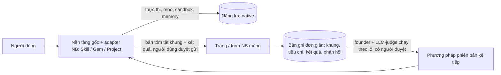

# Thu hẹp No Babysitting trước khi xây dựng

Phiên bản nhỏ nhất và còn bảo vệ được của No Babysitting (NB) **không phải là một "lớp cộng tác thích ứng" tổng quát**. Nó là một phương pháp **"đóng khung → nghiệm thu"** (frame-and-verify) cho các deliverable mơ hồ của **knowledge worker bán kỹ thuật (S2)**. Trước khi giao việc cho AI, phương pháp giúp người dùng biến yêu cầu mơ hồ thành mục tiêu, **tiêu chí nghiệm thu** (acceptance criteria) và tài liệu tham chiếu, đồng thời chỉ ra nên dùng năng lực gốc nào của nền tảng. Sau khi AI thực thi trên chính nền tảng đó (Claude, ChatGPT, Gemini), phương pháp chèn một bước nghiệm thu dựa đúng trên các tiêu chí ấy, kèm một điểm dừng để con người tự thẩm định. Kết luận là **thu hẹp (narrow)**: không tiến hành nguyên trạng, cũng không dừng. Bằng chứng về **vấn đề** mạnh: mô hình đóng khung sai một cách âm thầm, người dùng ít kiểm tra hơn khi output trông bóng bẩy, người dùng AI kém hơn 19 điểm phần trăm trên tác vụ nằm ngoài "biên năng lực", và cảm nhận năng suất lệch dấu so với đo đạc. Ngược lại, bằng chứng rằng một **giải pháp** kiểu NB cải thiện kết quả công việc chuyên nghiệp thì gần như chưa có. Phần lớn những gì thesis gọi là "lớp" (thực thi, memory, workflow capture, learning mode, cải thiện prompt) đã hoặc đang bị nền tảng hấp thụ. Nhu cầu cá nhân với việc "học cách cộng tác tốt hơn" cũng yếu: người ta muốn kết quả, và tiền cho nâng cao kỹ năng chủ yếu chảy qua doanh nghiệp. Vì vậy NB phải bán **kết quả tốt hơn**, còn kỹ năng là sản phẩm phụ. Thử nghiệm đầu tiên nên là một concierge MVP: so sánh A/B trong cùng một người với 6–10 người dùng S2, chấm mù deliverable, đo việc tự nguyện dùng lại sau 14 ngày. Thử nghiệm này không cần server, không cần memory riêng và không cần dịch vụ URL-first.

> **Quy ước gắn nhãn** (dùng xuyên suốt báo cáo): **[Sự kiện]** = điều nguồn sơ cấp hoặc nguồn đáng tin nêu trực tiếp; **[Phát hiện]** = kết quả nghiên cứu/khảo sát hoặc mẫu hình rút ra từ nhiều nguồn; **[Suy luận]** = lập luận của người viết dựa trên nguồn đã dẫn; **[Giả thuyết]** = mệnh đề hợp lý nhưng chưa kiểm chứng; **[Khuyến nghị]** = hành động đề xuất. "Chưa xác minh" nghĩa là chỉ có nguồn thứ cấp, hoặc nguồn mâu thuẫn, hoặc không truy cập được trang gốc. Mọi con số đều lấy từ nguồn được dẫn; báo cáo không tự tạo điểm số. Mốc thời gian nghiên cứu: 17/11/2026.

---

## 0. TL;DR: thu hẹp về "đóng khung và nghiệm thu", bắt đầu từ S2

**Câu trả lời cho câu hỏi trung tâm.** Phiên bản nhỏ nhất, bảo vệ được và đo được của NB là một **phương pháp có phiên bản**, đóng gói thành *kickoff prompt* (lời mở đầu sao chép–dán) cộng một Skill hoặc Project instructions trên **một** nền tảng chính. Phương pháp làm ba việc. (1) Dựng một khung vấn đề có **giả định hiển thị** và chỉ hỏi 1–3 câu thật sự có thể đổi hướng kế hoạch: mục tiêu, deliverable, tiêu chí nghiệm thu, ràng buộc, và câu "tác vụ này có nằm trong vùng AI làm tốt không?". (2) Đề xuất *năng lực gốc* phù hợp trên nền tảng người dùng đang dùng, kèm một "thẻ quyền hạn" nói rõ việc chạy ở đâu, đọc/ghi được gì, cần phê duyệt gì. (3) Sau khi thực thi native, chạy một lượt nghiệm thu theo chính các tiêu chí đã chốt, với một bước "kiểm tra giả định" do người dùng tự làm trước khi chấp nhận kết quả. Mọi việc thực thi, truy cập repo/tài liệu, sandbox và memory đều giao cho nền tảng **[Khuyến nghị]**.

| Hạng mục | Kết luận |
|---|---|
| Phán quyết | **Thu hẹp (Narrow)**. Giữ định hướng dài hạn B1 như một khát vọng, không làm phạm vi v1 |
| Phân khúc đầu tiên | **S2**: PM, BA, analyst, consultant, tech lead có deliverable kiểm chứng được. S1 chỉ làm nhóm đối chứng nhỏ; hoãn S3 |
| Lời hứa giá trị | "Ít deliverable phải làm lại hơn, vì vấn đề được đóng khung đúng và kết quả được nghiệm thu trước khi gửi đi." Không phải "học cộng tác với AI" |
| Kiến trúc K1 | Kickoff prompt + một Skill/Project/Gem; không server, không memory riêng; quan sát kiểu concierge |
| Kiến trúc K2 | Adapter mỏng trên 1–2 nền tảng + một trang/form tối giản lưu bản tóm tắt do người dùng chủ động gửi; chỉ thêm khi K1 đạt ngưỡng |
| Không xây | Dịch vụ nạp URL/repo, memory engine, vector/graph DB, đa agent, sandbox, lưu token, extension trình duyệt, "learning mode", trình cải thiện prompt |
| Thử nghiệm đầu tiên | Concierge A/B trong cùng một người (AB/BA), 6–10 người S2, mỗi người 2 tác vụ thật, chấm mù, đo thời gian khách quan, đo tái sử dụng tự nguyện sau 14 ngày |
| Ngưỡng quyết định (đăng ký trước) | **Đi tiếp** khi người chấm mù chọn deliverable NB ở ≥7/10 cặp **và** ≥4/10 người tự nguyện dùng lại; **dừng hoặc xoay trục** khi ≤5/10 cặp **hoặc** dưới 3/10 người dùng lại; kết quả nằm giữa thì lặp lại với thêm tác vụ trước khi kết luận |

---

## 1. Đánh giá tổng quan: vấn đề có thật, giải pháp chưa được chứng minh, khoảng trống còn hẹp

### Cơ hội nằm ở hai đầu của tác vụ, không nằm ở giữa

Mảng "giữa" của quy trình (lập kế hoạch, thực thi, đa agent, tác vụ nền, sandbox, memory) đã thuộc về nền tảng. **[Sự kiện]** Tính đến 11/2026, Claude Code cloud session có thể clone "any public repository", chạy test trong VM cách ly và tạo PR ([Claude Code on the web](https://code.claude.com/docs/en/claude-code-on-the-web)). ChatGPT Work (ra mắt 09/07/2026 theo báo chí; trang chính thức trả 403) là agent chạy dài, tự chia dự án thành bước, hỏi lại và xin phê duyệt ([The Next Web](https://thenextweb.com/news/openai-chatgpt-work-agent-launch)). Claude Code Projects (beta công khai) có mục tiêu, coordinator và project memory ([Claude Code Projects](https://code.claude.com/docs/en/claude-projects.md)). Hai đầu của tác vụ thì vẫn hở. **[Suy luận]** Không nền tảng nào có một chế độ chuyên biệt để **đóng khung vấn đề trước khi thực thi** cho công việc tri thức. Không nền tảng nào **nghiệm thu kết quả theo tiêu chí do người dùng định nghĩa** một cách độc lập với agent đã làm ra kết quả đó. Và không nền tảng nào **phản hồi cho chính người dùng về cách họ cộng tác** qua nhiều tác vụ ([Claude Code output styles](https://code.claude.com/docs/en/output-styles); [OpenAI Build skills](https://learn.chatgpt.com/docs/build-skills); [Gemini CLI changelog](https://geminicli.com/docs/changelogs/)).

### Độ mạnh của thesis: vấn đề mạnh, giải pháp yếu

**[Phát hiện]** Bằng chứng về vấn đề rất nhất quán. Thứ nhất, mô hình mặc định **hỏi quá ít** và lặng lẽ chọn một cách hiểu. Khi yêu cầu được hé lộ dần qua nhiều lượt, hiệu năng trung bình giảm 39% ([Laban et al., ICLR 2026](https://arxiv.org/abs/2505.06120)). Thứ hai, trong 9.830 hội thoại Claude.ai, khi người dùng tạo ra artifact thì cả ba hành vi thẩm định quan sát được đều giảm, và chỉ 8,7% hội thoại có kiểm tra sự kiện ([Anthropic AI Fluency Index](https://academy.claude.com/tutorials/the-ai-fluency-index)); đây là dữ liệu tương quan, thiên về người dùng sớm. Thứ ba, 758 consultant BCG dùng AI trên tác vụ nằm ngoài "biên năng lực" có xác suất đúng thấp hơn 19 điểm phần trăm ([Dell'Acqua et al.](https://mitsloan.mit.edu/sites/default/files/2023-10/SSRN-id4573321.pdf)). Thứ tư, lập trình viên giàu kinh nghiệm chậm hơn 19% khi dùng AI nhưng vẫn tin mình nhanh hơn khoảng 20% ([METR, arXiv 2507.09089](https://arxiv.org/pdf/2507.09089)).

**[Phát hiện]** Bằng chứng về giải pháp thì hẹp. Tách bước phát hiện yêu cầu thiếu ra khỏi bước thực thi giúp đóng gần hết khoảng cách trên SWE-bench có yêu cầu thiếu ([Edwards et al., "Ask or Assume?"](https://consensus.app/papers/details/w:4fff7875-1a05-4c44-93e3-d570647cd685/?utm_source=claude_desktop)), nhưng đó là benchmark với người dùng mô phỏng. Gia sư AI có rào chắn tránh được tác hại học tập ở học sinh ([Bastani et al., PNAS 2025](https://papers.ssrn.com/abstract=4895486)), nhưng đó là bối cảnh giáo dục. **Chưa có nghiên cứu nào** thử nghiệm một lớp coaching kiểu NB so với dùng nền tảng bình thường cho knowledge worker chuyên nghiệp.

### Vấn đề người dùng quan trọng nhất: deliverable "gần đúng" được chấp nhận vì trông hoàn chỉnh

**[Suy luận]** Khi gộp các gap lại, vấn đề trung tâm là: **người dùng giao một yêu cầu chưa đóng khung, nhận về một deliverable bóng bẩy nhưng lệch nhu cầu thật, và chấp nhận nó vì không có tiêu chí để kiểm tra**. Ở S1 vấn đề này đã được đo: 66% lập trình viên coi "AI solutions that are almost right, but not quite" là nỗi bực lớn nhất ([Stack Overflow 2025](https://stackoverflow.blog/2025/07/29/developers-remain-willing-but-reluctant-to-use-ai-the-2025-developer-survey-results-are-here/)). Ở S2 nó hiện ra qua cơ chế "biên năng lực lởm chởm" (jagged frontier) và sự sụt giảm thẩm định trước artifact. Đây là một vấn đề về **kết quả**, không phải về **kỹ năng**, và đó là điểm then chốt của định vị.

### Khác biệt hứa hẹn nhất: trung lập, độc lập và gắn vào tiêu chí của chính người dùng

**[Suy luận]** Ba tài sản mà nhà cung cấp nền tảng ít có động cơ tự xây là: (a) lời khuyên **trung lập giữa các nền tảng** về năng lực nào hợp với vấn đề nào; (b) bước nghiệm thu **độc lập với agent thực thi**, neo vào tiêu chí người dùng đã chốt; (c) phản hồi về cách cộng tác, **riêng tư cho cá nhân** chứ không phải telemetry báo về cho chủ lao động. Cả ba đều mỏng và đều có thể bị sao chép. Lợi thế bền vững duy nhất có thể có là **dữ liệu đánh giá tích lũy** về những cách đóng khung và nghiệm thu thực sự giảm làm lại, và tài sản đó chỉ tồn tại nếu K1/K2 chứng minh có giá trị **[Giả thuyết]**.

### Rủi ro chính và khuyến nghị

Ba rủi ro lớn nhất là: nền tảng hấp thụ phần "đóng khung" trong 12–18 tháng; coaching tạo ma sát lớn hơn lợi ích (các thiết kế giảm lệ thuộc hiệu quả nhất lại bị người dùng chấm thấp nhất, theo [Buçinca et al. 2021](https://consensus.app/papers/details/w:73713e06-5efc-4c9b-b0da-7408bdb871aa/?utm_source=claude_desktop)); và không ai trả tiền ở cấp cá nhân. **[Khuyến nghị]** Thu hẹp phạm vi, chọn S2, dẫn dắt bằng kết quả, và kiểm chứng phương pháp bằng concierge trước khi viết một dòng code nào.

---

## 2. Đánh giá Product Thesis: thuyết phục ở chẩn đoán, chưa được chống đỡ ở cơ chế "thích ứng"

### 2.1 Phần nào thuyết phục, yếu, thiếu căn cứ, hay cần đổi

| Thành phần thesis | Đánh giá | Căn cứ chính |
|---|---|---|
| "Biến vấn đề mơ hồ thành outcome kiểm chứng được" | **Thuyết phục** về nhu cầu | Đóng khung sai âm thầm; giá trị của việc hỏi mục tiêu sụp gần như hết sau khoảng 10% quá trình thực thi ([Gulati et al. 2026](https://consensus.app/papers/details/w:80ea5c02-e9a1-4378-b223-f088f1a8897b/?utm_source=claude_desktop)) |
| Giao thực thi cho nền tảng (B3, B8) | **Thuyết phục** | Nền tảng đã có đủ primitive thực thi (mục 3.5) |
| "Adaptive Coaching" như điểm khác biệt | **Yếu** | Cá nhân hóa phong cách agent đã phổ biến (GSD profile-user, Hermes USER.md, Superpowers 7.0.2); learning mode có ở cả ba nhà cung cấp; MetaCLASS: mô hình tốt nhất chỉ chọn đúng nước coaching 43,2% lần và gần như không biết im lặng ([arXiv 2602.02457](https://arxiv.org/html/2602.02457v1)) |
| "Workflow Design" | **Cần đổi**: thu hẹp thành *chọn và cấu hình năng lực gốc* | Workflow capture đã native (Claude skill recording, hộp duyệt kỹ năng của Gemini CLI) ([Claude Help](https://support.claude.com/en/articles/12512198-how-to-create-custom-skills); [Gemini CLI changelog](https://geminicli.com/docs/changelogs/)) |
| Phát triển năng lực người dùng (B4 chiều 4) | **Chưa có căn cứ** trong MVP | Cần dữ liệu nhiều phiên; hiệu năng khi có AI không dự báo được năng lực về sau ([Bastani et al.](https://papers.ssrn.com/abstract=4895486); [Wu et al.](https://consensus.app/papers/details/w:95c1638c-2304-4b3d-a8b2-60ccb6c3f6c1/?utm_source=claude_desktop)) |
| Platform-agnostic ở cấp phương pháp (B1) | **Khả thi** ở lớp chỉ dẫn; **không khả thi** ở lớp thích ứng/đánh giá nếu không có artifact do người dùng giữ | SKILL.md, AGENTS.md, MCP là chuẩn mở; memory và dấu vết cộng tác bị khóa theo nền tảng ([agentskills.io](https://agentskills.io/home)) |
| URL-first là entry point lý tưởng (B7) | **Cần đổi** | Chỉ coding agent mới thật sự clone repo; Gemini nói rõ không đọc repo từ URL gõ vào prompt ([Gemini Help](https://support.google.com/gemini/answer/16176929?hl=en)) |
| Định vị "học cộng tác với AI" | **Cần đổi** thành "kết quả tốt hơn" | Không thấy cá nhân trả tiền cho coaching; nhu cầu kỹ năng nằm ở doanh nghiệp (mục 2.7) |

### 2.2 Sáu gap chồng lấn nhau và thu về ba trục

**[Suy luận]** Sáu gap không độc lập. "Problem Framing Gap" và "Evaluation Gap" là hai đầu của cùng một trục: **tiêu chí nghiệm thu**. Tiêu chí được viết ra lúc đóng khung là thứ duy nhất làm phép nghiệm thu sau đó khả thi. "Interaction Gap" (cách viết brief) phần lớn là kỹ thuật prompt, thứ đang mất giá qua từng thế hệ mô hình: Anthropic giờ khuyên *bỏ* chỉ dẫn tự kiểm tra trên Opus 5 vì gây kiểm tra thừa ([Anthropic prompting best practices](https://platform.claude.com/docs/en/build-with-claude/prompt-engineering/claude-prompting-best-practices)). "Capability Blindness" và "Workflow Gap" cùng là câu hỏi "năng lực nào phù hợp với vấn đề này". "Learning Gap" là một **kết cục dài hạn** chứ không phải điểm vào sản phẩm.

| Trục gộp | Gap gốc | Bằng chứng tần suất/mức độ | Nền tảng đã hấp thụ? | Giá trị làm điểm vào |
|---|---|---|---|---|
| **A. Đóng khung & tiêu chí** | Problem Framing + phần lớn Interaction | Mô hình hỏi quá ít ([ClarifyMT-Bench](https://consensus.app/papers/details/w:c0e592c3-c453-4535-b22d-4897edfafbcd/?utm_source=claude_desktop)); chỉ 10,1% hội thoại "consults on approach before execution" ([Fluency Index](https://academy.claude.com/tutorials/the-ai-fluency-index)) | Một phần (plan mode, ChatGPT Work hỏi giữa chừng) nhưng chưa có chế độ đóng khung riêng | **Cao**, nhất là S2 |
| **B. Thẩm định & nghiệm thu** | Evaluation | Thẩm định giảm khi có artifact; 66% S1 khổ vì "gần đúng" | Phía mô hình đã tự kiểm tra; phía con người thì chưa | **Cao**, cả S1 lẫn S2 |
| **C. Khớp năng lực** | Capability Blindness + Workflow | Jagged frontier; "không biết dùng AI để làm gì" là lý do chính S3 không dùng ([Pew](https://www.pewresearch.org/social-trends/2025/02/25/workers-experience-with-ai-chatbots-in-their-jobs/)) | Nền tảng chỉ gợi ý tính năng của chính mình | **Trung bình**; bền về cấu trúc nhưng khó đo |
| (Kết cục) Năng lực dài hạn | Learning | Deskilling trong bối cảnh học ([Shen & Tamkin](https://www.anthropic.com/research/AI-assistance-coding-skills)) | Learning mode cho học tập | **Không phải điểm vào**; chỉ đo được ở K2+ |

**[Suy luận]** Theo phân khúc: với S1, điểm vào giá trị nhất là **B** (nghiệm thu), vì nỗi đau là xác minh chứ không phải đóng khung, nhưng thông điệp này đã đông. Với S2, điểm vào là **A+B** nối nhau, tức tiêu chí được viết trước rồi dùng để nghiệm thu sau. Với S3, điểm vào là **C**, nhưng kênh tiếp cận lại đi qua doanh nghiệp. Không có dữ liệu định lượng để nhân "tần suất × mức độ × sẵn lòng thay đổi"; bảng trên chỉ là xếp hạng định tính.

### 2.3 So sánh phân khúc: S2 thắng nhờ có deliverable kiểm chứng được và ít bị khóa kênh

| Tiêu chí | S1: Developer | S2: Bán kỹ thuật (PM/BA/analyst/consultant/tech lead) | S3: Không kỹ thuật |
|---|---|---|---|
| Tần suất & mức độ đau | **Cao, đo được**: 66% "almost right"; review thành nút thắt ([CMU, alphaXiv 2607.07980](https://www.alphaxiv.org/abs/2607.07980.md)) | **Cao nhưng ít dữ liệu trực tiếp**: các RCT BCG/P&G cho thấy cả hiệu ứng lớn lẫn rủi ro ngoài biên ([NBER w33641](https://www.nber.org/system/files/working_papers/w33641/w33641.pdf)) | **Thấp do ít dùng**: 63% lao động Mỹ dùng AI ít hoặc không dùng ([Pew](https://www.pewresearch.org/social-trends/2025/02/25/workers-experience-with-ai-chatbots-in-their-jobs/)) |
| Sẵn lòng đổi hành vi / trả tiền | Đổi hành vi nếu tiết kiệm thời gian review; trả tiền cá nhân cho tool dev là có thật nhưng đông đối thủ | ChatPRD cho thấy PM trả tiền cho trợ giúp gắn với artifact (công ty tự báo 100k+ PM) ([Ry Walker](https://rywalker.com/research/chatprd)); người mua B2B tiềm năng là team lead | Người trả tiền là doanh nghiệp (L&D) |
| Tiếp cận để thử nghiệm | Dễ nhất | Dễ qua mạng lưới quen biết | Khó nếu không qua doanh nghiệp |
| Mật độ cạnh tranh | **Bão hòa** (5/8 dự án tham chiếu, Spec Kit, Kiro, OpenSpec…) | **Tranh chấp, còn khoảng trống** ở "vấn đề mơ hồ → deliverable kiểm chứng được" xuyên vai trò | Self-serve trống, B2B đông (Multiverse, Sana/Workday, BetterUp, Larridin) |
| Khớp entry point | URL repo hoạt động native trên coding agent | Tài liệu/spec đính kèm, đôi khi repo | Chỉ mô tả vấn đề + tài liệu tùy chọn |
| Dễ đo outcome | **Dễ nhất** (test/CI) | **Trung bình**: chấm mù theo tiêu chí, người nhận deliverable xác nhận | Khó |

**[Khuyến nghị]** Chọn **S2** làm phân khúc đầu tiên, cụ thể là những người có deliverable mà người khác kiểm tra được: PRD, phân tích, đề xuất, báo cáo, spec. Có thể đưa 2–3 người S1 vào làm đối chứng để biết phương pháp có chuyển được giữa các phân khúc không. **[Suy luận]** S1 dễ đo nhất nhưng là nơi NB khó khác biệt nhất. S3 trống ở mảng self-serve, nhưng sự trống đó nhiều khả năng là tín hiệu nhu cầu yếu hơn là khoảng trống: các app coach/companion tiêu dùng như Dot đã đóng cửa ([TechCrunch](https://techcrunch.com/2025/09/05/personalized-ai-companion-app-dot-is-shutting-down)), và người dùng S3 bị ràng buộc bởi việc chủ lao động có cho phép và hỗ trợ hay không ([BCG AI at Work 2025](https://www.bcg.com/publications/2025/ai-at-work-momentum-builds-but-gaps-remain)). Rủi ro của S2 là họ có thể thích công cụ chuyên theo vai trò hơn một phương pháp chung (phản đề c).

### 2.4 Thesis thay thế: "Problem-to-Verified-Deliverable"

**[Khuyến nghị]** Thay vì *"Adaptive Problem-to-Outcome Collaboration Layer"*, hãy kiểm chứng thesis hẹp hơn:

> *No Babysitting giúp knowledge worker bán kỹ thuật biến một yêu cầu mơ hồ thành **một deliverable đã được nghiệm thu**. Trước khi giao cho AI, NB giúp chốt mục tiêu, tiêu chí nghiệm thu và tài liệu tham chiếu. Sau khi AI thực thi trên nền tảng người dùng đang dùng, NB dẫn một bước nghiệm thu theo đúng tiêu chí đó. Kỹ năng cộng tác phát triển như sản phẩm phụ của việc làm thật, không qua bài giảng.*

Thesis này giữ những phần có bằng chứng (đóng khung tách khỏi thực thi; thẩm định chủ động; tham chiếu và rubric) và bỏ đi những phần khó chứng minh trong MVP (thích ứng qua nhiều phiên, phát triển năng lực, platform-agnostic toàn phần). Nó có thể được gọi là "SDD cho công việc tri thức, co giãn theo kích cỡ tác vụ". Spec-driven development (phát triển dựa trên đặc tả) đã thành hàng phổ thông cho code, nhưng **chưa có tương đương cho analyst/consultant** ([Böckeler, martinfowler.com](https://www.martinfowler.com/articles/exploring-gen-ai/sdd-3-tools.html); [Tessl](https://tessl.io/blog/skills-are-software-and-they-need-a-lifecycle-introducing-skills-on-tessl/)). Bài học từ SDD cũng phải mang theo: Kiro từng biến một bug nhỏ thành "4 user stories with 16 acceptance criteria" ([Böckeler, martinfowler.com](https://www.martinfowler.com/articles/exploring-gen-ai/sdd-3-tools.html)). Nghĩa là quy trình phải tự co theo tác vụ, nếu không sẽ thành gánh nặng.

Một lưu ý về tên gọi: "Stop babysitting your agents" đã là khẩu hiệu marketing của các nhà cung cấp công cụ dev ([Unblocked](https://getunblocked.com/blog/stop-babysitting-your-agents); [WorkOS](https://workos.com/blog/agents-babysitting-agents)). **[Suy luận]** Với S2, cái tên gợi tới việc "trông chừng agent code" có thể làm lệch định vị, nên cần kiểm tra trong phỏng vấn.

### 2.5 Giải quyết ba căng thẳng T1–T3

**T1: Entry point và phân khúc phải được chọn cùng nhau.** **[Phát hiện]** Một URL được dán vào chỉ thành `git clone` thật trên coding agent (Claude Code, Codex, Jules). Trên các app chat, URL đó cần thêm bước đính kèm, kết nối hoặc import, và Gemini nói rõ không đọc repo từ URL gõ vào prompt ([Claude GitHub connector](https://claude.com/docs/connectors/github); [Gemini Help](https://support.google.com/gemini/answer/16176929?hl=en)). **[Khuyến nghị]** Mỗi phân khúc có một entry point riêng:

| Phân khúc | Entry point chính | Vai trò của URL |
|---|---|---|
| S1 | Kickoff/Skill trong Claude Code hoặc Codex; URL repo công khai hoạt động native | Chính |
| S2 | Kickoff prompt hoặc template Project/Gem trong app chat họ đang dùng + đính kèm tài liệu/spec (hoặc luồng GitHub attach) | Phụ: "URL" hiểu là "tài nguyên bạn đang làm việc cùng" |
| S3 | Mô tả vấn đề bằng ngôn ngữ thường + tài liệu tùy chọn | Không có |

**T2: Phần lớn thesis kiểm chứng được mà không cần memory bền vững.** **[Suy luận]** Trong một phiên duy nhất có thể kiểm chứng: đóng khung giúp cải thiện outcome (chiều 1–2), một phần hành vi cộng tác (chiều 3), và thích ứng trong phiên qua các "nút vặn" hướng dẫn. Những gì *cần* dữ liệu nhiều phiên: độ chính xác của cá nhân hóa, việc rút dần hỗ trợ, và phát triển năng lực (chiều 4). Đó là lý do "adaptive" là phần **khó kiểm chứng nhất** trong K1. Các vòng thích ứng đã được chứng minh đều nằm trong miền có cấu trúc và cần nhiều phiên ([VanLehn 2011](https://eric.ed.gov/?id=EJ946764); [Guo 2022](https://consensus.app/papers/details/w:539f3264-cc4f-467e-97c9-2b8a92524cf2/?utm_source=claude_desktop)). Với 2–4 phiên, một hồ sơ markdown do người dùng tự giữ và dán lại đủ để thử xem thích ứng có mang sang được không, và việc người dùng có chịu mang hồ sơ đó theo hay không chính là một tín hiệu cần đo.

**T3: Ranh giới nằm giữa "nội dung phương pháp" và "trạng thái".** **[Phát hiện]** Phần lõi của SKILL.md, AGENTS.md và MCP là chuẩn mở dùng chung giữa các nhà cung cấp. Memory, output style, hook, quyền hạn, điều phối và dữ liệu dấu vết cộng tác đều bị khóa theo nền tảng ([agentskills.io](https://agentskills.io/home); [OpenAI Build skills](https://learn.chatgpt.com/docs/build-skills)). Bề mặt nền tảng cũng thay đổi nhanh. OpenAI deprecate Agent Builder, với hạn tắt 30/11/2026 ([OpenAI deprecations](https://developers.openai.com/api/docs/deprecations)), và Evals cũng chuyển sang chỉ đọc rồi tắt cùng ngày. Gemini CLI bị thay bằng Antigravity CLI cho người dùng cá nhân từ 18/06/2026 ([Google Developers Blog](https://developers.googleblog.com/en/an-important-update-transitioning-gemini-cli-to-antigravity-cli/)). **[Khuyến nghị]** Phương pháp viết bằng văn bản trung lập, dùng các trường lõi của chuẩn mở. Ở K1, **chọn một nền tảng chính** cho mỗi phân khúc và khai thác sâu năng lực gốc ở đó (plan mode, Projects, Gems). Chỉ thêm adapter thứ hai khi đã có câu hỏi về tính di động cần trả lời. Không phụ thuộc vào bề mặt builder của bất kỳ nhà cung cấp nào.

### 2.6 Phản đề mạnh nhất (steelman) và chỗ bằng chứng đi ngược thesis

| Phản đề | Phiên bản mạnh nhất | Bằng chứng | Phán quyết | Hệ quả cho NB |
|---|---|---|---|---|
| (a) Nền tảng hấp thụ toàn bộ trong 12–18 tháng | Mỗi nhà cung cấp trong khoảng 12 tháng qua đã ra agent tự chia mục tiêu, workflow capture, memory học từ việc bị sửa, learning mode; Anthropic đã có framework 4D, chỉ số Fluency và có tin đồn về "fluency scorecard" | Claude Code Projects "goal"; ChatGPT Work; [TestingCatalog](https://testingcatalog.com/anthropic-to-introduce-personal-ai-fluency-scorecard-in-claude) (chưa xác minh) | **Đúng phần lớn.** Ngoại lệ: lời khuyên trung lập liên nền tảng, nghiệm thu độc lập, phản hồi riêng tư về cách cộng tác | Chỉ sở hữu các phần nhà cung cấp có ít động cơ xây; giả định vòng đời ngắn; đo nhanh |
| (b) Người dùng muốn kết quả, không muốn kỹ năng | Khoảng 47% hội thoại sinh viên là "direct" ([Anthropic Education Report](https://www.anthropic.com/news/anthropic-education-report-how-university-students-use-claude)); mức tăng augmentation tháng 11/2025 đến từ lặp lại tác vụ chứ không phải học ([Anthropic Economic Index](https://www.anthropic.com/research/anthropic-economic-index-january-2026-report)); không có dữ liệu cá nhân trả tiền cho coaching | Mạnh | **Đúng với cá nhân** | Bán outcome; để kỹ năng là sản phẩm phụ; coaching tùy chọn và chỉ bật theo mức rủi ro |
| (c) Giải pháp hẹp theo tác vụ thắng phương pháp chung | ChatPRD có người trả tiền vì nó gắn với artifact; Hallmark có thể đưa ra cổng kiểm tra cụ thể vì chỉ làm một loại outcome; Tessl bỏ hướng spec-as-source để chuyển sang registry kỹ năng có đánh giá ([Tessl](https://tessl.io/blog/skills-are-software-and-they-need-a-lifecycle-introducing-skills-on-tessl/)) | Trung bình–mạnh | **Đúng một phần** | Đóng khung xoay quanh *loại deliverable* (PRD, phân tích, đề xuất) thay vì "mọi vấn đề"; có thể là hướng xoay trục |
| (d) Đánh giá thêm phức tạp mà không thêm giá trị | LLM-as-judge mang thiên kiến vị trí, phong cách, tự ưu ái; tự báo cáo không đáng tin (METR); một lớp đánh giá ngây thơ cho ra tín hiệu tự tin nhưng sai | Mạnh với chấm điểm cộng tác/năng lực | **Đúng với chiều 3–4; sai với chiều 1** khi neo vào tiêu chí của người dùng | Giữ nghiệm thu theo tiêu chí, có thể chạy được; hoãn chấm điểm cộng tác/năng lực |
| (e) Platform-agnostic = trừu tượng quá mức | Mỗi nền tảng có cơ chế native khác nhau; bề mặt thay đổi trong 6–14 tháng; adapter cho N nền tảng tốn công bảo trì | Mạnh | **Đúng cho K1** | Một nền tảng chính; agnostic chỉ ở lớp văn bản phương pháp |
| (f) URL-first là sai entry point cho đa số knowledge worker | URL chỉ hoạt động trọn vẹn trên coding agent; S2/S3 làm việc với tài liệu; dịch vụ nạp URL tự mang vào bộ ba rủi ro bảo mật | Mạnh | **Đúng**, trừ S1 | URL chỉ là entry chính cho S1; S2 dùng tài liệu, S3 dùng mô tả vấn đề |

**Chỗ bằng chứng đi ngược thesis, nói thẳng.** **[Phát hiện]** Huấn luyện ngây thơ có thể làm người dùng *kém đi*. Trong nghiên cứu BCG, nhóm được xem tổng quan prompt engineering làm *tệ hơn* nhóm chỉ dùng GPT trên tác vụ ngoài biên năng lực: −24 so với −13 điểm phần trăm so với đối chứng, ý nghĩa ở mức 10% ([Dell'Acqua et al.](https://mitsloan.mit.edu/sites/default/files/2023-10/SSRN-id4573321.pdf)). Một quy trình hành vi cứng nhắc làm giảm chất lượng tài liệu tại một nhà bán lẻ Fortune 500 (preprint, có yếu tố gây nhiễu) ([Farach et al. 2026](https://consensus.app/papers/details/w:ad0f6b0f-b9e2-4966-bd80-074f8e21480f/?utm_source=claude_desktop)). Huấn luyện viên sức khỏe bằng LLM không tăng hành vi vận động hơn app không có LLM ([Stanford, Bloom](https://news.stanford.edu/stories/2026/04/ai-health-coach-mindset)). Microsoft cho biết các yếu tố tổ chức gắn với 67% tác động của AI, còn hành vi cá nhân chỉ 32% (tương quan) ([Microsoft WTI 2026](https://www.microsoft.com/en-us/worklab/work-trend-index/agents-human-agency-and-the-opportunity-for-every-organization)). Nghĩa là một công cụ cá nhân đang tác động vào cái đòn bẩy nhỏ hơn.

### 2.7 Giả định mô hình kinh doanh và cách mỗi mô hình đổi khuyến nghị

**Giả định nền:** báo cáo giả định K1 chạy miễn phí dưới dạng concierge, và chưa chọn mô hình doanh thu. **[Phát hiện]** Người trả tiền duy nhất có bằng chứng rõ cho việc "giúp người làm việc tốt hơn với AI" là **doanh nghiệp**: Section, Multiverse (gọi vốn 70 triệu USD với định giá 2,1 tỷ USD vào 05/2026), Larridin (Series A 30 triệu USD ngày 02/11/2026), cùng các vòng seed năm 2026 của Scholé AI và Certifyde ([Multiverse](https://www.multiverse.io/blog/multiverse-raises-70-million-europes-ai-adoption-platform); [Larridin](https://larridin.com/press-releases/larridin-raises-30-million-in-series-a-to-prove-ais-impact-across-the-human-and-agent-workforce); [Scholé AI](https://trainingindustry.com/press-release/artificial-intelligence/schole-ai-raises-3m-to-transform-workforce-learning-in-the-age-of-ai/)). Ở chiều ngược lại, công cụ tối ưu prompt cho người tiêu dùng PromptPerfect được báo là đóng cửa, nhưng ngày tháng mâu thuẫn và không có postmortem chính thức ([promptbuilder.cc](https://promptbuilder.cc/blog/promptperfect-shutting-down-alternatives-2026)).

| Mô hình | Khuyến nghị thay đổi ra sao |
|---|---|
| Miễn phí / mã nguồn mở | Tối đa độ phủ, rẻ nhất để kiểm chứng; doanh thu xấp xỉ 0; dễ bị nền tảng hoặc fork hấp thụ. Thước đo: tái sử dụng tự nguyện, chia sẻ tự nhiên. Hợp với chiến lược phân phối qua marketplace |
| Freemium cá nhân | Bằng chứng yếu nhất; cạnh tranh với gói 20 USD/tháng người dùng đã trả. Chỉ khả thi nếu tiết kiệm thời gian rõ trên deliverable giá trị cao (consultant tính giờ, PM có output hiển thị) |
| B2B nhóm (team lead / practice lead mua) | Khớp phát hiện "chuẩn mực tổ chức quyết định tác động". Câu chuyện giá trị: "quy trình đóng khung + nghiệm thu chuẩn hóa → ít deliverable phải làm lại". Kéo các chiều B4 về thước đo của người mua: làm lại, thời gian, chất lượng, tái sử dụng |
| Enablement doanh nghiệp | Ngân sách lớn nhất nhưng đông đối thủ; đòi dashboard, bằng chứng năng lực, mua sắm và review bảo mật; không khả thi trong K1, chỉ khả thi một phần trong K2. Hồ sơ năng lực nhân viên có thể chạm tới GDPR Art. 22 và các ca rủi ro cao về việc làm trong Phụ lục III của AI Act ([GDPR Art. 22](https://gdpr-info.eu/art-22-gdpr/); [AI Act Art. 50](https://artificialintelligenceact.eu/article/50/)) |

**[Khuyến nghị]** Trong K1, hỏi theo kiểu *Mom Test*: hỏi về chi tiêu hiện tại và ai duyệt công cụ/đào tạo AI, đừng hỏi "bạn có trả tiền không" ([The Mom Test](https://www.momtestbook.com/)). Trong K2, thử **một** tín hiệu trả tiền: một pilot có phí hoặc một cam kết trước từ 1–2 team lead.

---

## 3. Tình báo cạnh tranh: vòng lặp "brainstorm → plan → làm → review → ghi bài học" đã thành hàng phổ thông

### 3.1 Bức tranh: mọi mảnh ghép đều đã có, chỉ chưa ai ghép chúng lại

**[Phát hiện]** Trong 8 dự án tham chiếu, vòng **brainstorm/discuss → spec/plan → thực thi bằng sub-agent với context mới → review/verify → ghi bài học** đã thành hàng phổ thông. Các dự án này miễn phí (MIT), chạy trên 10–17 host, và được phân phối qua marketplace chính chủ: Superpowers có mặt trong marketplace plugin chính thức của Anthropic và marketplace Codex của OpenAI ([Superpowers README](https://github.com/obra/superpowers/blob/22f0b463e7a5e579904dd6211a520321035526f7/README.md#installation)). Ở thị trường rộng hơn, mỗi thành phần của NB đều đã có người làm: đóng khung (Spec Kit, Kiro, ChatPRD), coaching (Microsoft Prompt Coach, Multiverse Atlas, learning mode native), workflow (Cowork plugins, Zapier), đánh giá (AI Fluency Index và Larridin ở cấp tổ chức; Langfuse/Promptfoo ở cấp mô hình), memory (native). **Không ai kết hợp** việc coaching ngay trong một tác vụ thật, đánh giá cách con người cộng tác trên chính tác vụ đó, và thích ứng theo kết quả ([Anthropic AI Fluency Index](https://anthropic.com/research/AI-fluency-index); [Microsoft Prompt Coach](https://learn.microsoft.com/en-in/training/modules/explore-prebuilt-microsoft-365-copilot-agents/7-examine-prompt-coach-agent); [Larridin](https://larridin.com/press-releases/larridin-raises-30-million-in-series-a-to-prove-ais-impact-across-the-human-and-agent-workforce)).

**[Suy luận]** Phán quyết về "đóng gói lại": "Problem-to-Outcome" xấp xỉ SDD cộng requirements elicitation cộng definition-of-done, được tổng quát ra ngoài code. "Adaptive coaching" xấp xỉ intelligent tutoring cộng scaffolding/fading (giàn giáo hỗ trợ rồi rút dần), và đang được các bên có vốn lớn sản phẩm hóa. Phần mới là **sự kết hợp cùng với phép đo**, không phải từng khái niệm riêng lẻ.

### 3.2 Kiểm chứng danh sách tham chiếu: hai URL đã thay đổi

**[Sự kiện]** Bảy trên tám URL dẫn tới dự án đang hoạt động. Có hai thay đổi cần báo cáo. **ECC** đã đổi tên thành `affaan-m/ECC`; tên cũ vẫn trỏ về cùng HEAD ([ECC README](https://github.com/affaan-m/ECC/blob/3f14a103a8694e51c1df9a806217a6d0b5f7a6f7/README.md)). **GSD** (`gsd-build/get-shit-done`) đã **bị lưu trữ (archived) và chuyển nhà**. README hiện là trang chuyển hướng tới `open-gsd/gsd-core`, do người bảo trì khác phụ trách, và commit cuối của repo gốc là ngày 31/05/2026 ([GSD redirect README](https://github.com/gsd-build/get-shit-done/blob/bdcaab2c752d9a33a1a1ca9acf3a3c81fb991815/README.md); [gsd-core README](https://github.com/open-gsd/gsd-core/blob/641d9872a9d1263617c191796396d503babf7cff/README.md)). Fork này cho rằng tác giả gốc không liên lạc được từ 01/04/2026 và nhắc tới một token liên quan; khẳng định đó **chưa được xác minh độc lập**. Báo cáo dùng gsd-core làm đại diện cho GSD. **[Suy luận]** Tổng số commit không phải tín hiệu trưởng thành đáng tin: Hermes, REA và ECC có lượng commit do bot hoặc agent tạo ra rất lớn. Nhịp phát hành và số người bảo trì là tín hiệu tốt hơn. Số issue đang mở không đọc được, vì github.com và api.github.com trả 403 trong phiên nghiên cứu.

### 3.3 Ma trận so sánh

| Dự án (nhà hiện tại) | Mục đích / người dùng | Đóng khung | Coaching thích ứng | Đánh giá | Memory | Nền tảng / ma sát | Trưởng thành (11/2026) | Phân loại so với NB |
|---|---|---|---|---|---|---|---|---|
| Superpowers | Phương pháp dev bằng skill tự kích hoạt | **Mạnh**: hỏi "why" trước, hỏi một câu mở | Nhẹ: đọc cách người dùng nói | Outcome (TDD, verify) + **chấm mù hội thoại brainstorming** | Tài liệu trong repo | ~17 host; cài một dòng | v7.0.2 (03/11/2026) | **Đối thủ trực tiếp (đóng khung, S1)** |
| BMAD Method | Agile AI-driven dev; persona; v7 có coach "Founder" | Mạnh (Clarify, elicitation) | Tư thế coach: "hand the pen back" | Retro có quyết định nghiệm thu; eval kỹ năng so với mô hình trần | memlog, AGENTS.md | npx + uv + Node/Python; v7 alpha | v6.12.4 ổn định; v7 alpha | **Đối thủ trực tiếp (phương pháp, S1/S2-lite)** |
| GSD → GSD Core | Vòng lặp spec-driven theo pha | discuss-phase | **Hồ sơ hành vi 8 chiều**, có cổng đồng ý | UAT hội thoại; audit độ phủ eval | STATE.md, USER-PROFILE.md | npx installer | Gốc archived; kế nhiệm v1.21.0 | Lân cận + tham chiếu khái niệm (user profiling); rủi ro quản trị |
| Compound Engineering | Vòng dev + "compound" bài học vào repo | ce-brainstorm | Không | Review outcome; retro quy trình agent | `docs/solutions/` | 14 host; marketplace | v3.38.1 (11/11/2026); không telemetry | Lân cận + tham chiếu (vòng học) |
| ECC | "Hệ điều hành harness": 72 agent, 327 skill | `/ecc:plan` | Không (instinct học điều *agent* nên làm) | Gate build/test/lint; tự chấm output | Memory Vault, instinct có độ tin cậy | Claude Code chính; context lớn | v2.2.3 (01/10/2026) | Lân cận + tham chiếu (vệ sinh memory) |
| Hermes Agent | Runtime agent cá nhân tự cải thiện | Không | USER.md + Honcho (mô hình hóa sở thích) | Judge mỗi lượt cho `/goal` | MEMORY/USER.md, FTS5 | Installer shell; kênh chat | v0.23.2 (16/11/2026) | Lân cận + đối tác tích hợp |
| Hallmark | Skill thiết kế front-end chống "AI slop" | Hỏi một lần lấy tư liệu | Không | **Gate Floor/Reflex/Finish**, lint, reviewer context mới, vision judge | design.md | `npx skills add` | v2.0.0, không tag | Tham chiếu khái niệm (thiết kế đánh giá) |
| REA | MCP + CLI dịch ngược | Không | Không | Bằng chứng + giới hạn mỗi phát hiện | — | npx; Node 22+ | v6.9.0 (12/11/2026) | Technical enabler |
| Anthropic AI Fluency (4D, Index) | Dạy và đo năng lực cộng tác | Một phần (Delegation) | Không (khóa học) | **Đo hành vi ở cấp quần thể** | — | Miễn phí | Đã phát hành | Tham chiếu khái niệm + mối đe dọa native lớn nhất |
| Microsoft Prompt Coach | Viết lại prompt cho người dùng M365 | Ở cấp prompt | Một phần | Không | Không | Đi kèm Copilot | Đã phát hành | Lân cận / đe dọa (S2/S3 doanh nghiệp) |
| Spec Kit / Kiro / OpenSpec | SDD cho code | **Mạnh** (spec) | Không | Một phần | steering/constitution | Coding agent | Rất hoạt động | Lân cận (S1) |
| ChatPRD | Copilot viết PRD cho PM | **Mạnh** (theo artifact) | Một phần | Không | Một phần | App riêng | 100k+ PM (công ty tự báo) | Lân cận, gần S2 nhất |
| Multiverse / Section / Sana-Workday / Larridin | Enablement và đo lường doanh nghiệp | ? | Atlas, Sana: có (theo tuyên bố) | Larridin "AI Fluency": cấp tổ chức | ? | Bán B2B | Có vốn lớn | Lân cận / đe dọa (B2B) |
| Claude Cowork + plugins; ChatGPT Work | Agent native cho knowledge worker | Một phần (lập kế hoạch) | Không | Không | Native | Native | GA / đã ra mắt | Đối tác tích hợp + đe dọa |

Nguồn cho từng ô: các README và tệp đã ghim commit (liệt kê trong Phụ lục, WS1) và các trang được dẫn trong mục 3.4. "?" nghĩa là không xác minh được từ nguồn công khai.

### 3.4 Phân tích sâu (10 mục)

**Superpowers (obra/superpowers, v7.0.2).** **[Sự kiện]** Skill `brainstorming` yêu cầu dùng "before any creative work… in software or out of it (a talk, a business, a renovation)". Skill này tuân thủ nguyên tắc "Never ask what the project or their context already answers", và nếu yêu cầu còn thiếu thì bắt đầu bằng "one open question… Say why you're asking" ([brainstorming SKILL.md](https://github.com/obra/superpowers/blob/22f0b463e7a5e579904dd6211a520321035526f7/skills/brainstorming/SKILL.md)). Ghi chú phát hành v7.0.2 cho biết, trong các hội thoại được chấm mù, số câu hỏi thừa giảm từ 41 xuống 23 và lý do đằng sau yêu cầu được làm rõ trước mọi phương án ở 33/33 hội thoại ([RELEASE-NOTES](https://github.com/obra/superpowers/blob/22f0b463e7a5e579904dd6211a520321035526f7/RELEASE-NOTES.md)). Đây là con số do người bảo trì tự báo. **[Suy luận]** Hai trụ của tính mới mà NB nhận về mình đã bị cắt bớt. Hỏi "why" trước và thích ứng theo cách người dùng nói đã có sẵn. Đánh giá *phía agent* trong cuộc cộng tác bằng transcript chấm mù cũng đã có. Phần còn trống là đánh giá và phát triển *phía con người*, cùng với việc ra khỏi phạm vi coding agent. **[Khuyến nghị]** Dùng skill này làm nhánh đối chứng khi thử với S1.

**BMAD Method (v6.12 ổn định; v7 alpha).** **[Sự kiện]** `bmad-facilitate` hướng dẫn agent: "They hold the knowledge; you draw it out… if you are making the user's calls, hand the pen back". Module Founder (cố vấn "Nadia") coaching phần kinh doanh, hỏi "one question per message" và học dần "how they take a push" ([bmad-facilitate](https://github.com/bmad-code-org/BMAD-METHOD/blob/e435a22574fe55722841086e5566420178b98df3/skills/core-tools/bmad-facilitate/SKILL.md); [founder SKILL.md](https://github.com/bmad-code-org/BMAD-METHOD/blob/e435a22574fe55722841086e5566420178b98df3/skills/founder/bmad-founder-agent-advisor/SKILL.md)). **[Suy luận]** BMAD đã vươn tới công việc ngoài kỹ thuật, nhưng người dùng vẫn phải cài qua npx và uv vào một coding tool. Vậy khoảng trống thật của S2/S3 là **ma sát ở điểm vào**, không phải thiếu nội dung phương pháp.

**GSD Core (open-gsd/gsd-core, v1.21.0).** **[Sự kiện]** `/gsd:profile-user` tạo hồ sơ hành vi 8 chiều, gồm "Explanation Depth" và "Learning Style", với cổng đồng ý trước khi phân tích phiên làm việc, có trích dẫn bằng chứng và ngưỡng tin cậy HIGH/MEDIUM/LOW ([profile-user.md](https://github.com/open-gsd/gsd-core/blob/641d9872a9d1263617c191796396d503babf7cff/commands/gsd/profile-user.md); [user-profiling.md](https://github.com/open-gsd/gsd-core/blob/641d9872a9d1263617c191796396d503babf7cff/gsd-core/references/user-profiling.md)). **[Suy luận]** Đây là bản gần nhất với "adaptive" của NB, nhưng nó lập hồ sơ *phong cách* để agent chiều theo, không lập hồ sơ *năng lực* để người dùng tiến bộ, và nó chạy một lần chứ không thích ứng liên tục. Thiết kế đồng ý + bằng chứng + độ tin cậy là khuôn mẫu đáng mượn.

**Compound Engineering (v3.38.1).** **[Sự kiện]** `/ce-compound` lưu bài học "in its cheapest durable form, a test or lint rule, a coding standard, or a repo learning". STRATEGY.md tự đặt ra phép thử: "Resist a change when… it can't materially justify its usefulness against what the host already does on its own". Dự án không thu telemetry ([ce-compound](https://github.com/EveryInc/compound-engineering-plugin/blob/a3d6a8ee41a404b74391ee278423b52890b8920d/skills/ce-compound/SKILL.md); [STRATEGY.md](https://github.com/EveryInc/compound-engineering-plugin/blob/a3d6a8ee41a404b74391ee278423b52890b8920d/STRATEGY.md)). **[Suy luận]** Nguyên tắc "dạng bền rẻ nhất" là câu trả lời cụ thể cho câu hỏi "phản hồi thay đổi hành vi thế nào". Việc dự án không đo được hiệu quả bên trong repo của người khác là lời cảnh báo cho tham vọng đánh giá của NB.

**ECC (affaan-m/ECC, v2.2.3).** **[Sự kiện]** `continuous-learning-v2` tạo các "instinct" có độ tin cậy từ 0,3 đến 0,9, gắn theo dự án, và chỉ nâng lên phạm vi toàn cục khi "seen in 2+ projects". Memory Vault coi memory là "unreviewed context, not executable policy" ([continuous-learning-v2](https://github.com/affaan-m/ECC/blob/3f14a103a8694e51c1df9a806217a6d0b5f7a6f7/skills/continuous-learning-v2/SKILL.md); [ECC README](https://github.com/affaan-m/ECC/blob/3f14a103a8694e51c1df9a806217a6d0b5f7a6f7/README.md)). **[Suy luận]** Quy mô 327 skill tự nó là một vấn đề "babysitting": người dùng phải biết gọi bề mặt nào. Một lớp *chọn năng lực* có thể đứng trên ECC thay vì làm lại ECC.

**Hermes Agent (v0.23.2).** **[Sự kiện]** Đây là runtime đa mô hình, chạy qua Telegram, Slack và WhatsApp. Nó dùng `USER.md` có giới hạn dung lượng cộng Honcho để "derive insights about the user's preferences". Tài liệu của chính Hermes ghi nhận lỗi thường gặp "I told it to remember, and the next session it forgot" ([memory.md](https://github.com/NousResearch/hermes-agent/blob/27e389359263b7294e2788fee048953fc34b82d1/website/docs/user-guide/features/memory.md)). **[Suy luận]** Hermes là dự án duy nhất chạm tới người không kỹ thuật, nhưng nó là một runtime thực thi, đúng loại thứ NB tuyên bố không xây. Nó là bằng chứng cảnh giác cho B6: ngay cả runtime trưởng thành cũng vật lộn với memory.

**Anthropic AI Fluency (4D + Index).** **[Sự kiện]** Framework gồm bốn năng lực Delegation, Description, Discernment, Diligence, với 24 hành vi chỉ báo; 11 hành vi quan sát được trong chat. Anthropic thừa nhận các hành vi không quan sát được "arguably some of the most consequential" ([AI Fluency Framework PDF](https://www-cdn.anthropic.com/b383cf6baddbfc72fdf8b0ed533a518e2872d531.pdf); [AI Fluency Index](https://anthropic.com/research/AI-fluency-index)). **[Suy luận]** Đây là mối đe dọa native lớn nhất. Anthropic có framework, có phương pháp đo và có dữ liệu. NB nên **ánh xạ vào 4D** thay vì dựng một taxonomy cạnh tranh.

**Microsoft 365 Copilot Prompt Coach.** **[Sự kiện]** Agent dựng sẵn này giúp viết lại prompt chưa rõ rồi chuyển sang agent khác để chạy. Nó cũng có dạng template và mẫu mã nguồn mở ([Microsoft Learn](https://learn.microsoft.com/en-in/training/modules/explore-prebuilt-microsoft-365-copilot-agents/7-examine-prompt-coach-agent)). **[Suy luận]** Phạm vi dừng ở prompt, chưa tới vấn đề. Nhưng nó cho thấy nhà cung cấp AI doanh nghiệp lớn nhất đã tặng kèm một "coach" cho S2/S3.

**ChatPRD.** **[Sự kiện, công ty tự báo]** Khẳng định có 100.000+ PM và 750.000+ tài liệu tính đến 06/2026; gói Pro khoảng 180 USD/năm ([Ry Walker](https://rywalker.com/research/chatprd); [ChatPRD](https://chatprd.ai/blog/chatprd-the-first-year)). Không có số liệu kiểm toán. **[Suy luận]** S2 trả tiền cho trợ giúp đóng khung *gắn với artifact và vai trò*. Đây là bằng chứng mạnh nhất cho phản đề (c), đồng thời là gợi ý định dạng: NB nên đóng khung xoay quanh loại deliverable.

**Claude Cowork + plugins và ChatGPT Work.** **[Phát hiện]** Cowork mở plugin (skills + connectors + commands + sub-agents theo chức năng công việc) từ 30/01/2026 và GA trên các gói trả phí từ 09/04/2026 theo nguồn thứ cấp ([The New Stack](https://thenewstack.io/anthropic-brings-plugins-to-cowork/); [Claude blog](https://claude.com/resources/articles/cowork-plugins-across-enterprise)). ChatGPT Work cho phép người dùng "answer its questions, change direction, and approve important actions" ([The Next Web](https://thenextweb.com/news/openai-chatgpt-work-agent-launch)). **[Suy luận]** Nửa "lập kế hoạch → thực thi → hỏi lại" trong luồng của NB đã được ship native cho S2/S3. NB chỉ còn chỗ ở *trước* và *sau* các agent này.

### 3.5 Bảng năng lực nền tảng gốc (tính đến 11/2026)

| Chiều | Anthropic (Claude.ai, Claude Code, Cowork) | OpenAI (ChatGPT, Work, Codex) | Google (Gemini, Gems, Antigravity CLI, Jules) |
|---|---|---|---|
| Skills / Plugins | Agent Skills (chuẩn mở), cần bật code execution; plugin Cowork; ghi lại tác vụ để tạo skill (chỉ Mac Cowork) ([Claude Help](https://support.claude.com/en/articles/12512198-how-to-create-custom-skills)) | Skills theo chuẩn mở + thư mục plugin chung cho ChatGPT và Codex ([OpenAI Build skills](https://learn.chatgpt.com/docs/build-skills)) | Gemini CLI có skills từ v0.24.0 (01/2026); CLI bị thay bằng Antigravity CLI cho người dùng cá nhân ([changelog](https://geminicli.com/docs/changelogs/)) |
| MCP | Native; MCP Apps | Apps SDK dựa trên MCP Apps | CLI có; app tiêu dùng chưa xác minh |
| Agent / thực thi ủy quyền | Cloud session VM, subagent, Projects (beta) | ChatGPT Work (09/07/2026), Codex cloud | Jules (VM, ra PR) |
| Memory | Theo chủ đề, sửa/xóa được; memory riêng từng project; incognito; import/export thử nghiệm ([Claude Help](https://support.claude.com/en/articles/11817273-use-claude-s-chat-search-and-memory-to-build-on-previous-context.md)) | Saved memories + tổng hợp từ lịch sử chat; project-only memory (theo trích đoạn, chưa xác minh) | Memory từ chat cũ, Saved info; không có trong Gems ([Gemini Help](https://support.google.com/gemini/answer/16598469?hl=en)) |
| Chỉ dẫn cấp project | CLAUDE.md (4 tầng), đọc AGENTS.md; Project instructions | Project instructions, AGENTS.md cho Codex | Gems, GEMINI.md (CLI) |
| Truy cập repo | Cloud: mọi repo công khai; chat: import tệp chọn lọc | Codex: repo của tài khoản đã kết nối; connector chat chỉ đọc | Import code: 1 repo, ≤5.000 tệp/100 MB, không có lịch sử |
| Tác vụ nền / theo lịch | Có (cloud scheduled tasks) | Có (Scheduled Tasks trong Work) | Jules chạy bất đồng bộ |
| Human-in-the-loop / quyền hạn | 6 chế độ quyền; plan mode; auto mode có classifier ([Permission modes](https://code.claude.com/docs/en/permission-modes.md)) | Phê duyệt hành động quan trọng; lớp auto-review | Plan mode, sandbox, gia cố chống prompt injection (v0.61.0) |
| Learning / coaching | Learning Mode; output style Learning/Explanatory ([Output styles](https://code.claude.com/docs/en/output-styles)) | Study Mode (tình trạng 11/2026 mâu thuẫn giữa các nguồn) | Guided Learning |
| "Cải thiện chỉ dẫn" | `/doctor prompt-audit` | skill-creator | "Use Gemini to rewrite instructions" ([Gems Help](https://support.google.com/gemini/answer/15146780)) |
| **Chế độ đóng khung trước khi thực thi** | **Không có** | **Không có** | **Không có** |
| **Phản hồi về cách người dùng cộng tác** | **Không có** (có tin đồn về scorecard, chưa xác minh) | **Không có** | **Không có** |

**[Phát hiện]** Mô hình hiếm khi tự đặt câu hỏi làm rõ. AskBench cho thấy mô hình thường trả lời thẳng các prompt thiếu thông tin ([alphaXiv 2602.11199](https://www.alphaxiv.org/abs/2602.11199)). Ngay tài liệu Claude Code Projects cũng có mục xử lý sự cố tên "Threads guessed or stalled instead of asking" ([Claude Code Projects](https://code.claude.com/docs/en/claude-projects.md)).

### 3.6 Bảng giao / sở hữu / cần adapter / chưa đáng tin / dễ lỗi thời

| Năng lực | Phân loại | Bằng chứng native | Khoảng thời gian trước khi bị hấp thụ [Giả thuyết trừ khi ghi khác] |
|---|---|---|---|
| Thực thi code/repo, clone, chạy test, sandbox, PR | **Giao** | Claude Code cloud, Codex cloud, Jules | Đã bị hấp thụ |
| Tác vụ nền / chạy dài / theo lịch | **Giao** | Cloud scheduled tasks, Work | Đã bị hấp thụ |
| Điều phối đa agent / chia nhỏ tác vụ | **Giao** | Subagent, Projects, Work | Đã bị hấp thụ |
| Kết nối công cụ / dữ liệu | **Giao** (qua MCP) | Connector, thư mục plugin | Đã bị hấp thụ |
| Gác cổng quyền / phê duyệt / HITL | **Giao**; NB *hiển thị và giải thích* | Permission modes, auto-review | Đã bị hấp thụ |
| Lưu trữ memory người dùng / project | **Giao** (B6 đứng vững) | Claude, ChatGPT, Gemini | Đã bị hấp thụ |
| Chỉ dẫn cấp project | **Giao**; NB viết nội dung vào khe native | CLAUDE.md / AGENTS.md / Project instructions | Đã bị hấp thụ |
| Đóng gói phương pháp cho từng nền tảng | **Cần adapter** (lõi SKILL.md + AGENTS.md) | Agent Skills dùng chung giữa các nhà cung cấp | Định dạng ổn định; bề mặt Google hay thay đổi |
| Vào từ URL repo công khai | **Cần adapter / định tuyến sang coding surface** | Fetch trong chat chỉ một phần | 6–12 tháng để app chat đọc repo native |
| Mang context người dùng/project qua nền tảng khác | **Cần adapter** (artifact do người dùng giữ) | Import/export của Claude còn thử nghiệm | 12–24 tháng |
| Ghi workflow thành skill tái dùng | **Dễ lỗi thời** | Skill recording; hộp kỹ năng của Gemini; skill-creator | 0–6 tháng |
| "Cải thiện prompt/chỉ dẫn" | **Dễ lỗi thời** | Gems rewrite; `/doctor` | 0–6 tháng |
| Learning / Socratic mode | **Dễ lỗi thời như điểm khác biệt** | Study/Guided/Learning | Đã bị hấp thụ |
| Câu hỏi làm rõ trong tác vụ | **Giao cơ chế; sở hữu chính sách** (khi nào hỏi, hỏi gì) | Plan mode; Work hỏi lại; nhưng mô hình hỏi quá ít | 6–12 tháng |
| **Đóng khung trước khi thực thi** cho công việc tri thức | **Sở hữu** | Chưa có chế độ riêng | 12–18 tháng (rủi ro cao nhất trong nhóm NB sở hữu) |
| **Chọn năng lực/bề mặt liên nền tảng** | **Sở hữu** | Nền tảng chỉ gợi ý tính năng của mình | Bền về cấu trúc |
| **Nghiệm thu outcome theo tiêu chí người dùng** | **Sở hữu** phương pháp; giao việc chạy test/CI | Nền tảng verify code, không verify công việc tri thức so với ý định | 12–18 tháng cho tự kiểm của agent; bước nghiệm thu độc lập bền hơn |
| **Phản hồi về chất lượng cộng tác & năng lực con người** | **Sở hữu; chưa đáng tin** | Chưa có | 18+ tháng; nhà cung cấp có động cơ giảm ma sát, không phải coaching |
| Mức hướng dẫn thích ứng | **Sở hữu chính sách**; giao cơ chế (output style, chế độ quyền) | Preset tĩnh | ~12 tháng cho preset "thích ứng" |

Nguồn: tổng hợp từ tài liệu chính thức dẫn ở mục 3.5 ([Claude Code overview](https://code.claude.com/docs/en/overview); [Codex cloud](https://learn.chatgpt.com/docs/cloud.md)). Không tìm thấy roadmap chính thức nào nói về chế độ đóng khung hay phản hồi cộng tác, nên các khoảng thời gian trên là ước lượng.

### 3.7 Mật độ cạnh tranh theo phân khúc và kênh

| Phân khúc | Công cụ cá nhân self-serve | Enablement bán cho doanh nghiệp | Tính năng native | Mật độ ròng cho một sản phẩm kiểu NB |
|---|---|---|---|---|
| S1 | Rất cao | Trung bình | Rất cao | **Bão hòa** |
| S2 | Trung bình, phân mảnh theo vai trò | Trung bình–cao | Cao và đang tăng | **Tranh chấp; còn khoảng trống** ở "vấn đề mơ hồ → deliverable kiểm chứng được" xuyên vai trò |
| S3 | Thấp | Cao | Trung bình | **Self-serve trống, B2B đông** |

**[Suy luận]** Trả lời câu hỏi "S3 trống là khoảng trống hay tín hiệu nhu cầu yếu": với kênh cá nhân, đó là **tín hiệu nhu cầu yếu**. Tiền cho S3 chảy qua chủ lao động, và các app coach tiêu dùng đã đóng cửa hoặc xoay trục (Dot, Pi). Một NB nhắm S3 thực chất là bước vào thị trường enablement B2B, đối đầu với những bên đã có vốn.

### 3.8 Nhu cầu chưa được phục vụ, cơ hội khác biệt và mối đe dọa

**[Suy luận]** Có bốn nhu cầu chưa được phục vụ, mỗi nhu cầu có ít nhiều bằng chứng. Thứ nhất là *coaching thẩm định gắn với tác vụ*: "trước khi chấp nhận deliverable bóng bẩy này, hãy kiểm X/Y/Z theo tiêu chí của bạn". Nhu cầu này dựa trên phát hiện về artifact trong Fluency Index. Thứ hai là *đánh giá cộng tác trên từng tác vụ, riêng tư cho cá nhân*, trong khi hiện nay chỉ có đánh giá tổng hợp hoặc kiểu giám sát. Thứ ba là *cấu trúc vấn đề → deliverable cho công việc ngoài code*. Thứ tư là *sự kiềm chế có hiệu chỉnh*: biết lúc nào không nên coaching. MetaCLASS cho thấy mô hình gần như không chọn im lặng khi im lặng là đúng ([arXiv 2602.02457](https://arxiv.org/html/2602.02457v1)). Khác biệt sẽ khó hoặc không bền ở các mảng: câu hỏi đóng khung, template workflow, checklist nghiệm thu, memory dạng tệp. Tất cả đều sao chép được trong vài ngày.

| Hạng | Mối đe dọa | Lý do họ dễ thêm tính năng này | Điều họ dễ bỏ sót |
|---|---|---|---|
| 1 | Anthropic | Có framework 4D, có phương pháp đo, có Learning Mode, memory, Cowork | Trung lập liên nền tảng; đánh giá riêng tư; có thể dừng ở mức "giáo dục" |
| 2 | Microsoft | Prompt Coach + agent + phân tích tổ chức; phân phối theo ghế | Đóng khung vượt mức viết lại prompt |
| 3 | Multiverse / Section / Sana-Workday / BetterUp | UX coaching + ngân sách HR | Tích hợp sâu với thực thi native; đánh giá trên tác vụ thật |
| 4 | Larridin / Workhelix | Đã đo "AI Fluency" ở cấp tổ chức | Coaching; lòng tin cá nhân (telemetry dễ bị coi là giám sát) |
| 5 | Spec Kit / Kiro / ChatPRD | Đã sở hữu problem-to-spec | Tính tổng quát ngoài code; đánh giá cộng tác |
| 6 | OpenAI / Google | Mode native + memory + Workspace Agents | Bề mặt sản phẩm biến động |

---

## 4. Các phương án kiến trúc: phương án đơn giản nhất cũng là phương án duy nhất kiểm chứng được thesis

### 4.1 Đào sâu URL-first: chín câu hỏi

| # | Câu hỏi | Trả lời ngắn (11/2026) |
|---|---|---|
| 1 | Repo được khám phá thế nào; có hiểu cấu trúc/phụ thuộc không? | **[Sự kiện]** Coding agent clone thật nên hiểu đầy đủ. Claude.ai chỉ đọc "file names and contents only", không đọc lịch sử, PR hay issue ([Claude GitHub connector](https://claude.com/docs/connectors/github)). Gemini import tối đa 5.000 tệp/100 MB và "can't read a repo from a GitHub URL typed into a prompt" ([Gemini Help](https://support.google.com/gemini/answer/16176929?hl=en)). Connector GitHub của ChatGPT chỉ đọc; cộng đồng báo nhiều trục trặc (trang trợ giúp trả 403, nội dung lấy từ trích đoạn tìm kiếm) |
| 2 | Repo lớn: chọn tệp, giới hạn | **[Sự kiện]** Đây là bài toán đã có công cụ mở giải: repo map của Aider (xếp hạng theo đồ thị), Repomix `--remote --compress` (giảm khoảng 70% token, đếm token, Secretlint), gitingest ([Repomix README](https://raw.githubusercontent.com/yamadashy/repomix/main/README.md)). Mô hình Claude hiện có context 1 triệu token ([Anthropic pricing](https://platform.claude.com/docs/en/about-claude/pricing)). **[Khuyến nghị]** Coi việc chọn tệp là chuyện coaching ("repo phải trả lời câu hỏi nào?"), không phải chuyện kỹ thuật |
| 3 | Lịch sử, quan hệ giữa các thành phần | Import trong chat: không có. Coding agent: có (shallow clone có thể cắt bớt). Packer: thêm được git log (`--include-logs`) |
| 4 | Chạy test / kiểm chứng ở đâu | **[Sự kiện]** Chỉ trong sandbox của coding agent: Claude Code cloud (không tính phí VM riêng), Codex cloud (internet của agent tắt mặc định), Jules, Codespaces ([Codex internet access](https://learn.chatgpt.com/docs/cloud/internet-access)). Container code của ChatGPT chặn mạng ra ngoài ([Simon Willison](https://simonwillison.net/2026/Jan/26/chatgpt-container-environment/)). Hệ quả: chiều Task Outcome của S1 mạnh hơn nhiều so với S2/S3 |
| 5 | Hoạt động liên nền tảng ra sao | Mỗi nền tảng một hành vi. NB chỉ có thể hứa *đưa ra chỉ dẫn bước tiếp theo đúng cho từng nền tảng* ("Trên Gemini dùng Import code; trên Claude đính kèm qua GitHub; trên Claude Code chỉ cần đưa URL") |
| 6 | Rủi ro bảo mật từ nội dung không tin cậy | **[Sự kiện]** "Lethal trifecta" (bộ ba chết người): dữ liệu riêng tư + nội dung không tin cậy + khả năng liên lạc ra ngoài ([Simon Willison](https://simonwillison.net/2025/Jun/16/the-lethal-trifecta/)). Sự cố thật: issue độc trên GitHub MCP làm rò dữ liệu repo riêng ([Invariant Labs](https://invariantlabs.ai/blog/mcp-github-vulnerability)); CVE-2026-26268 cho phép RCE trên Cursor qua repo git trần nhúng sẵn ([NVD](https://nvd.nist.gov/vuln/detail/CVE-2026-26268)); "Comment and Control" khiến API key rò qua tiêu đề PR (nguồn thứ cấp; điểm CVSS chưa xác minh) ([Vaughan](https://codex.danielvaughan.com/2026/05/02/spring-2026-ai-coding-agent-vulnerabilities-cursor-rce-comment-control-codex-cli-defence/)) |
| 7 | Repo riêng tư thay đổi gì | Mỗi nền tảng có OAuth/GitHub App riêng và luồng duyệt của admin tổ chức. Một dịch vụ NB tự host sẽ phải giữ PAT hoặc chạy GitHub App riêng, tức là tự gánh trách nhiệm giữ thông tin xác thực và thêm một chân vào bộ ba rủi ro, trước khi chứng minh được giá trị |
| 8 | Có giữ được đơn giản mà không giấu ràng buộc? | **Có**, nếu NB *nói rõ ràng buộc và cú nhấp tiếp theo* thay vì trừu tượng hóa chúng: một "thẻ quyền hạn" một dòng ở mỗi bước, nêu (a) việc chạy ở đâu, (b) đọc/ghi được gì, (c) thiết lập mạng, (d) người dùng phải duyệt gì **[Khuyến nghị]** |
| 9 | Tài nguyên không phải repo cho S2/S3 | MVP: tài liệu tải lên, PDF, spec, văn bản dán vào, trang web công khai, tất cả xử lý native. Hoãn: crawl cả site tài liệu, đồng bộ nhiều nguồn, tích hợp Notion/Confluence, kho tài liệu phía NB |

### 4.2 Bảng so sánh phương án

Thang: ++ rất tốt · + tốt · 0 trung tính · – yếu · –– kém.

| Tiêu chí | 0. Kickoff prompt sao chép–dán | A. Instructions / Skill di động | B. Phương pháp + Skills + adapter mỏng | C. Dịch vụ URL-first tự host | D. MCP server / app ChatGPT–Claude | E. Lai (web mỏng lưu bản ghi + thực thi native) | Extension trình duyệt |
|---|---|---|---|---|---|---|---|
| Ma sát người dùng | ++ | + | + | ++ khi dán; –– khi cần xác thực | 0 | + | – |
| Thời gian ra MVP, K1 | ++ (vài ngày) | ++ (~1 tuần) | + (2–3 tuần) | – (3–4+ tuần) | – (3–4 tuần + chờ duyệt app) | 0 | – |
| Thời gian ra MVP, K2 | ++ | ++ | ++ | 0 | + | + | 0 |
| Độ phức tạp | Rất nhỏ | Thấp | Thấp–TB | Cao | TB–cao | TB | TB |
| Chi phí suy luận cho NB | 0 (gói của người dùng chịu) | 0 | 0 | NB trả mỗi phiên | Thấp | Thấp | 0 |
| Tính di động | ++ | + | + | ++ nhưng ép dùng UI riêng | + (Claude + ChatGPT; Gemini chưa rõ) | + | 0 |
| Bảo mật / riêng tư | ++ | ++ | ++ | –– | – | + nếu chỉ lưu bản tóm tắt | –– |
| Đánh giá | Rubric tự review | Rubric trong Skill | Rubric theo nền tảng | Judge tập trung | Log tool call | Bản ghi so sánh được giữa các phiên | – |
| Bảo trì | ++ | + | – | – | – | 0 | – |
| Khả năng phòng thủ | –– | – | – | 0 | 0 | + (dữ liệu outcome theo thời gian) | – |
| Hợp S1 / S2 / S3 | + / ++ / + | ++ / + / – | ++ / ++ / + | 0 / + / – | + / 0 / – | + / ++ / + | – / 0 / – |

Nguồn: tổng hợp từ tài liệu nền tảng ở mục 4.1, [MCP spec 2025-11-25](https://modelcontextprotocol.io/specification/2025-11-25) và [MCP Apps](https://workos.com/blog/2026-01-27-mcp-apps). **[Suy luận]** Chi phí suy luận không phải vấn đề của phương án C. Ước lượng theo bảng giá Sonnet 5.5 là khoảng 0,30 USD cho một phiên đóng khung và khoảng 0,70 USD khi nhét thêm một repo 100k token; đây là phép tính bậc độ lớn của ghi chú WS3 dựa trên [Anthropic pricing](https://platform.claude.com/docs/en/about-claude/pricing). Vấn đề thật của C là thời gian xây, gánh nặng bảo mật, và việc người dùng phải rời nền tảng AI của mình. C chỉ chứng minh được "chúng tôi tóm tắt được repo", trong khi đó là thứ đã phổ thông, không phải thesis.

### 4.3 Kiến trúc khuyến nghị

**K1 (1 người, ≤4 tuần): phương án 0 + A.** **[Khuyến nghị]**

```
Vấn đề của người dùng (+ tài liệu / URL tùy chọn)
        |
        v
[Kickoff prompt / Skill NB]  <- văn bản phương pháp có phiên bản: khung có giả định hiển thị,
        |                       chính sách 1–3 câu hỏi, kiểm tra "trong/ngoài biên năng lực",
        |                       gợi ý năng lực native + thẻ quyền hạn, tiêu chí nghiệm thu,
        |                       khối nghiệm thu cuối tác vụ, Project Brief để sao chép.
        |                       NB sở hữu. Không server.
        v
[Nền tảng gốc]  Claude.ai / ChatGPT / Gemini  -> đính kèm/import/connector cho tài liệu, repo
                Claude Code / Codex / Jules    -> clone, chạy test, PR (S1)
        |
        v
[Khối nghiệm thu cuối tác vụ] -> người dùng dán vào form / chia sẻ transcript -> founder đọc (concierge)
```

**K2 (1–2 người, 1–3 tháng): phương án B + E tối thiểu, chỉ sau khi K1 đạt ngưỡng.** **[Khuyến nghị]**



Dữ liệu chỉ vào kho K2 khi **người dùng chủ động gửi bản tóm tắt**, không bao giờ là repo thô hay thông tin xác thực. MCP/app ChatGPT (phương án D) là kênh phân phối cho *sau khi* đã chứng minh có tái sử dụng. Khi làm, xây trên MCP Apps để chạy được cả trên Claude.

### 4.4 Ranh giới trách nhiệm native và tự xây

| Lớp | Chủ sở hữu | Ghi chú |
|---|---|---|
| Nạp repo/tài liệu, chọn tệp, clone | Native (Repomix/gitingest là đường dự phòng có tài liệu) | NB chỉ chỉ đường và nói lý do |
| Thực thi code, test, sandbox, chính sách mạng | Native | NB nêu thiết lập hạn chế nên dùng |
| Xác thực / OAuth / repo riêng | Native | NB không bao giờ giữ token |
| Memory hội thoại, context project | Native + Project Brief do người dùng giữ | |
| Đóng khung, làm rõ, tiêu chí nghiệm thu | **NB** | Lõi của thesis |
| Coaching thích ứng (mức hướng dẫn, mức thách thức) | **NB** (quy tắc trong văn bản, người dùng điều khiển được) | Tầng rủi ro B5 viết thành quy tắc |
| Thiết kế workflow = chọn năng lực + thẻ quyền hạn | **NB** | Biến ràng buộc của nền tảng thành bước hiển thị |
| Đánh giá | Rubric của **NB**; bằng chứng outcome lấy từ native (test/CI) | Con người duyệt trong K1 |
| Vòng học giữa nhiều người dùng | **NB** (chỉ K2, bản ghi mỏng) | Chỉ sau khi K1 có tín hiệu |

### 4.5 Chiến lược memory và đánh giá

**[Khuyến nghị]** *Memory.* K1 **không có kho lưu bền nào**. Task Context chỉ sống trong phiên (một nhật ký quyết định chạy theo). Project Memory là một **Project Brief** để người dùng sao chép vào Project, CLAUDE.md hoặc AGENTS.md. User Memory là một **hồ sơ NB** markdown dưới 15 dòng do người dùng tự giữ. Lý do: native memory đã đủ cho việc nhớ thông tin, nhưng NB không đọc, mang theo hay kiểm soát được nó ([Claude import/export](https://support.claude.com/en/articles/12123587-importing-and-exporting-your-memory)). Memory tự động còn khuếch đại xu nịnh (sycophancy): hồ sơ memory người dùng gắn với mức tăng lớn nhất về xu nịnh đồng tình ([Jain et al., CHI 2026](https://arxiv.org/abs/2509.12517)), và Mem0/MemOS/Zep làm xu nịnh nghiêm ngặt trên câu hỏi khoa học tăng 2–4 lần (poster workshop) ([Bensal et al.](https://iclr.cc/virtual/2026/10016383)). Ngoài ra, 96% memory của ChatGPT do hệ thống tự tạo mà người dùng không yêu cầu ([Dash et al.](https://arxiv.org/abs/2602.01450v2)). K2 chỉ thêm memory khi qua một cổng đăng ký trước: một tỷ lệ người dùng không chịu mang artifact theo **và** các phiên thiếu artifact cho bằng chứng đóng khung hoặc outcome kém hơn. *Đánh giá.* Neo vào tiêu chí nghiệm thu của người dùng. Chạy test khi có test. Dùng LLM-judge theo lô, có con người duyệt (mục 5.5). Luôn đánh giá **khi không nạp hồ sơ người dùng**.

### 4.6 Bảo mật và quyền riêng tư

**[Khuyến nghị]** Mọi thành phần NB tuân theo bốn quy tắc. (1) Lời gọi LLM của chính NB không có tool, không có hành động ra ngoài, và chỉ xử lý nội dung không tin cậy dưới dạng dữ liệu được trích. (2) Không lưu thông tin xác thực; repo riêng chỉ đi qua connector native. (3) Không bao giờ tự chạy code; khuyến nghị mặc định hạn chế (internet Codex tắt, mạng Claude Code ở chế độ Limited, allowlist chỉ cho GET). (4) Memory chỉ được ghi khi người dùng xác nhận, không bao giờ ghi từ nội dung mô hình đọc được, vì đó đúng là đường tấn công SpAIware ([Schneier](https://www.schneier.com/blog/archives/2024/10/hacking-chatgpt-by-planting-false-memories-into-its-data.html)). **[Suy luận]** Bảng kiểm "agent này chạm được vào gì" vừa là biện pháp bảo vệ vừa là một artifact coaching có giá trị thật cho S1/S2, vì tài liệu của các nhà cung cấp về mảng này không đồng đều.

### 4.7 Chi phí và độ phức tạp theo kịch bản

| | K1 | K2 |
|---|---|---|
| Thứ cần xây | Văn bản phương pháp, một Skill/Gem/Project, một form thu khối nghiệm thu (bảng tính) | Adapter thứ hai (tùy chọn), trang/form mỏng, bảng bản ghi, script judge chạy theo lô |
| Chi phí suy luận của NB | Gần 0 (gói của người dùng) | Thấp: dưới 0,10 USD mỗi lượt review theo lô (ước lượng bậc độ lớn từ bảng giá) |
| Chi phí lớn nhất | Thời gian của founder, khoảng 1–2 giờ/phiên concierge | Tuyển 15–30 người dùng; bảo trì adapter khi nền tảng đổi |
| Rủi ro bảo mật | Gần như không có | Thấp nếu chỉ lưu bản tóm tắt |

### 4.8 Danh sách KHÔNG xây (K1 và K2)

1. Dịch vụ nạp URL, clone hoặc pack repo. Nền tảng và Repomix/gitingest đã làm việc này.
2. Repo map, code graph, embeddings hay vector DB tự xây cho code hoặc tài liệu.
3. Graph DB, event pipeline, telemetry streaming.
4. Memory engine tự xây hoặc đồng bộ memory liên nền tảng. Không dùng cơ chế trích xuất tự động kiểu mem0/Letta/Zep để mô hình hóa người dùng.
5. Điều phối đa agent hay agent runtime.
6. Sandbox chạy code, hoặc bất cứ việc chạy code của người dùng/repo nào trên hạ tầng NB.
7. Lưu OAuth token, PAT, hoặc GitHub App có quyền đọc repo.
8. Extension trình duyệt.
9. Stack observability/LLM tracing nặng. Một bảng tính là đủ.
10. LLM phía NB có tool hoặc hành động ra ngoài trên nội dung không tin cậy.
11. N adapter được bảo trì đầy đủ trong K1. Mỗi phân khúc một nền tảng chính.
12. "Learning mode", trình cải thiện prompt, workflow-to-skill capture, audit chỉ dẫn. Native đã có hoặc sắp có (mục 3.6).
13. Thang năng lực phổ quát hoặc điểm tổng hợp về "AI fluency" (B4), cùng mọi hồ sơ năng lực nhân viên phía server.

---

## 5. Khung đánh giá thích ứng: hai đòn bẩy, bốn chiều, không có điểm tổng hợp

### 5.1 Các nguyên tắc ứng dụng AI có bằng chứng mạnh nhất

| # | Nguyên tắc | Bằng chứng | Độ mạnh | Dùng trong NB |
|---|---|---|---|---|
| P1 | **Xét tác vụ có khớp với AI không (jagged frontier) trước khi giao việc** | RCT đăng ký trước, n=758 ([Dell'Acqua](https://mitsloan.mit.edu/sites/default/files/2023-10/SSRN-id4573321.pdf)); RCT n=128: chất lượng giảm ở tác vụ thu nhận tri thức ([Bottesch et al.](https://consensus.app/papers/details/w:1e089224-b0a2-428d-afb0-05bc4ee11b1d/?utm_source=claude_desktop)) | Mạnh | Câu hỏi khung: "Tác vụ này có nằm trong vùng AI làm tốt không? Dấu hiệu nào cho thấy không?" |
| P2 | **Chủ động tham gia và kiểm chứng; không thụ động chấp nhận output bóng bẩy** | n=199 ([Buçinca](https://consensus.app/papers/details/w:73713e06-5efc-4c9b-b0da-7408bdb871aa/?utm_source=claude_desktop)); "Assumption" CFF giảm lệ thuộc mà không tăng tải nhận thức ([Ghosh et al., preprint](https://consensus.app/papers/details/w:30026832-d716-4f1e-aea9-92fee8fa6b3d/?utm_source=claude_desktop)); tổng quan 35 nghiên cứu ([Romeo et al.](https://consensus.app/papers/details/w:94f2b33c-1128-4177-bf58-12774ee7564d/?utm_source=claude_desktop)) | Trung bình–mạnh (đổi lại sự hài lòng giảm) | Bước "kiểm tra giả định" trước khi chấp nhận |
| P3 | **Dùng AI để hiểu, không thay phần tư duy cần giữ** | Thực nghiệm thực địa ~1.000 học sinh ([Bastani](https://papers.ssrn.com/abstract=4895486)); RCT n=52 ([Shen & Tamkin](https://www.anthropic.com/research/AI-assistance-coding-skills)); N=3.562 ([Wu et al.](https://consensus.app/papers/details/w:95c1638c-2304-4b3d-a8b2-60ccb6c3f6c1/?utm_source=claude_desktop)) | Mạnh trong học tập; TB trong công việc | Cơ sở cho chiều 4; mẫu "giải thích lại" |
| P4 | **Đo outcome, không đo năng suất cảm nhận** | METR: tin rằng nhanh hơn 20%, đo thấy chậm hơn 19% ([METR](https://arxiv.org/pdf/2507.09089)); dùng AI lệ thuộc và dùng AI tự chủ cho lợi ích tức thời tương đương ([Zhu et al.](https://consensus.app/papers/details/w:b7629dc3-4f13-43af-a025-88bcf034c246/?utm_source=claude_desktop)) | Trung bình–mạnh | Không dựa vào tự báo cáo |
| P5 | **Lặp lại; coi output đầu là bản nháp** | n=9.830, tương quan ([Fluency Index](https://academy.claude.com/tutorials/the-ai-fluency-index)) | Trung bình | Tín hiệu cộng tác quan sát được |
| P6 | **Nêu ý định và lý do + vài ràng buộc thật sự quan trọng; loại bỏ mâu thuẫn** | Hướng dẫn của ba nhà cung cấp hội tụ ([Anthropic](https://platform.claude.com/docs/en/build-with-claude/prompt-engineering/claude-prompting-best-practices); [OpenAI](https://developers.openai.com/cookbook/examples/gpt-5/gpt-5_prompting_guide.md); [Google](https://aistudio.google.com/docs/prompting-strategies)) | Trung bình (bằng chứng từ nhà cung cấp) | Chỉ báo chất lượng đóng khung |
| P7 | **Cho AI mục tiêu kiểm chứng được và tài liệu tham chiếu phong phú** | Kinh nghiệm kỹ thuật của nhà cung cấp; Six Shifts dòng 6 | Trung bình (ít bằng chứng độc lập cho công việc ngoài code) | Bước "tham chiếu + rubric trước khi thực thi" |
| P8 | **Đặt điểm dừng cho con người theo khả năng đảo ngược và mức rủi ro** | Hướng dẫn nhà cung cấp hội tụ: "local, reversible actions" so với hành động "hard to reverse" ([Anthropic](https://platform.claude.com/docs/en/build-with-claude/prompt-engineering/claude-prompting-best-practices)) | Trung bình | Cơ sở cho B5 |
| P9 | **Huấn luyện ngắn, nhắm đúng mục tiêu, hoặc giàn giáo nhận thức có thể giúp; huấn luyện kỹ thuật prompt chung chung và quy trình cứng có thể gây hại** | RCT n=164 (+) ([Chen et al.](https://consensus.app/papers/details/w:e6c19f0a-1909-4c90-ac13-502e3462316e/?utm_source=claude_desktop)); n=150 (+) ([Gerlich](https://consensus.app/papers/details/w:63f899c9-29dc-4c9c-9704-4174c40f8a73/?utm_source=claude_desktop)); n=388 (hỗn hợp) ([Farach](https://consensus.app/papers/details/w:ad0f6b0f-b9e2-4966-bd80-074f8e21480f/?utm_source=claude_desktop)); n=758 (−) | Hỗn hợp (nhiều preprint) | Coaching nhắm vào **hiệu chỉnh** (độ khớp tác vụ, kiểm chứng, giả định), không nhắm vào mẹo prompt |

**[Phát hiện]** Trong một RCT (preprint), mức lợi từ GenAI không được dự báo bởi điểm GPA mà bởi "AI Interaction Competence": khả năng khơi gợi, lọc và kiểm chứng output ([Idan et al. 2026](https://consensus.app/papers/details/w:c117aecd-7ddd-4f8c-90ba-b10c7a577873/?utm_source=claude_desktop)). Đây là bằng chứng gần nhất cho thấy "cách cộng tác" quyết định outcome. **[Suy luận]** Các thực hành phía *mô hình* (tự kiểm tra, mô tả tool) đang mất giá qua mỗi thế hệ. Các thực hành phía *con người* (độ khớp tác vụ, đóng khung, thẩm định, trách nhiệm) thì không. NB nên đặt toàn bộ giá trị vào phía con người.

### 5.2 Khám phá vấn đề một cách tự nhiên, không dùng bảng câu hỏi

**[Phát hiện]** Mô hình thường nhận ra sự mơ hồ khi được yêu cầu đánh giá nó, nhưng trong sử dụng thường lại trả lời thẳng ([Su et al. 2026](https://consensus.app/papers/details/w:63b8bea2-db5a-4beb-b39b-692e6e6bf7bc/?utm_source=claude_desktop)). Với agent khoa học dữ liệu, chỉ *một* câu hỏi làm rõ đã gỡ lại phần lớn mất mát. Nhưng prompt dễ dãi thì khiến agent hỏi thừa ở tác vụ rõ ràng, còn prompt dè dặt thì khiến agent mặc định âm thầm ở tác vụ mơ hồ ([Ambig-DS](https://consensus.app/papers/details/w:fe113dc1-bbee-4514-aa5d-79d56fd94866/?utm_source=claude_desktop)). Câu hỏi hiệu quả có hai thuộc tính: liên quan tới tác vụ và người dùng trả lời được ([CLARITI](https://consensus.app/papers/details/w:30c8eee7-dc04-46d6-97bb-42a2f625bed6/?utm_source=claude_desktop)). Chọn câu hỏi theo giá trị thông tin kỳ vọng (EVPI) cho độ phủ cao hơn 7–39% trong khi hỏi ít hơn 1,5–2,7 lần ([SAGE-Agent](https://consensus.app/papers/details/w:3719af63-e115-43b7-b94b-68b9b915621a/?utm_source=claude_desktop)). Câu hỏi về mục tiêu gần như hết giá trị sau khoảng 10% quá trình thực thi, và trong 300 phiên tự do không mô hình tiên tiến nào hỏi đúng thời điểm tối ưu ([Gulati et al.](https://consensus.app/papers/details/w:80ea5c02-e9a1-4378-b223-f088f1a8897b/?utm_source=claude_desktop)). Hầu hết bằng chứng này là benchmark với người dùng mô phỏng.

**[Khuyến nghị]** Mẫu khám phá vấn đề gồm năm bước:

1. **Nêu lại và giả định trước.** Phác một khung ngắn gồm mục tiêu, deliverable, cách nghiệm thu, ràng buộc và giả định, trong đó giả định được viết ra rõ ràng. Người dùng *sửa* một giả định thì rẻ hơn trả lời một câu hỏi mở. Đây là suy luận, chưa được kiểm chứng trực tiếp.
2. **Chỉ hỏi câu quyết định outcome và người dùng trả lời được**, thường 1–3 câu ở đầu. Không đặt trần cứng; ngân sách câu hỏi phải được hiệu chỉnh trong thử nghiệm.
3. **Mục tiêu và tiêu chí nghiệm thu hỏi trước; dữ liệu đầu vào hỏi sau**, theo đường cong thời điểm của Gulati et al.
4. **Nêu năng lực dưới dạng đề xuất chứ không phải câu hỏi**, ví dụ: "Việc này có thể làm bằng X (chạy test, đọc repo, tác vụ theo lịch). Bạn muốn dùng không?" Người dùng không thể hỏi về năng lực họ không biết là có.
5. **Logic phỏng vấn có cấu trúc chạy ngầm sau cuộc hội thoại.** Phỏng vấn có cấu trúc nằm trong nhóm kỹ thuật elicitation hiệu quả nhất ([Davis et al., RE 2006](https://ebse.webspace.durham.ac.uk/ebse-bibliography/effectiveness-of-requirements-elicitation-techniques-empirical-results-derived-from-a-systematic-review/)), nên hệ thống tự theo dõi một checklist nội bộ thay vì hiện form cho người dùng.

Taxonomy bốn chiều Goal / Constraint / Input / Context ([LHAW](https://consensus.app/papers/details/w:3d912f6c-871f-491f-b8a7-fa0b73d3bbcf/?utm_source=claude_desktop)) bao được năm trong sáu mục tiêu khám phá của NB. "Capability blindness" là chiều *duy nhất* nằm ngoài tài liệu về làm rõ yêu cầu.

### 5.3 Thích ứng: hai đòn bẩy và chính sách suy ra / hỏi / xác nhận

**[Suy luận]** Bảy chiều thích ứng mà đề bài nêu (cường độ hướng dẫn, độ sâu câu hỏi, mức thách thức, quyền tự chủ, độ phức tạp workflow, mức giải thích, yêu cầu kiểm chứng) thu về **hai đòn bẩy có bằng chứng**. Đòn bẩy thứ nhất là **AI làm bao nhiêu và người làm bao nhiêu**. Đòn bẩy này phải rút dần khi năng lực tăng, theo hiệu ứng đảo ngược chuyên môn (expertise reversal effect): hướng dẫn giúp người mới nhưng có thể hại người giỏi ([Kalyuga 2007](https://link.springer.com/article/10.1007%2Fs10648-007-9054-3)); chất lượng của nhân viên giỏi nhất còn giảm nhẹ khi có AI hỗ trợ ([Brynjolfsson et al., QJE](https://econpapers.repec.org/RePEc:oup:qjecon:v:140:y:2025:i:2:p:889-942.)). Đòn bẩy thứ hai là **cần bao nhiêu kiểm chứng**, co giãn theo mức rủi ro và theo khoảng cách của tác vụ tới biên năng lực AI. Mức giải thích và độ sâu câu hỏi chỉ là thiết lập con của hai đòn bẩy này.

| Quyết định | Mặc định | Cơ sở |
|---|---|---|
| Mức rủi ro, khả năng đảo ngược, có sẵn phép kiểm tra hay không | **Suy ra** từ tác vụ, hiện trong khung | Yêu cầu kiểm chứng quyết định automation bias ([Romeo](https://consensus.app/papers/details/w:94f2b33c-1128-4177-bf58-12774ee7564d/?utm_source=claude_desktop)) |
| Chuyên môn của người dùng cho *tác vụ này* | **Suy ra yếu**; chỉ **hỏi** nếu nó đổi kế hoạch | Tự đánh giá không đáng tin; người hiểu biết AI hơn lại tự tin hơn nhưng kém chính xác hơn ([Fernandes et al.](https://research.aalto.fi/en/publications/ai-makes-you-smarter-but-none-the-wiser-the-disconnect-between-pe/)) |
| Mục tiêu, deliverable, tiêu chí nghiệm thu | **Hỏi/xác nhận** ở đầu, với giả định hiển thị | Thời điểm làm rõ |
| Mức hướng dẫn cho phiên này | **Đề xuất** mặc định; một chạm để tăng/giảm | Hỗ trợ do người dùng chủ động yêu cầu hiệu quả hơn hỗ trợ luôn bật ([Lu et al. 2024](https://consensus.app/papers/details/w:bebacfc4-97db-44d1-84c1-943f3f441df4/?utm_source=claude_desktop)) |
| Sở thích bền / mức tự chủ / hồ sơ | **Xác nhận** rõ ràng; người dùng sửa được | Rủi ro lập hồ sơ sai; open learner model |
| Bước kiểm chứng trước khi chấp nhận | **Tự chèn** một phép kiểm nhẹ khi rủi ro cao hoặc output bóng bẩy | Discernment giảm khi có artifact; Assumption CFF tải nhận thức thấp |

**[Giả thuyết]** Chính sách coaching **gác theo mức rủi ro** (chỉ coaching khi rủi ro cao, tác vụ có khả năng nằm ngoài biên năng lực, hoặc người dùng yêu cầu) giữ được phần lớn lợi ích với ma sát chấp nhận được. Chưa được kiểm chứng. Cần lưu ý một rủi ro công bằng: các can thiệp phản tư mang lợi nhiều hơn cho người có Need for Cognition (nhu cầu tư duy) cao ([Buçinca](https://consensus.app/papers/details/w:73713e06-5efc-4c9b-b0da-7408bdb871aa/?utm_source=claude_desktop); [Li et al., CHI 2026](https://consensus.app/papers/details/w:7d694d6e-189b-4085-ac83-602b40e58d48/?utm_source=claude_desktop)). Vì vậy coaching phải nhẹ, nếu không sẽ chỉ giúp những người ít cần nhất.

### 5.4 Bốn chiều đánh giá (B4), không có thang số tự chế

| Chiều | Chỉ báo | Bằng chứng quan sát được | Phương pháp | Giới hạn chính | Cần người duyệt khi | Rủi ro Goodhart | Chi phí | Trong MVP? |
|---|---|---|---|---|---|---|---|---|
| (1) Task Outcome | Đạt tiêu chí người dùng đã xác nhận; đúng; phù hợp mục đích; phải làm lại bao nhiêu | Test pass; checklist tiêu chí; diff; được chấp nhận ở bước sau (merge, gửi đi, được dùng) | Phép kiểm chạy được trước; rubric từ *chính* tiêu chí của người dùng; so cặp với baseline (chấm mù, đảo thứ tự, judge khác họ mô hình); người dùng xác nhận | Nhiều tác vụ tri thức không có đáp án chuẩn; thiên kiến judge; outcome thật đến muộn | Không có phép kiểm chạy được; rủi ro cao; các judge bất đồng | Tối ưu theo rubric thay vì nhu cầu thật; ưu ái thứ "trông bóng bẩy" | Thấp khi có test; TB khi dùng rubric + judge | **Có** |
| (2) Problem Framing | Mục tiêu/deliverable/tiêu chí rõ ràng; ràng buộc và giả định được nêu; câu hỏi quyết định outcome được hỏi sớm | Artifact khung trước khi thực thi; số lần đổi mục tiêu hoặc làm lại do đóng khung sai | Checklist Goal/Constraint/Input/Context; hồi cứu: "deliverable cuối có cần thông tin lẽ ra biết được mà không được hỏi không?" | Khó biết khung "đúng"; thiên kiến nhìn lại; người dùng thụ động chấp nhận khung | Bất đồng về vấn đề thật; tác vụ chiến lược | Khung dài, nhiều câu hỏi cho có vẻ kỹ (hỏi thừa) | Thấp–TB | **Có** |
| (3) Human-AI Collaboration | Mức tin cậy phù hợp; lặp lại; kiểm chứng trước khi chấp nhận; giao việc hợp lý; dùng năng lực native liên quan | Sửa output; hành động kiểm chứng; câu hỏi tiếp theo; có bắt được lỗi không | Dấu vết hành vi (các chỉ báo 4D quan sát được); mã hóa transcript; thỉnh thoảng cài lỗi có chủ đích (khi người dùng đồng ý) | Nhiều hành vi diễn ra ngoài nền tảng; hành vi chưa chắc là chất lượng; quyền riêng tư | Khi diễn giải hành vi ngoài nền tảng; khi lập hồ sơ | "Kiểm tra cho có"; đếm số lần lặp sẽ thưởng cho sự kém hiệu quả | TB | **Một phần** (vài tín hiệu) |
| (4) User Capability Development | Thành tích ít trợ giúp hơn trên một tác vụ *sau, tương đương*; tự viết khung tốt mà không cần nhắc; tự đánh giá đúng hơn | Kết quả trên tác vụ chuyển giao; lượng hướng dẫn cần giảm dần | Tác vụ trễ/chuyển giao; so sánh trong cùng người qua nhiều tác vụ; thăm dò "ít trợ giúp hơn" (tự nguyện) | Cần thời gian và nhiều phiên (T2); độ khó tác vụ gây nhiễu; hiệu ứng mới lạ | **Luôn luôn** | Dạy để qua bài thăm dò | Cao | **Không** (không đưa ra tuyên bố nào trong MVP) |

Nguồn: tổng hợp WS4 từ [Fluency Index](https://anthropic.com/research/AI-fluency-index), [Lee et al., CHI 2025](https://advait.org/files/lee_2025_ai_critical_thinking_survey.pdf), [HAX](https://www.microsoft.com/en-us/research/publication/guidelines-for-human-ai-interaction/). **[Suy luận]** Dùng các hành vi 4D quan sát được làm *tín hiệu*, không làm *điểm số*. Cách này giữ được tinh thần B4 "không có thang năng lực phổ quát". Ba hành vi hiếm nhất trong Fluency Index là kiểm tra sự kiện (8,7%), hỏi về cách tiếp cận trước khi thực thi (10,1%) và chất vấn lập luận (15,8%). Chúng là mục tiêu đo tốt nhất cho thử nghiệm đầu tiên, vì còn nhiều dư địa để dịch chuyển và gắn trực tiếp với rủi ro outcome **[Giả thuyết]**.

### 5.5 LLM-as-judge và tự báo cáo: hai nguồn tín hiệu cần được rào chắn

**[Phát hiện]** LLM-as-judge (dùng mô hình ngôn ngữ làm giám khảo) mang thiên kiến đo được. Cuộc audit lớn nhất (21 judge, khoảng 541.000 lượt chấm) cho thấy tỷ lệ khớp tuyệt đối làm phóng đại độ tin cậy, với mức giảm kappa 33–41 điểm phần trăm ([Norman et al. 2026](https://consensus.app/papers/details/w:5e4436ac-1785-4ee0-8bf4-c52c04759020/?utm_source=claude_desktop)). Thiên kiến phong cách chiếm ưu thế, nghiêng về markdown hơn văn xuôi ([Soumik 2026](https://consensus.app/papers/details/w:a62fc5fd-1356-441f-acd7-c2964ac456d2/?utm_source=claude_desktop)). Mô hình nhận ra output của chính mình và ưu ái nó ([Panickssery et al.](https://consensus.app/papers/details/w:e8c83980-3fb7-45fd-b39c-742792be31ec/?utm_source=claude_desktop)), thậm chí ưu ái cả output cùng họ mô hình ([Spiliopoulou et al.](https://consensus.app/papers/details/w:2d619eab-7fc8-47cb-88ab-ca7f81a6193f/?utm_source=claude_desktop)). Con người lẫn preference model đôi khi thích câu trả lời xu nịnh viết thuyết phục hơn câu trả lời đúng ([Sharma et al., ICLR 2024](https://proceedings.iclr.cc/paper_files/paper/2024/hash/0105f7972202c1d4fb817da9f21a9663-Abstract-Conference.html)). Tự báo cáo là tín hiệu yếu nhất (METR; [Fernandes et al.](https://research.aalto.fi/en/publications/ai-makes-you-smarter-but-none-the-wiser-the-disconnect-between-pe/)). Cảm nhận "hữu ích nhất" cũng không trùng với "hiệu quả nhất" ([Ghosh et al.](https://consensus.app/papers/details/w:30026832-d716-4f1e-aea9-92fee8fa6b3d/?utm_source=claude_desktop)).

**[Khuyến nghị]** Quy tắc dùng judge: dùng tiêu chí của người dùng làm rubric; chấm theo cặp và đảo thứ tự; dùng judge **khác họ mô hình** với mô hình sinh output; bỏ hoặc chuẩn hóa định dạng trước khi chấm; hoán vị thứ tự các lựa chọn trong rubric ([Xu et al. 2026](https://consensus.app/papers/details/w:1c1828b5-0e58-470f-935f-1510727e2e13/?utm_source=claude_desktop)); báo cáo kappa thay vì tỷ lệ khớp thô; đối chiếu với một tập nhỏ do người gán nhãn trước khi tin judge; chuyển các ca judge kém tự tin hoặc bất đồng sang người duyệt. Trong K1, judge **chỉ là kiểm tra phụ**. Thước đo chính là người chấm mù.

### 5.6 Vòng học, quyền kiểm soát của người dùng và xử lý bất định

**[Phát hiện]** Vòng thích ứng khép kín có hiệu quả trong các miền có cấu trúc: hệ gia sư thông minh step-based đạt d ≈ 0,76 ([VanLehn 2011](https://eric.ed.gov/?id=EJ946764)); prompt siêu nhận thức thích ứng đạt g ≈ 0,40 về kết quả học ([Guo 2022](https://consensus.app/papers/details/w:539f3264-cc4f-467e-97c9-2b8a92524cf2/?utm_source=claude_desktop)). Open learner model (mô hình người học mở, cho người học xem mô hình hệ thống có về họ) thúc đẩy phản tư và tăng độ chính xác khi người học được thương lượng với mô hình ([Bull 2020](https://consensus.app/papers/details/w:a6440a05-6673-48a8-991b-1a85d92207a8/?utm_source=claude_desktop)). Dạng "chỉ xem được" đơn giản lại được ưa hơn ([Hooshyar et al.](https://consensus.app/papers/details/w:c06cc634-68b8-4709-9917-e169646f6f67/?utm_source=claude_desktop)). **Chưa có nghiên cứu nào** khép vòng Đánh giá → Thích ứng cho cộng tác chuyên nghiệp với AI. Đây là khoảng trống thực nghiệm trung tâm của thesis.

**[Khuyến nghị]** Bảy nguyên tắc cho vòng học:

1. Lưu **quan sát dưới dạng giả thuyết kèm bằng chứng**, không lưu nhãn tính cách. Ví dụ: "đã chấp nhận output mà không kiểm ở 2 tác vụ rủi ro cao A, B", thay vì "người dùng lệ thuộc".
2. Chỉ đề xuất thay đổi bền khi có ít nhất 2 quan sát nhất quán trên các tác vụ khác nhau. Ngưỡng này là lựa chọn thiết kế cần thử, không rút ra từ bằng chứng.
3. **Mặc định xem được; thương lượng khi người dùng muốn.**
4. **Thích ứng theo rủi ro và tác vụ, không chỉ theo người.**
5. **Mặc định rút dần hỗ trợ; khôi phục khi có bằng chứng lỗi.**
6. **Không tối ưu vòng lặp theo tự báo cáo hay tốc độ.** Sự hài lòng chỉ là chỉ số rào chắn. Nếu tối ưu theo hài lòng, vòng lặp sẽ trôi dần về phía ít kiểm chứng hơn, tức là củng cố thói quen xấu.
7. **Tách thành tích tác vụ khỏi năng lực.** Chỉ tuyên bố về năng lực khi có tác vụ sau, tương đương và ít trợ giúp hơn.

**[Khuyến nghị]** Kiểm soát với ít cấu hình nhất: (a) **một thẻ "Giả định"** tối đa 7 dòng, hiện đầu phiên hoặc khi người dùng hỏi "bạn đang giả định gì về tôi?"; mỗi dòng có giá trị, nguồn (người dùng nói / quan sát ở tác vụ X ngày Y) và nút sửa/xóa. (b) **Ba "nút vặn" ngay trong chat**: tăng/giảm hướng dẫn, thách thức, tự chủ. Thay đổi trong phiên áp dụng ngay; muốn đặt làm mặc định cho các phiên sau thì phải xác nhận (B5). (c) **"Chỉ lần này"** là mặc định cho mọi lời hỏi về việc ghi nhớ. (d) Dùng các công tắc native (incognito, Temporary Chat, pause/reset) thay vì xây lại. (e) Mỗi project/khách hàng một brief, không bao giờ gộp. (f) **Đánh giá chạy không kèm hồ sơ** để hạn chế xu nịnh do memory. Người dùng muốn nhiều hơn "visibility, accessibility, transparency, and user control" đối với memory AI ([Chen et al., CHI 2026](https://grady.uga.edu/research/ai-never-forgets-exploring-users-perceptions-of-ai-memory-and-chatgpts-memory-feature/)).

---

## 6. Kế hoạch MVP và kiểm chứng: concierge trước, phần mềm sau

### 6.1 Đơn vị kiểm chứng

**[Khuyến nghị]** Mỗi đơn vị là một tác vụ công việc **thật**, hơi mơ hồ, mà người tham gia thật sự cần xong trong hai tuần tới. Người tham gia tự mang tác vụ đến, vừa tránh tác vụ nhân tạo vừa kiểm tra luôn nhu cầu thật. Chuỗi bước: yêu cầu mơ hồ → phát biểu vấn đề → mục tiêu + tiêu chí nghiệm thu → phương án → workflow chạy trên ChatGPT/Claude **của chính họ** → deliverable mà một người khác kiểm tra được. Mỗi bước để lại một artifact (ghi chú khung, tiêu chí, transcript, deliverable) để chấm sau.

### 6.2 K1 (1 người, ≤4 tuần, ≤10 người dùng): concierge / Wizard-of-Oz, A/B trong cùng một người

**[Khuyến nghị]** **Tuần 1:** 8–12 phỏng vấn theo Mom Test/JTBD về các tác vụ mơ hồ đã từng làm với AI, chi tiêu hiện tại và ai là người trả tiền. Phỏng vấn đồng thời dùng để sàng lọc tác vụ thật. **Tuần 2–3:** 6–10 phiên concierge, mỗi người 2 tác vụ tương đương. Thứ tự được **đối trọng (AB/BA)** bằng tung đồng xu: một tác vụ làm "như bình thường với ChatGPT/Claude", tác vụ kia có founder đóng vai "lớp NB" theo **kịch bản cố định** gồm các loại câu hỏi, khung có giả định hiển thị, thẻ quyền hạn, bước nghiệm thu, và mọi can thiệp đều được ghi log. **Tuần 4 (có thể lấn sang tuần 5):** chấm mù và kiểm tra tái sử dụng sau 14 ngày. Nếu concierge thành công và còn thời gian, thử bản kickoff prompt **không có người hỗ trợ** với tối đa 2 người dùng. **Không** làm prototype URL-first, cũng **không** chạy phép thử liên nền tảng trong K1. Thiết kế này mượn cách METR ngẫu nhiên hóa ở cấp tác vụ trong cùng một người ([METR](https://arxiv.org/pdf/2507.09089)).

**[Suy luận]** Concierge đi trước vì nó cô lập **thesis** ("phương pháp có giúp không?") khỏi **triển khai/UX** ("có giao được bằng phần mềm không?"). Bắt đầu bằng URL-first sẽ trộn lẫn hai loại thất bại.

### 6.3 K2 (1–2 người, 1–3 tháng): bản di động không có người hỗ trợ

**[Khuyến nghị]** **Tháng 1:** chạy K1, rồi mã hóa những gì hiệu quả thành Skill, Project instructions hoặc kickoff prompt. **Tháng 2:** 15–30 người dùng tự làm không có hỗ trợ, mỗi người 2–3 tác vụ. Có **nhánh đối chứng "tờ hướng dẫn tĩnh"** (bản tóm tắt best practice của nhà cung cấp) để kiểm phản đề (a) và (c). Có một nhánh liên nền tảng (Claude so với ChatGPT) nếu tính di động là giả thuyết còn sống. Có phép thử hồ sơ do người dùng giữ qua 2–4 phiên. **Tháng 3:** theo dõi năng lực trên tác vụ thứ ba; thử pilot có phí hoặc cam kết trước với 1–2 team lead; chỉ làm prototype URL-first nếu tác vụ xoay quanh repo chiếm đa số. Nếu đủ n (≥20) và lo ngại hiệu ứng mang sang, chuyển sang thiết kế giữa các nhóm.

### 6.4 Chỉ số, gắn với các chiều B4

| Chiều | Chỉ số | Phương pháp | Ghi chú |
|---|---|---|---|
| Task outcome | Rubric 1–7 có mốc neo, rút từ tiêu chí của chính tác vụ; đạt/không từng tiêu chí; phải làm lại bao nhiêu | **Chấm mù** bởi 1–2 chuyên gia không biết điều kiện; người nhận deliverable chấm nếu có | Thang 1–7 là công cụ chấm do nhóm định nghĩa, không phải chuẩn bên ngoài; LLM-judge chỉ là kiểm tra phụ |
| Thời gian / công sức | Thời gian hoạt động thực, số lượt, số lần sửa/prompt lại | Timestamp/log, đếm từ transcript | **Không dùng tự báo cáo** |
| Chất lượng đóng khung | Mục tiêu, ràng buộc, tiêu chí kiểm chứng được có trước khi thực thi | Người chấm mù đọc artifact | Điều kiện NB tạo ra các artifact này theo thiết kế, nên phải chấm thêm *độ khớp của deliverable cuối với nhu cầu thật* |
| Chất lượng cộng tác | Hành động kiểm chứng, giao việc hợp lý, số vòng "gần đúng" | Mã hóa transcript (thử trước trên 2 phiên) | |
| Hài lòng / ma sát | "Có đáng công thêm không?" + một mục công sức kiểu NASA-TLX; chênh lệch thời gian cảm nhận so với đo | Khảo sát sau tác vụ | Sẽ bị thổi phồng do mới lạ và hiệu ứng Hawthorne |
| **Tái sử dụng tự nguyện** (tín hiệu nhu cầu chính) | Tự dùng lại phương pháp trên tác vụ mới trong 14 ngày; xin template; giới thiệu người khác | Check-in + bằng chứng artifact | Tín hiệu mạnh nhất: hành vi, không phải ý kiến |
| Năng lực trên tác vụ sau | Hành vi đóng khung/kiểm chứng xuất hiện ở tác vụ thứ ba làm một mình | Cùng rubric, chấm mù | Chỉ là tín hiệu yếu trong K1 |

**[Suy luận]** Với thiết kế ghép cặp n=10 (α=0,05 hai phía, power 80%), phép thử chỉ phát hiện được hiệu ứng rất lớn, khoảng dz ≈ 1,0. Đây là xấp xỉ thống kê chuẩn, không lấy từ một nguồn cụ thể. Vì vậy K1 là **phép thử tín hiệu đi tiếp/dừng**, không phải bằng chứng về kích thước hiệu ứng. Hãy đăng ký trước **ngưỡng quyết định** theo kiểu sign test, thay vì dựa vào ý nghĩa thống kê. Cho nhiều tác vụ trên mỗi người (như METR) rẻ hơn tuyển thêm người.

### 6.5 Yếu tố gây nhiễu và cách giảm

**[Khuyến nghị]** *Độ khó tác vụ:* người tham gia tự chấm kích cỡ và độ quen của hai tác vụ; loại các cặp lệch nhiều; ghi lại tác vụ nằm trong hay ngoài biên năng lực AI. Theo BCG, đây là yếu tố gây nhiễu chính. *Học/thứ tự:* đối trọng và báo cáo theo thứ tự. Hiệu ứng mang sang tích cực tự nó là bằng chứng cho chiều 4, nhưng nó làm co khoảng cách A/B đo được. *Mới lạ/Hawthorne:* phiên baseline cũng được quan sát như phiên NB; đặt trọng số cho tái sử dụng sau 14 ngày cao hơn hài lòng trong phiên. *Hiệu ứng người coach trong concierge:* kịch bản hóa và ghi log các nước coaching; coi bản K2 không người hỗ trợ là phép thử thật. *Thiên lệch chọn mẫu:* người tuyển từ cộng đồng mê AI có ít dư địa cải thiện nhất, nên cần tuyển hỗn hợp và ghi lại tần suất dùng AI lúc đầu vào. *Thiên kiến người chấm:* chấm mù, và ít nhất 2 người chấm trên một tập con.

### 6.6 Tiêu chí dừng / xoay trục, tách theo loại thất bại

Mọi ngưỡng là **đề xuất để đăng ký trước**, không rút ra từ thực nghiệm.

| Kiểu thất bại | Tín hiệu (K1 trừ khi ghi K2) | Loại thất bại | Hành động |
|---|---|---|---|
| Nhu cầu yếu | Dưới 5/10–12 người phỏng vấn kể được một tác vụ AI mơ hồ gần đây làm hỏng và tốn thời gian/chất lượng thật; hoặc mất hơn 2 tuần để tuyển 10 người qua kênh quen | Phân khúc (hoặc thesis nếu đúng ở mọi phân khúc) | Đổi phân khúc một lần (S2↔S1); vẫn yếu thì xem lại tiền đề |
| Khác biệt yếu so với native | Người chấm mù chọn NB ở ≤5/10 cặp; hoặc (K2) NB không hơn tờ hướng dẫn tĩnh/tính năng native | Thesis (nếu concierge thất bại); triển khai (nếu chỉ prototype thất bại) | Concierge thất bại → dừng hoặc xoay trục; chỉ prototype thất bại → sửa cách mã hóa |
| Ma sát coaching > lợi ích | Trung vị "đáng công" ≤ trung lập; phiên NB lâu hơn đáng kể mà chất lượng không tăng; người dùng bỏ qua bước đóng khung | UX (nếu outcome tăng) hoặc thesis (nếu không) | Cắt khung về mặc định tối thiểu; độ sâu do người dùng tự chọn |
| Không cải thiện outcome | Không có lợi ích khách quan về chất lượng, làm lại hay thời gian dù người dùng hài lòng | Thesis | Bỏ tuyên bố "outcome"; cân nhắc hướng giáo dục/đào tạo B2B (đông đối thủ) |
| Chi phí > giá trị | Bản K2 tái tạo được dưới khoảng một nửa lợi ích của concierge; hoặc giá trị chỉ xuất hiện ở tác vụ hiếm, rủi ro cao | Triển khai / mô hình kinh doanh | Thu hẹp về loại tác vụ giá trị cao hoặc thành dịch vụ B2B |
| Tính di động yếu | (K2) Phương pháp chạy trên một nền tảng mà không chạy trên nền tảng kia, hoặc cần adapter nặng | Triển khai (kiến trúc), *không phải* thesis | Làm một nền tảng trước; bỏ tuyên bố platform-agnostic cho v1 |
| Không tái sử dụng tự nguyện | Dưới 3/10 tự dùng lại trong 14 ngày dù đánh giá tích cực | Thesis hoặc UX (hiệu ứng mới lạ) | Tín hiệu dừng mạnh cho sản phẩm độc lập; cân nhắc nhúng vào workflow nhóm (B2B) |
| Người dùng không mang artifact theo | (K1/K2) Đa số không dán lại hồ sơ/brief ở phiên 2 | UX / kiến trúc memory | Chuyển về một nền tảng với khe native (Project/Skill); xem lại cổng memory |
| Phân phối thất bại | (K2) Được đánh giá cao nhưng lượt cài/chia sẻ không đáng kể; team lead không pilot | Phân phối | Đổi kênh (cộng đồng → team lead B2B), không đổi thesis |

**[Suy luận]** Concierge dương tính rồi prototype thất bại nghĩa là phương pháp hiệu quả nhưng phần mềm chưa chở được nó. Đó không phải lý do bỏ sản phẩm. Một prototype thất bại không đồng nghĩa với sản phẩm chết. Concierge âm tính với người chấm mù mới là bằng chứng mạnh nhất chống lại thesis.

### 6.7 Thứ gì được kiểm chứng bằng loại bằng chứng nào

| Câu hỏi | Nghiên cứu bàn giấy (báo cáo này) | Thử prototype / concierge | Hành vi thật |
|---|---|---|---|
| Vấn đề có thật không? | **Đã có** (đóng khung sai, thẩm định giảm, biên năng lực, chênh lệch cảm nhận) | | Phỏng vấn xác nhận cho S2 |
| Nền tảng đã làm gì? | **Đã có** (mục 3.5–3.6) | Thử tay 10 phút mỗi nền tảng với URL dán trần | |
| Phương pháp có cải thiện outcome so với baseline? | Không thể | **Concierge K1** | |
| Phương pháp có sống được khi không có người? | | **Prototype K2** | |
| Có nhu cầu / sẵn lòng trả tiền? | Bằng chứng gián tiếp (B2B có tiền, cá nhân không) | | **Tái sử dụng 14 ngày; pilot có phí** |
| Thích ứng qua phiên có giá trị? | Chỉ từ tương tự với ITS/OLM | Hồ sơ do người dùng giữ (K2) | Tỷ lệ mang artifact theo |

---

## 7. Bản thiết kế sản phẩm: Six Shifts như kim chỉ nam cho phía AI, bổ sung các nguyên tắc cho phía con người

### 7.1 Six Shifts thực ra là gì

**[Sự kiện]** **Không có tài liệu Anthropic nào mang tên "Six Shifts".** Đó là **nhãn thứ cấp** mà các bài bình luận đặt cho một **bảng sáu dòng "then → now"** ([forest-fox.com](https://forest-fox.com/claude-5-context-engineering-new-rules-en/)). Bảng này nằm trong bài kỹ thuật **"The new rules of context engineering for Claude 5 generation models"** của **Thariq Shihipar** (Member of Technical Staff, Anthropic), chuyên mục Engineering, đăng ngày **24/07/2026**. URL chuẩn `claude.com/blog/…` chuyển hướng 308 tới `claude.dev/blog/…`, nơi nội dung được phục vụ ([bài gốc](https://claude.dev/blog/the-new-rules-of-context-engineering-for-claude-5-generation-models/); [URL chuẩn](https://claude.com/blog/the-new-rules-of-context-engineering-for-claude-5-generation-models)). Các nguồn thứ cấp liệt kê không thống nhất, nên báo cáo dùng **đúng chữ của bài gốc**. **Phạm vi** của bài: cấu hình context cho **Claude Code và agent harness** (system prompt, CLAUDE.md, skills, mô tả tool). Bài không nói gì về knowledge worker, người không phải developer, hay vai trò của con người khi duyệt output. Thông điệp tổng thể của bài là trước đây "we were overconstraining Claude Code", và giờ có thể xóa nhiều ràng buộc để "let the model use surrounding context and judgement instead". Theo phạm vi của đề bài, báo cáo không bàn về các con số nền mà bài nêu.

| # | Then → Now (chữ trong bài gốc) | Nội dung chính |
|---|---|---|
| 1 | **Give Claude rules → Let Claude use judgement** | Mô hình mới có phán đoán tốt hơn; thay lệnh cấm bằng chỉ dẫn theo ngữ cảnh ("Write code that reads like the surrounding code…"); chỉ giữ ràng buộc ở "highly important areas" |
| 2 | **Give Claude examples → Design interfaces** | Ví dụ "constrains them to a certain exploration space"; thay vào đó thiết kế tool/script/tệp có tham số biểu đạt tốt (ví dụ enum trạng thái + một quy tắc) |
| 3 | **Put it all upfront → Use progressive disclosure** | Nạp đúng context vào đúng lúc; việc coi CLAUDE.md là nơi chứa mọi best practice là "a common myth" |
| 4 | **Repeat yourself → Simple tool descriptions** | Bỏ ví dụ lặp lại; đặt hướng dẫn dùng tool vào mô tả tool |
| 5 | **Memory in CLAUDE.md files → Auto-memory** | Claude "now automatically saves memories that are relevant to the work and to you" |
| 6 | **Simple specs → Rich references** | Spec có thể là mockup HTML, bộ test chi tiết, hay hàm trong codebase khác; "Rubrics allow Claude to try and verify your taste… spinning up verifier agents" |

**[Sự kiện, mức tin cậy thấp hơn]** Bài gốc dẫn người đọc tới bài nói "Field Guide to Fable" (AI Engineer World's Fair, 01/07/2026). Bài nói này nêu khái niệm "capability overhang", ma trận bốn ô "unknowns" (known/unknown × knowns/unknowns), lời khuyên "staying in the loop", và gợi ý nhờ Claude đố mình về những gì nó đã làm. Các ý này lấy từ **bản tóm tắt transcript của bên thứ ba**, nên câu chữ chưa được xác minh ([conffab](https://agents.conffab.com/worlds-fair/live/day-1-keynotes/sessions/1782921900.md)).

**[Suy luận]** Six Shifts nói về **phía AI** của cuộc cộng tác: cách *cấu hình* context cho agent. Muốn dùng nó làm tinh thần cho NB (B10), cần **dịch** nó: *brief của một knowledge worker đóng vai trò giống system prompt*, nên các lỗi ràng buộc quá mức rất có thể cũng xảy ra khi con người giao việc. Việc chuyển giao này hợp lý nhưng **chưa được chứng minh** cho công việc ngoài code. Ngoài ra các shift gắn với một thế hệ mô hình cụ thể ("for Claude 5 generation models"), nên hướng dẫn rút ra từ chúng phải được kiểm tra lại khi mô hình thay đổi. Chính bài gốc cũng khuyên định kỳ audit và đơn giản hóa.

### 7.2 Từ shift tới hành vi sản phẩm

| Shift | Ý nghĩa với knowledge worker [Suy luận] | Gap / năng lực / chiều đánh giá | Hành vi sản phẩm NB [Giả thuyết] | Six Shifts chỉ hướng rõ tới đâu |
|---|---|---|---|---|
| 1. Rules → judgement | Giao việc bằng **ý định + lý do** và 1–3 ràng buộc không thương lượng cho phần rủi ro cao, thay vì danh sách NÊN/KHÔNG NÊN dài; quy tắc mâu thuẫn gây hại | Interaction, Capability Blindness → Framing, Coaching → chiều Framing, Collaboration | Viết lại danh sách quy tắc của người dùng thành *mục tiêu + lý do + ràng buộc cứng*; đánh dấu "vùng rủi ro cao" nơi giữ ràng buộc và điểm dừng cho con người (gắn với B5) | **Rõ** với người viết harness; **mơ hồ** với con người: ai quyết định thế nào là "highly important"? **Căng thẳng** với bằng chứng jagged frontier |
| 2. Examples → interfaces | Định hình **cấu trúc** công việc (trạng thái, điểm kiểm, khung deliverable, tiêu chí) thay vì dán mẫu cho AI bắt chước | Workflow → Workflow Design → chiều Outcome | Workflow đầu ra là những "interface" nhỏ: trạng thái rõ (câu hỏi mở → nháp → đã nghiệm thu), mỗi trạng thái một quy tắc; không thư viện template (B2) | **Mơ hồ** ngoài phạm vi tool; **mâu thuẫn** với khuyến nghị "always include few-shot examples" của Google ([Gemini guide](https://aistudio.google.com/docs/prompting-strategies)) và "3–5 examples" của chính Anthropic cho định dạng/giọng ([Anthropic docs](https://platform.claude.com/docs/en/build-with-claude/prompt-engineering/claude-prompting-best-practices)). Cách hóa giải: hiểu shift 2 là chỉ áp dụng cho thiết kế tool/interface |
| 3. Upfront → progressive disclosure | Không nhồi mọi thứ lên đầu; chỉ hỏi những câu **làm đổi kế hoạch**; đưa gợi ý vào đúng lúc cần | Framing, Learning → Framing, Coaching → chiều Framing, Capability | Khám phá theo giai đoạn (mục 5.2); gợi ý coaching vào lúc cần rồi rút dần | **Rõ** về nguyên tắc; **im lặng** về cách biết context nào là quan trọng |
| 4. Repeat yourself → simple tool descriptions | Một nguồn sự thật duy nhất cho chỉ dẫn (project brief, custom instructions); bỏ trùng lặp | Interaction → Workflow Design → chiều Collaboration | Một lời nhắc audit nhẹ cho custom instructions/Project/Skill để tìm trùng lặp và mâu thuẫn | **Rõ nhưng hẹp**; nền tảng đã có (`/doctor`) nên **dễ bị hấp thụ**; không xây tính năng quanh nó |
| 5. CLAUDE.md → auto-memory | Để nền tảng nhớ; việc của người chuyển từ *viết* memory sang *duyệt và sửa* memory | Learning → Evaluation & Learning → chiều Capability | Dựa vào native memory (B6/B8); NB thêm thẻ "Giả định" và bước xác nhận trước thay đổi bền (B5) | **Rõ** về việc giao memory cho nền tảng; **im lặng** về kiểm tra, độ chính xác, độ cũ và quyền kiểm soát. **Căng thẳng** với bằng chứng 96% memory tự tạo và memory làm tăng xu nịnh |
| 6. Simple specs → rich references | Đưa cho AI **artifact thật** (deliverable cũ, tài liệu nguồn, dữ liệu, mockup, ca kiểm thử) và biến "thế nào là tốt" thành **rubric** kiểm được | Evaluation, Framing, Capability Blindness → Framing, Evaluation → chiều Outcome, Framing | **Bước "tham chiếu + rubric trước khi thực thi"**: người dùng mang ví dụ tốt hoặc nguồn; NB giúp biến "tốt" thành 3–7 tiêu chí kiểm được; thực thi native; lượt nghiệm thu theo rubric + **điểm dừng thẩm định của con người**. Với S3: "cho tôi 3–4 hướng khác nhau để phản hồi" (Field Guide) | **Rõ nhất và dùng được ngay**. Lưu ý: output phong phú, bóng bẩy làm người dùng ít soi xét hơn (Fluency Index), nên rubric phải đi kèm một bước thẩm định của con người |

Nguồn của từng dòng: [bài gốc](https://claude.dev/blog/the-new-rules-of-context-engineering-for-claude-5-generation-models/) và các nguồn dẫn trong ô. **[Suy luận]** Hành vi sản phẩm có đòn bẩy cao nhất rút ra từ Six Shifts là **dòng 6**, và nó kiểm chứng được mà không cần memory bền vững. Dòng 3 là nền của việc khám phá vấn đề. Dòng 4 và 5 là việc vệ sinh harness mà nền tảng đã tự động hóa.

### 7.3 Chỗ Six Shifts im lặng hoặc căng thẳng, và các nguyên tắc cần thêm

**[Suy luận]** Six Shifts **không nói gì** về năm việc. (1) Vấn đề có đúng là vấn đề cần giải không (problem discovery). (2) Khi nào **không** nên dùng AI (jagged frontier). (3) Con người kiểm chứng và tránh lệ thuộc ra sao, vì phần kiểm chứng trong bài là *phía mô hình* (verifier agents). (4) Phát triển kỹ năng và nguy cơ mất kỹ năng. (5) Người dùng không kỹ thuật. Thước đo thành công của bài là "coding evaluations" của mô hình, không phải outcome của con người. Trong bốn chiều của B4, Six Shifts nói rõ về **Task Outcome** (rubric, verifier), nói lỏng về **Problem Framing**, nói gián tiếp về **Collaboration**, và **không nói gì** về **User Capability Development**.

**[Suy luận]** Căng thẳng triết lý cốt lõi là: Six Shifts bảo "tin phán đoán của mô hình hơn", còn bằng chứng nhân tố con người bảo "con người đã tin AI quá mức, nhất là khi output bóng bẩy" ([Lee et al., CHI 2025](https://advait.org/files/lee_2025_ai_critical_thinking_survey.pdf); Fluency Index; BCG). **[Khuyến nghị]** Lập trường thống nhất cho NB: ***"Cho AI nhiều tự do hơn về CÁCH làm; giữ con người nắm chắc LÀM GÌ, CÓ NÊN LÀM KHÔNG, và KẾT QUẢ CÓ TỐT KHÔNG."*** Six Shifts là kim chỉ nam ở phía cấu hình AI. Ở phía con người, bổ sung bằng **4D** của Anthropic (Delegation ≈ đóng khung và chọn năng lực; Description ≈ coaching cách giao việc; Discernment ≈ nghiệm thu; Diligence ≈ trách nhiệm) ([AI Fluency Framework](https://www-cdn.anthropic.com/b383cf6baddbfc72fdf8b0ed533a518e2872d531.pdf)), bằng ma trận "unknowns" của Field Guide, và bằng các nguyên tắc P1–P4 ở mục 5.1. Một căng thẳng nữa: hướng dẫn GPT-5 cho chế độ "eagerness cao" là "Do not ask the human to confirm or clarify assumptions" ([OpenAI](https://developers.openai.com/cookbook/examples/gpt-5/gpt-5_prompting_guide.md)). Cách hóa giải: **làm rõ *trước* khi giao việc, để agent tự chủ *trong* lúc thực thi, và gác cổng theo mức rủi ro**.

### 7.4 Bản thiết kế tóm tắt

| Thành phần | Nội dung |
|---|---|
| Định vị | "Biến yêu cầu mơ hồ thành deliverable đã nghiệm thu, ngay trên AI bạn đang dùng." Không phải coach, không phải agent, không phải thư viện prompt |
| Người dùng mục tiêu | S2: PM, BA, analyst, consultant, tech lead đã dùng ChatGPT/Claude, có deliverable mà người khác sẽ kiểm |
| Đề xuất giá trị | Ít làm lại hơn và ít lỗi "gần đúng" bị gửi đi hơn; kỹ năng đóng khung và thẩm định lớn dần như sản phẩm phụ |
| Năng lực cốt lõi | (1) Khung có giả định hiển thị + 1–3 câu hỏi giá trị cao + kiểm tra biên năng lực; (2) chọn năng lực native + thẻ quyền hạn; (3) tham chiếu + rubric trước khi thực thi; (4) nghiệm thu theo tiêu chí + kiểm tra giả định; (5) Project Brief và hồ sơ NB để sao chép |
| Ranh giới | Không thực thi, không nạp repo, không giữ token, không lưu memory phía server, không chấm điểm năng lực |
| Nguyên tắc kiến trúc | Đơn giản nhất mà vẫn chứng minh được thesis; native trước; văn bản trung lập + một nền tảng chính; không chạm vào bộ ba rủi ro bảo mật |
| Mẫu tương tác | Sửa giả định thay vì trả lời bảng câu hỏi; coaching bật theo rủi ro và theo yêu cầu; ba nút vặn trong chat; "chỉ lần này" là mặc định |
| Nguyên tắc memory | Task context trong phiên; mọi thứ bền đều được đề xuất, xác nhận và do người dùng giữ; không bao giờ ghi từ nội dung không tin cậy |
| Nguyên tắc đánh giá | Neo vào tiêu chí của người dùng; ưu tiên phép kiểm chạy được; chấm mù; judge khác họ mô hình; không có điểm tổng hợp; không tuyên bố về năng lực trong MVP |
| Phạm vi MVP | Kickoff prompt + một Skill/Project/Gem + kịch bản concierge + form khối nghiệm thu |
| Ngoài mục tiêu | Lớp "adaptive" xuyên phiên, hỗ trợ đa nền tảng, S3, enablement doanh nghiệp, URL-first service, dashboard |

---

## 8. Sổ đăng ký quyết định

Phân loại: **Locked** (khóa) · **Provisionally accepted** (tạm chấp nhận) · **Requires validation** (cần kiểm chứng) · **Reconsider** (xem lại). Độ tin cậy: Cao / Trung bình / Thấp.

| # | Quyết định | Vị trí hiện tại | Bằng chứng | Độ tin cậy | Đánh đổi | Hành động khuyến nghị | Phân loại |
|---|---|---|---|---|---|---|---|
| B1 | Danh tính dài hạn: Adaptive AI Collaboration Layer, agnostic ở cấp phương pháp | Giả thuyết chiến lược | Mọi thành phần đã có nơi khác; nền tảng hấp thụ nhanh; "adaptive" là phần khó kiểm chứng nhất (mục 2.1, 3.6) | Thấp | Tầm nhìn rộng dễ kể chuyện nhưng không có điểm vào bảo vệ được | Giữ làm khát vọng; v1 là thesis "Problem-to-Verified-Deliverable" (2.4) | **Reconsider** |
| B2 | Không phải prompt library, template tĩnh, chatbot đa năng, agent runtime, framework đa agent | Quyết định rõ | Những thứ này đã thành hàng phổ thông hoặc native (3.1, 3.6) | Cao | Mất đường "dễ ra sản phẩm" | Giữ nguyên; bổ sung "không phải learning mode, không phải trình cải thiện prompt" | **Locked** |
| B3 | NB sở hữu Discovery & Framing · Coaching & Adaptation · Workflow Design · Evaluation & Learning; giao thực thi | Giả thuyết chiến lược | Ranh giới thực thi đúng; nhưng Workflow Design dạng *sinh workflow* đã thành phổ thông, Coaching dạng *learning mode* đã bị hấp thụ | Trung bình | Thu hẹp làm sản phẩm mỏng hơn, dễ bị sao chép | Đổi "Workflow Design" thành "chọn và cấu hình năng lực native + thẻ quyền hạn"; coaching chỉ chạy theo đóng khung và đánh giá | **Provisionally accepted** (đã sửa) |
| B4 | Bốn chiều đánh giá; không thang năng lực phổ quát | Quyết định rõ (các chiều cần kiểm) | Chiều 1–2 đo được trong một phiên; chiều 3 một phần; chiều 4 cần nhiều phiên; judge và tự báo cáo có thiên kiến (5.4–5.5) | Trung bình | Bỏ chiều 4 khỏi MVP làm câu chuyện "phát triển năng lực" yếu đi | Giữ "không thang phổ quát" (Locked); chiều 1–2 dùng trong MVP; chiều 3 chỉ vài tín hiệu; chiều 4 không tuyên bố trước K2 | **Provisionally accepted** (chiều 4: **Requires validation**) |
| B5 | Thích ứng theo rủi ro: tự động / đề xuất / xác nhận; người dùng tăng giảm hướng dẫn | Quyết định rõ (chưa kiểm triển khai) | Ba nhà cung cấp hội tụ về tự chủ theo khả năng đảo ngược (P8); hỗ trợ theo yêu cầu tốt hơn luôn bật; nguy cơ mệt mỏi vì phải xác nhận chưa có dữ liệu | Trung bình | Xác nhận nhiều thì an toàn nhưng tạo ma sát | Triển khai bằng quy tắc văn bản + ba nút vặn + "chỉ lần này"; đo mệt mỏi xác nhận trong K1 | **Provisionally accepted** |
| B6 | Memory khái niệm User/Project/Task; ưu tiên native; chỉ tự xây khi đã chứng minh giới hạn | Nguyên tắc | Giới hạn được chứng minh về *loại* (không đọc được, không mang theo được), chưa chứng minh về *mức độ*; memory tự động làm tăng xu nịnh và mở đường tấn công (4.5) | Cao (nguyên tắc) | Artifact do người dùng giữ có thể không được mang theo | K1: không kho bền; hồ sơ + brief do người dùng giữ; K2: memory sau cổng | **Locked** (nguyên tắc); kho K2: **Requires validation** |
| B7 | Entry point lý tưởng: dán URL repo/tài nguyên, không cài đặt | Giả định chưa kiểm | Chỉ coding agent mới clone; chat cần đính kèm/import; dịch vụ URL thêm rủi ro bảo mật (4.1) | Cao (về việc nó không phổ quát) | Mất UX "một bước" cho S2/S3 | Chỉ là entry chính cho S1; S2 dùng tài liệu đính kèm; S3 dùng mô tả vấn đề; không xây dịch vụ | **Reconsider** |
| B8 | Ưu tiên năng lực native, không xây lại | Quyết định rõ | Nền tảng đã có toàn bộ primitive thực thi (3.5); chính Compound Engineering cũng có phép thử tương tự | Cao | Phụ thuộc vào sự thay đổi của nền tảng | Giữ; thêm quy tắc "không phụ thuộc bề mặt builder" (Agent Builder, Gemini CLI đã bị thay) | **Locked** |
| B9 | Phân khúc đầu tiên | Mở | S2 có deliverable kiểm chứng được, có tiền lệ trả tiền theo artifact, ít bị khóa kênh; S1 bão hòa; S3 qua doanh nghiệp (2.3) | Trung bình | S2 có dữ liệu cộng đồng trực tiếp mỏng | Chọn S2 (+2–3 S1 đối chứng); xác nhận bằng phỏng vấn tuần 1 | **Requires validation** (khuyến nghị: S2) |
| B10 | Six Shifts là tinh thần và cảm hứng của phương pháp | Quyết định rõ | Bài gốc nói về cấu hình harness; im lặng về phía con người; căng thẳng với bằng chứng lệ thuộc quá mức (7.1–7.3) | Cao (về cách hiểu) | Thêm 4D/P1–P4 làm "tinh thần" bớt thuần nhất | Giữ làm kim chỉ nam *phía AI*; bổ sung nguyên tắc phía con người; ưu tiên dòng 6 và 3 | **Provisionally accepted** |
| N1 | Định vị dẫn bằng kết quả, không bằng coaching | Mới | Không có dữ liệu cá nhân trả tiền cho coaching; người dùng muốn kết quả (2.6b) | Trung bình | Mất câu chuyện "nâng năng lực" cho bên mua B2B | Kiểm bằng phỏng vấn và đo tái sử dụng | **Requires validation** |
| N2 | Mô hình kinh doanh | Chưa đặt | Tiền chảy qua doanh nghiệp; cá nhân yếu (2.7) | Thấp | Tối ưu cho đường B2B có thể làm hỏng UX cá nhân | K1 miễn phí/concierge; K2 thử một pilot có phí với team lead | **Requires validation** |
| N3 | Nền tảng chính cho K1 | Chưa đặt | Skills/Projects/Gems có ở cả ba; Custom GPT có thể bị hạn chế trên gói cá nhân (một nguồn, chưa xác minh) | Thấp | Chọn sai thì mất người tham gia | Chọn theo nền tảng mà đa số người tham gia S2 đang dùng hằng ngày | **Requires validation** |

---

## 9. Lộ trình: chỉ giữ các giai đoạn có bằng chứng, mỗi giai đoạn một cổng

| Giai đoạn | Nội dung | Cổng để đi tiếp |
|---|---|---|
| **0. Chuẩn bị kiểm chứng** (tuần 1) | Viết phương pháp v0 (kickoff + kịch bản concierge); đăng ký trước ngưỡng; 8–12 phỏng vấn Mom Test/JTBD; thử tay 10 phút mỗi nền tảng với URL dán trần và tài liệu đính kèm | ≥5/10–12 người kể được một tác vụ AI mơ hồ gần đây đã làm hỏng việc thật; tuyển đủ 6–10 người S2 trong ≤2 tuần |
| **1. MVP nhỏ nhất** (K1: tuần 2–4; K2: tháng 1–2) | K1: concierge A/B. K2: mã hóa thành Skill/Project/kickoff; thử không người hỗ trợ với nhánh tờ hướng dẫn tĩnh | K1: NB thắng ≥7/10 cặp chấm mù **và** ≥4/10 tự dùng lại trong 14 ngày. K2: bản không người hỗ trợ giữ được khoảng ≥½ lợi ích concierge **và** hơn tờ hướng dẫn tĩnh |
| **2. Học và thích ứng** (K2: tháng 2–3) | Hồ sơ + brief do người dùng giữ qua 2–4 phiên; form bản ghi mỏng; judge theo lô có người duyệt; tác vụ thứ ba để theo dõi năng lực | Người dùng mang artifact theo; phiên có artifact tốt hơn phiên không có; chưa thấy dấu hiệu xu nịnh khi so đánh giá có và không có hồ sơ |
| **3. Di động và tích hợp** (sau K2, có điều kiện) | Adapter thứ hai; MCP App (Claude + ChatGPT) làm kênh phân phối; URL-first chỉ cho S1 nếu tác vụ repo chiếm đa số | Phương pháp chạy ngang nhau trên hai nền tảng mà không cần adapter nặng; có tín hiệu trả tiền (pilot) |
| **4. Hệ sinh thái** | **Chưa có cơ sở bằng chứng** để lập kế hoạch | Chỉ xem xét khi có dữ liệu outcome tích lũy đủ để thành tài sản phòng thủ |

**[Suy luận]** Khác biệt giữa K1 và K2 là có chủ ý. K1 dừng ở cuối Giai đoạn 1 với một quyết định đi tiếp/thu hẹp/dừng. K2 có thể đi tới Giai đoạn 2, nhưng chỉ khi cổng Giai đoạn 1 đã đạt.

---

## 10. Những điều còn chưa biết

| Câu hỏi | Vì sao quan trọng | Bằng chứng còn thiếu | Cách giải | Cách rẻ nhất |
|---|---|---|---|---|
| Đóng khung + nghiệm thu có cải thiện outcome so với dùng nền tảng bình thường cho tác vụ thật của S2 không? | Đây là thesis | Không có RCT nào với knowledge worker; chỉ có benchmark mô phỏng | Thử nghiệm | Concierge A/B K1 với chấm mù |
| Người dùng S2 chịu được bao nhiêu câu hỏi trước khi bỏ? | Ma sát có thể giết sản phẩm (Buçinca) | Không có dữ liệu với người dùng chuyên nghiệp thật | Thử nghiệm | Ghi log số câu hỏi và điểm bỏ cuộc trong concierge |
| Người dùng có tự nguyện dùng lại không? | Tín hiệu nhu cầu mạnh nhất | Chưa có | Hành vi thật | Check-in sau 14 ngày |
| Một prompt/Skill có tái tạo được lợi ích của concierge không? | Phân biệt thất bại thesis với thất bại triển khai | Chưa có | Thử nghiệm | Thử không người hỗ trợ với 2 người cuối K1, rồi K2 |
| NB có hơn một tờ hướng dẫn tĩnh và hơn tính năng native (plan mode, Work hỏi lại) không? | Phản đề (a), (c) | Chưa có | Thử nghiệm | Nhánh đối chứng tĩnh trong K2 |
| Người dùng có mang theo hồ sơ/brief không? | Quyết định kiến trúc memory và T3 | Chưa có | Thử nghiệm | Đo tỷ lệ dán lại ở phiên 2 |
| Ai trả tiền: cá nhân hay team lead? Họ đang chi bao nhiêu cho công cụ/đào tạo AI? | Mô hình kinh doanh | Không có WTP cá nhân; giá B2B chưa xác minh | Phỏng vấn | Câu hỏi Mom Test trong tuần 1 |
| Người dùng phản ứng thế nào khi được cho xem "điểm yếu cộng tác" của mình? | Rủi ro phòng thủ/tự chủ khi phản hồi | OLM chỉ có dữ liệu về mức thành thạo kiến thức | Thử nghiệm | Thử thẻ "Giả định" trong concierge |
| Một URL dán trần vào Claude.ai/ChatGPT chat thực sự cho ra gì (khi chưa kết nối GitHub)? | Hướng dẫn chính xác cho S2 | Chưa có tài liệu chính thức | Thử tay | 10 phút mỗi nền tảng |
| Gói ChatGPT cá nhân còn tạo được Custom GPT không? | Kênh phân phối S2/S3 | Chỉ một nguồn thứ cấp nói đã bị hạn chế từ 16/08/2026 ([tech-insider](https://tech-insider.org/gpt-store-vs-claude-skills-vs-gemini-gems-2026/)) | Thử tay | Thử tạo bằng một tài khoản Plus |

---

## 11. Phụ lục: nguồn, theo workstream

Ngày truy cập chung: 17/11/2026 trừ khi ghi khác. Commit/phiên bản như được ghim trong ghi chú.

**WS1: Cạnh tranh.**
- Dự án tham chiếu:
  - [ECC README @3f14a10](https://github.com/affaan-m/ECC/blob/3f14a103a8694e51c1df9a806217a6d0b5f7a6f7/README.md) (v2.2.3, 01/10/2026); [continuous-learning-v2](https://github.com/affaan-m/ECC/blob/3f14a103a8694e51c1df9a806217a6d0b5f7a6f7/skills/continuous-learning-v2/SKILL.md)
  - [Hermes README @27e3893](https://github.com/NousResearch/hermes-agent/blob/27e389359263b7294e2788fee048953fc34b82d1/README.md) (v0.23.2, 16/11/2026); [memory.md](https://github.com/NousResearch/hermes-agent/blob/27e389359263b7294e2788fee048953fc34b82d1/website/docs/user-guide/features/memory.md)
  - [Hallmark README @04977e1](https://github.com/Nutlope/hallmark/blob/04977e15f3dfd6ee4b74c887dac3eb52665d6c92/README.md); [gates.md](https://github.com/Nutlope/hallmark/blob/04977e15f3dfd6ee4b74c887dac3eb52665d6c92/skills/hallmark/references/gates.md)
  - [REA README @5ccb7c5](https://github.com/morluto/rea/blob/5ccb7c59c84e2297fd2c0ecb691154e410b285f2/README.md) (v6.9.0)
  - [Superpowers README @22f0b46](https://github.com/obra/superpowers/blob/22f0b463e7a5e579904dd6211a520321035526f7/README.md), [RELEASE-NOTES](https://github.com/obra/superpowers/blob/22f0b463e7a5e579904dd6211a520321035526f7/RELEASE-NOTES.md), [brainstorming](https://github.com/obra/superpowers/blob/22f0b463e7a5e579904dd6211a520321035526f7/skills/brainstorming/SKILL.md) (v7.0.2, 03/11/2026)
  - [Compound Engineering README @a3d6a8e](https://github.com/EveryInc/compound-engineering-plugin/blob/a3d6a8ee41a404b74391ee278423b52890b8920d/README.md), [STRATEGY.md](https://github.com/EveryInc/compound-engineering-plugin/blob/a3d6a8ee41a404b74391ee278423b52890b8920d/STRATEGY.md) (v3.38.1)
  - [GSD redirect README @bdcaab2](https://github.com/gsd-build/get-shit-done/blob/bdcaab2c752d9a33a1a1ca9acf3a3c81fb991815/README.md); [gsd-core README @641d987](https://github.com/open-gsd/gsd-core/blob/641d9872a9d1263617c191796396d503babf7cff/README.md), [profile-user.md](https://github.com/open-gsd/gsd-core/blob/641d9872a9d1263617c191796396d503babf7cff/commands/gsd/profile-user.md) (v1.21.0, 13/11/2026)
  - [BMAD README @e435a22](https://github.com/bmad-code-org/BMAD-METHOD/blob/e435a22574fe55722841086e5566420178b98df3/README.md), [bmad-facilitate](https://github.com/bmad-code-org/BMAD-METHOD/blob/e435a22574fe55722841086e5566420178b98df3/skills/core-tools/bmad-facilitate/SKILL.md), [founder advisor](https://github.com/bmad-code-org/BMAD-METHOD/blob/e435a22574fe55722841086e5566420178b98df3/skills/founder/bmad-founder-agent-advisor/SKILL.md) (v6.12.4 ổn định; v7 alpha)
- Thị trường rộng:
  - [Anthropic AI Fluency Index](https://anthropic.com/research/AI-fluency-index) (02/2026)
  - [Microsoft Prompt Coach](https://learn.microsoft.com/en-in/training/modules/explore-prebuilt-microsoft-365-copilot-agents/7-examine-prompt-coach-agent)
  - [Multiverse](https://www.multiverse.io/blog/multiverse-raises-70-million-europes-ai-adoption-platform) (05/2026)
  - [Larridin](https://larridin.com/press-releases/larridin-raises-30-million-in-series-a-to-prove-ais-impact-across-the-human-and-agent-workforce) (02/11/2026)
  - [Workday–Sana](https://newsroom.workday.com/2025-09-16-Workday-Signs-Definitive-Agreement-to-Acquire-Sana) (16/09/2025)
  - [Section](https://www.sectionai.com/ai/ai-proficiency-report)
  - [Böckeler về SDD](https://www.martinfowler.com/articles/exploring-gen-ai/sdd-3-tools.html) (15/10/2025)
  - [Tessl](https://tessl.io/blog/skills-are-software-and-they-need-a-lifecycle-introducing-skills-on-tessl/) (29/01/2026)
  - [ChatPRD (Ry Walker)](https://rywalker.com/research/chatprd)
  - [Cowork plugins](https://thenewstack.io/anthropic-brings-plugins-to-cowork/)
  - [Dot shutdown](https://techcrunch.com/2025/09/05/personalized-ai-companion-app-dot-is-shutting-down)
  - [MetaCLASS](https://arxiv.org/html/2602.02457v1) (02/2026)
  - [Bloom, Stanford](https://news.stanford.edu/stories/2026/04/ai-health-coach-mindset) (04/2026)
  - [Tankelevitch et al., CHI 2024](https://advait.org/files/tankelevitch_2024_GenAI_metacognition.pdf)

**WS2: Nền tảng native và Six Shifts.**
- Anthropic, Claude:
  - [Claude Help: custom skills](https://support.claude.com/en/articles/12512198-how-to-create-custom-skills)
  - [Claude Help: memory](https://support.claude.com/en/articles/11817273-use-claude-s-chat-search-and-memory-to-build-on-previous-context.md)
  - [Claude Code overview](https://code.claude.com/docs/en/overview), [memory](https://code.claude.com/docs/en/memory), [permission modes](https://code.claude.com/docs/en/permission-modes.md), [output styles](https://code.claude.com/docs/en/output-styles), [on the web](https://code.claude.com/docs/en/claude-code-on-the-web), [Projects (beta)](https://code.claude.com/docs/en/claude-projects.md)
- OpenAI:
  - [Build skills](https://learn.chatgpt.com/docs/build-skills), [Codex cloud](https://learn.chatgpt.com/docs/cloud.md)
  - [API deprecations](https://developers.openai.com/api/docs/deprecations)
  - [ChatGPT Work (TNW)](https://thenextweb.com/news/openai-chatgpt-work-agent-launch) (09/07/2026)
- Google:
  - [Gemini CLI changelog](https://geminicli.com/docs/changelogs/) (v0.64.0, 13/10/2026)
  - [Chuyển sang Antigravity CLI](https://developers.googleblog.com/en/an-important-update-transitioning-gemini-cli-to-antigravity-cli/) (19/05/2026)
  - [Gems](https://support.google.com/gemini/answer/15146780)
- Chuẩn mở: [agentskills.io](https://agentskills.io/home); [AAIF (InfoQ)](https://www.infoq.com/news/2025/12/agentic-ai-foundation) (09/12/2025); [AskBench](https://www.alphaxiv.org/abs/2602.11199)
- Six Shifts và nguồn liên quan:
  - [Shihipar, "The new rules of context engineering for Claude 5 generation models"](https://claude.dev/blog/the-new-rules-of-context-engineering-for-claude-5-generation-models/) (24/07/2026)
  - [Field Guide to Fable (transcript bên thứ ba)](https://agents.conffab.com/worlds-fair/live/day-1-keynotes/sessions/1782921900.md) (01/07/2026)
  - [AI Fluency Framework PDF](https://www-cdn.anthropic.com/b383cf6baddbfc72fdf8b0ed533a518e2872d531.pdf)
- Hướng dẫn của nhà cung cấp: [Anthropic prompting best practices](https://platform.claude.com/docs/en/build-with-claude/prompt-engineering/claude-prompting-best-practices); [OpenAI GPT-5 guide](https://developers.openai.com/cookbook/examples/gpt-5/gpt-5_prompting_guide.md); [Google prompt strategies](https://aistudio.google.com/docs/prompting-strategies)
- Nghiên cứu phía con người:
  - [Dell'Acqua et al.](https://mitsloan.mit.edu/sites/default/files/2023-10/SSRN-id4573321.pdf)
  - [Buçinca et al.](https://consensus.app/papers/details/w:73713e06-5efc-4c9b-b0da-7408bdb871aa/?utm_source=claude_desktop)
  - [Ghosh et al.](https://consensus.app/papers/details/w:30026832-d716-4f1e-aea9-92fee8fa6b3d/?utm_source=claude_desktop)
  - [Romeo et al.](https://consensus.app/papers/details/w:94f2b33c-1128-4177-bf58-12774ee7564d/?utm_source=claude_desktop)
  - [Lee et al.](https://advait.org/files/lee_2025_ai_critical_thinking_survey.pdf)
  - [Shen & Tamkin](https://www.anthropic.com/research/AI-assistance-coding-skills)
  - [Bastani et al.](https://papers.ssrn.com/abstract=4895486)
  - [Idan et al.](https://consensus.app/papers/details/w:c117aecd-7ddd-4f8c-90ba-b10c7a577873/?utm_source=claude_desktop)
  - [Chen et al.](https://consensus.app/papers/details/w:e6c19f0a-1909-4c90-ac13-502e3462316e/?utm_source=claude_desktop)
  - [Farach et al.](https://consensus.app/papers/details/w:ad0f6b0f-b9e2-4966-bd80-074f8e21480f/?utm_source=claude_desktop)
  - [Gerlich](https://consensus.app/papers/details/w:63f899c9-29dc-4c9c-9704-4174c40f8a73/?utm_source=claude_desktop)
  - [Bottesch et al.](https://consensus.app/papers/details/w:1e089224-b0a2-428d-afb0-05bc4ee11b1d/?utm_source=claude_desktop)

**WS3: Kiến trúc và URL-first.**
- Truy cập repo trên nền tảng: [Claude GitHub connector](https://claude.com/docs/connectors/github); [Gemini import code](https://support.google.com/gemini/answer/16176929?hl=en); [Codex internet access](https://learn.chatgpt.com/docs/cloud/internet-access); [Simon Willison về container ChatGPT](https://simonwillison.net/2026/Jan/26/chatgpt-container-environment/) (26/01/2026)
- Công cụ đóng gói repo: [Repomix README](https://raw.githubusercontent.com/yamadashy/repomix/main/README.md) (@813a886, 15/11/2026)
- Bảo mật:
  - [Lethal trifecta](https://simonwillison.net/2025/Jun/16/the-lethal-trifecta/) (16/06/2025)
  - [Invariant Labs](https://invariantlabs.ai/blog/mcp-github-vulnerability) (05/2025)
  - [CVE-2026-26268](https://nvd.nist.gov/vuln/detail/CVE-2026-26268)
  - [Comment and Control (thứ cấp)](https://codex.danielvaughan.com/2026/05/02/spring-2026-ai-coding-agent-vulnerabilities-cursor-rce-comment-control-codex-cli-defence/)
- Đặc tả và giá: [MCP spec 2025-11-25](https://modelcontextprotocol.io/specification/2025-11-25); [MCP Apps (WorkOS)](https://workos.com/blog/2026-01-27-mcp-apps); [Anthropic pricing](https://platform.claude.com/docs/en/about-claude/pricing)

**WS4: Coaching, đánh giá, vòng học.**
- Làm rõ yêu cầu:
  - [CLAMBER](https://arxiv.org/abs/2405.12063)
  - [Laban et al.](https://arxiv.org/abs/2505.06120)
  - [ClarifyMT-Bench](https://consensus.app/papers/details/w:c0e592c3-c453-4535-b22d-4897edfafbcd/?utm_source=claude_desktop)
  - [Su et al.](https://consensus.app/papers/details/w:63b8bea2-db5a-4beb-b39b-692e6e6bf7bc/?utm_source=claude_desktop)
  - [Ambig-DS](https://consensus.app/papers/details/w:fe113dc1-bbee-4514-aa5d-79d56fd94866/?utm_source=claude_desktop)
  - [Edwards et al.](https://consensus.app/papers/details/w:4fff7875-1a05-4c44-93e3-d570647cd685/?utm_source=claude_desktop)
  - [SAGE-Agent](https://consensus.app/papers/details/w:3719af63-e115-43b7-b94b-68b9b915621a/?utm_source=claude_desktop)
  - [CLARITI](https://consensus.app/papers/details/w:30c8eee7-dc04-46d6-97bb-42a2f625bed6/?utm_source=claude_desktop)
  - [Gulati et al.](https://consensus.app/papers/details/w:80ea5c02-e9a1-4378-b223-f088f1a8897b/?utm_source=claude_desktop)
  - [LHAW](https://consensus.app/papers/details/w:3d912f6c-871f-491f-b8a7-fa0b73d3bbcf/?utm_source=claude_desktop)
  - [Davis et al. 2006](https://ebse.webspace.durham.ac.uk/ebse-bibliography/effectiveness-of-requirements-elicitation-techniques-empirical-results-derived-from-a-systematic-review/)
- Gia sư thông minh và thích ứng:
  - [VanLehn 2011](https://eric.ed.gov/?id=EJ946764)
  - [Kalyuga 2007](https://link.springer.com/article/10.1007%2Fs10648-007-9054-3)
  - [Guo 2022](https://consensus.app/papers/details/w:539f3264-cc4f-467e-97c9-2b8a92524cf2/?utm_source=claude_desktop)
  - [Brynjolfsson et al.](https://econpapers.repec.org/RePEc:oup:qjecon:v:140:y:2025:i:2:p:889-942.)
  - [Fernandes et al.](https://research.aalto.fi/en/publications/ai-makes-you-smarter-but-none-the-wiser-the-disconnect-between-pe/)
  - [Lu et al.](https://consensus.app/papers/details/w:bebacfc4-97db-44d1-84c1-943f3f441df4/?utm_source=claude_desktop)
  - [Li et al., CHI 2026](https://consensus.app/papers/details/w:7d694d6e-189b-4085-ac83-602b40e58d48/?utm_source=claude_desktop)
  - [Anthropic Education Report](https://www.anthropic.com/news/anthropic-education-report-how-university-students-use-claude) (04/2025)
- Độ tin cậy của LLM-as-judge:
  - [Norman et al.](https://consensus.app/papers/details/w:5e4436ac-1785-4ee0-8bf4-c52c04759020/?utm_source=claude_desktop)
  - [Soumik](https://consensus.app/papers/details/w:a62fc5fd-1356-441f-acd7-c2964ac456d2/?utm_source=claude_desktop)
  - [Panickssery et al.](https://consensus.app/papers/details/w:e8c83980-3fb7-45fd-b39c-742792be31ec/?utm_source=claude_desktop)
  - [Spiliopoulou et al.](https://consensus.app/papers/details/w:2d619eab-7fc8-47cb-88ab-ca7f81a6193f/?utm_source=claude_desktop)
  - [Xu et al.](https://consensus.app/papers/details/w:1c1828b5-0e58-470f-935f-1510727e2e13/?utm_source=claude_desktop)
  - [Sharma et al.](https://proceedings.iclr.cc/paper_files/paper/2024/hash/0105f7972202c1d4fb817da9f21a9663-Abstract-Conference.html)
- Mô hình người học mở và hướng dẫn thiết kế:
  - [Bull 2020](https://consensus.app/papers/details/w:a6440a05-6673-48a8-991b-1a85d92207a8/?utm_source=claude_desktop)
  - [Hooshyar et al.](https://consensus.app/papers/details/w:c06cc634-68b8-4709-9917-e169646f6f67/?utm_source=claude_desktop)
  - [HAX](https://www.microsoft.com/en-us/research/publication/guidelines-for-human-ai-interaction/)
  - [TestingCatalog (chưa xác minh)](https://testingcatalog.com/anthropic-to-introduce-personal-ai-fluency-scorecard-in-claude)

**WS5: Memory và quyền kiểm soát.**
- Nền tảng và chuẩn: [Claude import/export](https://support.claude.com/en/articles/12123587-importing-and-exporting-your-memory); [Gemini memory](https://support.google.com/gemini/answer/16598469?hl=en); [agents.md](https://agents.md/); [MacPaw Portable Memory](https://research.macpaw.com/publications/portable-memory) (07/2026)
- Xu nịnh và memory: [Jain et al., CHI 2026](https://arxiv.org/abs/2509.12517); [Bensal et al., ICLR 2026 workshop](https://iclr.cc/virtual/2026/10016383); [Dash et al., WWW 2026](https://arxiv.org/abs/2602.01450v2)
- Người dùng và tấn công memory: [Chen et al., CHI 2026](https://grady.uga.edu/research/ai-never-forgets-exploring-users-perceptions-of-ai-memory-and-chatgpts-memory-feature/); [Schneier về SpAIware](https://www.schneier.com/blog/archives/2024/10/hacking-chatgpt-by-planting-false-memories-into-its-data.html) (10/2024)
- Pháp lý: [GDPR Art. 22](https://gdpr-info.eu/art-22-gdpr/); [AI Act Art. 50](https://artificialintelligenceact.eu/article/50/)

**WS6: Nhu cầu và kiểm chứng.**
- Khảo sát lao động:
  - [BCG AI at Work 2025](https://www.bcg.com/publications/2025/ai-at-work-momentum-builds-but-gaps-remain) (06/2025; số liệu qua nguồn thứ cấp)
  - [Microsoft WTI 2026](https://www.microsoft.com/en-us/worklab/work-trend-index/agents-human-agency-and-the-opportunity-for-every-organization) (05/05/2026)
  - [Pew](https://www.pewresearch.org/social-trends/2025/02/25/workers-experience-with-ai-chatbots-in-their-jobs/) (25/02/2025)
- Dữ liệu sử dụng: [OpenAI/NBER How People Use ChatGPT](https://openai.com/index/how-people-are-using-chatgpt/) (09/2025); [Anthropic Economic Index](https://www.anthropic.com/research/anthropic-economic-index-january-2026-report) (15/01/2026)
- Developer và thực nghiệm thực địa:
  - [Stack Overflow 2025](https://stackoverflow.blog/2025/07/29/developers-remain-willing-but-reluctant-to-use-ai-the-2025-developer-survey-results-are-here/) (29/07/2025)
  - [METR](https://arxiv.org/pdf/2507.09089) (07/2025)
  - [P&G Cybernetic Teammate](https://www.nber.org/system/files/working_papers/w33641/w33641.pdf)
  - [CMU về review](https://www.alphaxiv.org/abs/2607.07980.md)
- Thông điệp "babysitting" của nhà cung cấp: [Unblocked](https://getunblocked.com/blog/stop-babysitting-your-agents); [WorkOS](https://workos.com/blog/agents-babysitting-agents)
- Thị trường enablement: [Scholé AI](https://trainingindustry.com/press-release/artificial-intelligence/schole-ai-raises-3m-to-transform-workforce-learning-in-the-age-of-ai/) (01/2026); [PromptPerfect (thứ cấp, ngày mâu thuẫn)](https://promptbuilder.cc/blog/promptperfect-shutting-down-alternatives-2026)
- Phương pháp kiểm chứng: [The Mom Test](https://www.momtestbook.com/); [Kelley 1984, Wizard-of-Oz](https://dl.acm.org/doi/10.1145/357417.357420)

---

## Kết luận: năm điều cần mang về

**1. Khuyến nghị mạnh nhất.** Đừng xây một "lớp". Hãy kiểm chứng một **phương pháp đóng khung → nghiệm thu** cho deliverable mơ hồ của S2, chạy hoàn toàn trên nền tảng người dùng đang dùng, và bán nó bằng lời hứa "ít làm lại hơn" chứ không phải "cộng tác giỏi hơn". Nếu phương pháp thắng khi được một người làm thủ công (concierge), thì mới mã hóa nó thành phần mềm. Nếu nó không thắng, không phần mềm nào cứu được nó.

**2. Ba quyết định quan trọng nhất cần đưa ra tiếp theo.** (a) **Chốt S2 làm phân khúc đầu và chọn một nền tảng chính** theo nền tảng người tham gia dùng hằng ngày (B9, N3). (b) **Chốt định vị "kết quả trước, kỹ năng là sản phẩm phụ"** và các ngưỡng dừng/đi tiếp đăng ký trước: ví dụ ≥7/10 cặp chấm mù và ≥4/10 tự dùng lại trong 14 ngày (N1). (c) **Chính thức hạ B7 (URL-first) và B1 (lớp tổng quát)** xuống khỏi phạm vi v1, để đội không xây dịch vụ nạp repo hay memory engine trước khi có tín hiệu.

**3. Ba rủi ro lớn nhất cần giải quyết.** (a) **Bị hấp thụ**: Anthropic có đủ nguyên liệu (4D, Fluency Index, Learning Mode, Projects có goal) để ship "đóng khung và phản hồi cộng tác" như một tính năng; tin đồn về scorecard chưa xác minh nhưng cho thấy hướng đi. Phần đóng khung của NB có lẽ chỉ còn 12–18 tháng. (b) **Ma sát lớn hơn lợi ích**: các can thiệp chống lệ thuộc hiệu quả nhất lại bị người dùng ghét nhất, và mô hình có xu hướng can thiệp quá đà. (c) **Không có người trả tiền ở cấp cá nhân**: tiền nằm ở doanh nghiệp, nơi đã có đối thủ nhiều vốn và nơi hồ sơ năng lực nhân viên kéo theo rủi ro pháp lý.

**4. Thử nghiệm duy nhất nên chạy đầu tiên (K1: 4 tuần, ≤10 người).** *Concierge A/B trong cùng một người, thứ tự đối trọng, với 6–10 knowledge worker S2.* Tuần 1: 8–12 phỏng vấn Mom Test để sàng lọc tác vụ thật và hỏi về chi tiêu. Tuần 2–3: mỗi người làm hai tác vụ thật, tương đương, cần xong trong hai tuần. Một tác vụ làm "như bình thường" trên ChatGPT/Claude của họ; tác vụ kia có founder dẫn theo kịch bản cố định (khung có giả định hiển thị, 1–3 câu hỏi, kiểm tra biên năng lực, gợi ý năng lực native + thẻ quyền hạn, tiêu chí nghiệm thu, bước kiểm tra giả định). Thứ tự do tung đồng xu. Đo: chất lượng deliverable do 1–2 chuyên gia chấm mù theo tiêu chí của chính tác vụ; thời gian hoạt động từ log; số vòng sửa; hành động kiểm chứng; "có đáng công không"; và **tự nguyện dùng lại sau 14 ngày**. Quyết định theo ngưỡng đã đăng ký trước, không theo ý nghĩa thống kê. Không server, không memory, không URL-first.

**5. Đánh giá trung thực: No Babysitting có đáng xây không?** **Có, nhưng chỉ trong dạng hẹp và với điều kiện.** Vấn đề mà NB nhắm tới là có thật và được đo đạc tốt: AI làm ra deliverable "gần đúng", và người dùng chấp nhận chúng vì trông hoàn chỉnh. Chỉ có một khoảng hẹp mà nền tảng ít có động cơ chiếm: đóng khung trung lập, nghiệm thu độc lập theo tiêu chí của người dùng, và phản hồi riêng tư. Nhưng thesis hiện tại ôm quá nhiều thứ đã thành hàng phổ thông, và đặt cược vào nhu cầu "học cộng tác" vốn không có người trả tiền ở cấp cá nhân. NB đáng xây nếu ba điều kiện cùng đúng: (i) concierge cho thấy deliverable tốt hơn rõ rệt trong mắt người chấm mù; (ii) người dùng tự nguyện quay lại mà không cần nhắc; (iii) bản không người hỗ trợ giữ được phần lớn lợi ích đó, và có một team lead sẵn lòng trả tiền để chuẩn hóa nó cho cả nhóm. Nếu (i) thất bại, hãy dừng thesis. Nếu chỉ (iii) thất bại, hãy cân nhắc chuyển thành dịch vụ B2B hoặc một công cụ hẹp theo loại deliverable, kiểu "ChatPRD cho phân tích", thay vì bỏ hẳn.
