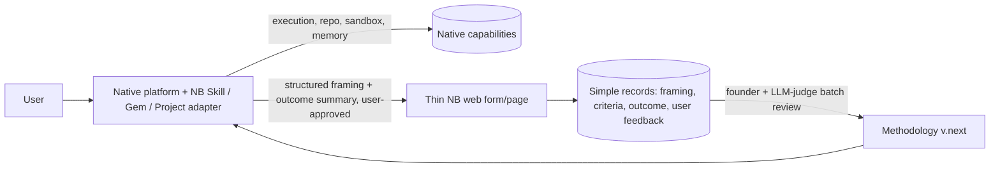

# WS3: Architecture Alternatives and URL-first Feasibility for No Babysitting (as of 17 Nov 2026)

Scope note: all repo and web content was treated as data. No downloaded code was run. The `no-babysitting` repo and site were not used. Tags: [Fact] means the source documents it; [Finding] means I observed it in a source or repo; [Inference] means my own reasoning from cited facts; [Hypothesis] means a claim still to be tested; [Recommendation] means a proposed action. Repos were cloned shallowly into the scratchpad on 2026-11-17: repomix @813a886 (commit 2026-11-15), gitingest @4e259a0 (2025-08-16), aider @5dc9490 (2026-05-22).

---

## Q1. What happens when a user pastes a public GitHub repo URL into each platform? Can the platform understand structure and dependencies?

### Takeaway
On every major platform, a pasted URL by itself does not reliably give the model the repo. In the chat apps (Claude.ai, ChatGPT, Gemini), the model gets repo content only through an explicit attach or import step or a connector. Gemini's docs say outright that it cannot read a repo from a URL typed into a prompt. Only the agentic coding surfaces (Claude Code local or cloud, Codex cloud or CLI, Jules) actually clone the repo, and only those can examine structure and dependencies at full fidelity. So "paste a URL, no setup" is true only on coding agents, which mostly serve S1 developers. For S2/S3 in chat apps there is always at least one attach, connect or import step.

### Cited Findings
**Claude.ai (chat and Projects)**
- [Fact] The GitHub integration adds a repo to a conversation, or selected files and folders to a project. It is "available on every plan, including Free" and works with public repos and with private repos you grant access to. — [Claude docs: GitHub integration](https://claude.com/docs/connectors/github)
- [Fact] "Claude reads file names and contents only: it doesn't see commit history, pull requests, or issues". Repository metadata is not retrieved either. — [Claude docs: GitHub integration](https://claude.com/docs/connectors/github)
- [Fact] In a chat, "Add from GitHub" appears only after the user connects GitHub (Customize > Connectors > GitHub Integration > Connect). The user can then "Search the repositories you have access to, or paste a repository URL". — [Claude docs: GitHub integration](https://claude.com/docs/connectors/github)
- [Fact] In a project, the user picks files and folders in a file browser. Several repos can be added "as long as the selected content fits within Claude's context window". Sync is manual ("Sync now"). GitHub content can be added only to private (unshared) projects. — [Claude docs: GitHub integration](https://claude.com/docs/connectors/github)
- [Finding] User-filed bug reports describe a connector that shows "Connected" while the file browser stays empty, private repos failing with "Claude cannot access that resource", and project sync failing. — [claudeissues #92585](https://claudeissues.com/issue/92585-github-connector-shows-connected-but-file-browser-stays-empty-add-repository-ins); [claudeissues #10647](https://claudeissues.com/issue/10647-bug-github-repository-sync-broken-in-claude-projects-files-not-accessible-despit) (community reports, current status unverified)
- [Fact] The Claude API's web fetch tool fetches only URLs already present in the conversation and does not support JavaScript-rendered sites. — [Claude web fetch tool docs](https://docs.claude.com/en/docs/agents-and-tools/tool-use/web-fetch-tool)

**ChatGPT**
- [Fact] The GitHub connector launched in May 2025 as the first deep research connector (beta, for Plus/Pro/Team). It reads code, READMEs and docs from repos the user authorized. — [TechCrunch, 2025-05-08](https://techcrunch.com/2025/05/08/chatgpts-deep-research-tool-gets-a-github-connector-to-answer-questions-about-code)
- [Fact] Per current help-center text as returned in search snippets: the GitHub app in ChatGPT is read-only ("only lets you read from your repositories to analyze and search your code. To generate, edit, and push code directly to GitHub, use Codex"). It turns prompts into GitHub search queries. Newer or private repos can take about 5 minutes to appear, and org admins may need to approve the app. Availability varies by plan and surface: Plus users may not see the app in standard chat even when Deep Research or Agent mode has it. — [OpenAI Help: Connecting GitHub to ChatGPT](https://help.openai.com/en/articles/11145903-connecting-github-to-chatgpt) (direct fetch returned HTTP 403. Content comes from search-result extracts, and versions of the article disagree on whether a synced index exists.)
- [Finding] Community threads report that ChatGPT refuses to read or list GitHub URLs, that public repos don't show up in Deep Research, and that it can hallucinate a repo's contents. — [OpenAI community: public repos not showing up](https://community.openai.com/t/public-repos-not-showing-up-in-deep-research/1257642); [OpenAI community: refuses to access GitHub](https://community.openai.com/t/chatgpt-refuses-to-access-github-or-to-list-the-files-in-a-folder/636506)
- [Fact] As of Jan 2026, ChatGPT's code container blocks general outbound internet from user code. pip and npm work through curated internal proxies, and a privileged `container.download` fetches "select public URLs". — [Simon Willison, 2026-01-26](https://simonwillison.net/2026/Jan/26/chatgpt-container-environment/)

**Gemini app**
- [Fact] The flow is Add file > More uploads > Import code, then paste a repo or branch URL. Limits are "one repository, with up to 5,000 files and a maximum size of 100 MB" per chat. The import is not synced to later repo changes. It is desktop web only (no mobile), requires the user to be 18+ with Keep Activity on, and on Workspace accounts needs admin enablement. — [Google Gemini Help 16176929](https://support.google.com/gemini/answer/16176929?hl=en)
- [Fact] Gemini "can't retrieve commit history, pull requests, or other metadata", "can't read a repo from a GitHub URL typed into a prompt", and cannot write to repositories. — [Google Gemini Help 16176929](https://support.google.com/gemini/answer/16176929?hl=en)
- [Fact] Code folder upload and GitHub import were announced on 2025-06-04. — [Google Workspace Updates](https://workspaceupdates.googleblog.com/2025/06/upload-code-folders-and-github-repositories-to-gemini.html)

**Claude Code (cloud and local)**
- [Fact] Through the GitHub App, cloud sessions can reach "any public repository, and private repositories that the Claude GitHub App is installed on". Through `/web-setup`, they can reach any repo the user's `gh` token can access. Cloud sessions are on Pro, Max, Ultra and Team, and on Enterprise premium seats. They draw on plan usage limits, and there is "no separate charge for the cloud VM". — [Claude Code docs: cloud sessions](https://code.claude.com/docs/en/claude-code-on-the-web)
- [Fact] The cloud VM clones the repo. Local repos without GitHub are uploaded as a bundle, which must be under 100 MB (it falls back to the current branch, then to a squashed snapshot). — [Claude Code docs: cloud sessions](https://code.claude.com/docs/en/claude-code-on-the-web)
- [Fact] For GitHub URLs, Claude Code's WebFetch guidance prefers `gh` CLI or `git` over fetching pages. — [Claude web fetch tool docs](https://docs.claude.com/en/docs/agents-and-tools/tool-use/web-fetch-tool) (stated in search summary of the Claude Code tool docs; treat as indicative)

**Codex cloud and Jules**
- [Fact] Codex cloud environments run a setup script with internet access and then an agent phase in which internet is off by default. All traffic goes through an HTTP/HTTPS proxy. — [OpenAI Codex docs: cloud environments](https://developers.openai.com/codex/cloud/environments); [Codex internet access](https://learn.chatgpt.com/docs/cloud/internet-access)
- [Fact] Jules clones the selected GitHub repo and branch into a Google-hosted VM, plans, tests, and returns a PR. The free tier is 15 tasks per rolling 24 h with 3 concurrent. Pro is 100/day. — [Gigazine, 2025-08-07](https://gigazine.net/gsc_news/en/20250807-ai-coding-agent-jules-public); [Activepieces pricing summary 2026](https://www.activepieces.com/blog/google-jules-pricing-free-pro-and-ultra-plans-2026) (secondary sources. The Ultra price conflicts across sources: $99.99, $124.99 and $249.99.)

### Inferences
- [Inference] The pasted URL behaves differently on each platform. In chat apps it is at best a pointer that triggers a web fetch of the rendered GitHub page (README and file list), or it is ignored or refused. Full content needs an attach or import step (Claude, Gemini) or a connector search (ChatGPT). On coding agents it leads to a real `git clone`.
- [Inference] Because of that split, NB cannot promise the same "paste a URL" behavior everywhere. What NB can promise across platforms is to produce the right next instruction for each platform, e.g. "On Gemini, use Import code. On Claude, attach via GitHub. On Claude Code, just give the URL."
- [Inference] Understanding dependencies works well only where the model can read manifests such as `package.json` or `pyproject.toml` plus the import graph. Chat attach can do this if the manifests and the relevant folders are selected. Coding agents do it natively by reading files and running tools.

### Gaps
- No official OpenAI page I could fetch (403) confirms whether a public repo the user doesn't own can be searched through the ChatGPT GitHub app, or whether it only covers authorized repos. Community reports suggest friction.
- I found no official doc on what Claude.ai chat does with a bare pasted GitHub URL when the GitHub integration is not connected (web fetch of the HTML page vs. nothing). This needs a 10-minute hands-on test per platform.
- I could not verify from primary docs whether ChatGPT Agent mode's virtual computer can `git clone` arbitrary public repos.

---

## Q2. Large repos: how are files selected, what are the context limits, and how do history and component relationships work?

### Takeaway
Selecting files in large repos is a solved problem with commoditized open-source tooling: Aider's tree-sitter repo map with graph ranking, Repomix's `--remote` with tree-sitter `--compress`, and gitingest's URL-swap digest. Native chat surfaces push the job onto the user ("select files thoughtfully") or impose hard caps (Gemini: 5,000 files / 100 MB). History and issues are absent from every chat-app import, so those need a coding agent with git, or a packer that adds git logs. NB should not build a repo-understanding engine. At most it should tell the user which tool and settings to use.

### Cited Findings
- [Fact] Aider's repo map lists the files and their key symbols with the critical definition lines. For large repos it sends "just the most relevant portions" by "a graph ranking algorithm, computed on a graph where each source file is a node and edges connect files which have dependencies". The default `--map-tokens` budget is 1k and grows dynamically. — [aider docs/repomap.md](https://raw.githubusercontent.com/Aider-AI/aider/main/aider/website/docs/repomap.md) (local clone @5dc9490, 2026-05-22)
- [Fact] Repomix packs a remote repo with `--remote <url>` (branch, tag or commit). `--compress` uses Tree-sitter to keep signatures, cutting tokens by about 70%. It provides per-file and total token counts, `--token-budget` (non-zero exit on overflow), Secretlint-based secret exclusion, `--include-logs` (git history, default 50 commits) and `--include-diffs`, an MCP server mode (`--mcp`, with `--sandbox`), and `--skill-generate` (outputs the Claude Agent Skills format). Remote repo config files are not trusted by default (`--remote-trust-config`). — [repomix README](https://raw.githubusercontent.com/yamadashy/repomix/main/README.md) (local clone @813a886, 2026-11-15, actively maintained)
- [Fact] Gitingest turns any GitHub URL into an LLM text digest when you replace "hub" with "ingest". It reports size and token count and accepts a PAT for private repos. There is also a browser extension. — [gitingest README](https://raw.githubusercontent.com/coderamp-labs/gitingest/main/README.md) (local clone @4e259a0, last commit 2025-08-16, so maintenance may be slowing)
- [Fact] The Gemini app import caps at 5,000 files / 100 MB per chat and includes no history or PRs. — [Google Gemini Help](https://support.google.com/gemini/answer/16176929?hl=en)
- [Fact] Claude.ai GitHub content must fit the context window, and the docs advise users to "Start small" and "Select files thoughtfully". — [Claude docs: GitHub integration](https://claude.com/docs/connectors/github)
- [Fact] Current Claude models (Opus 5.5, Sonnet 5.5) have 1M-token context at standard per-token pricing. — [Anthropic pricing](https://platform.claude.com/docs/en/about-claude/pricing)
- [Fact] Claude Code cloud sessions auto-compact long contexts and support subagents that use separate context windows. — [Claude Code docs: cloud sessions](https://code.claude.com/docs/en/claude-code-on-the-web)

### Inferences
- [Inference] History and relationships by platform:
  - Chat-app imports (Claude.ai, Gemini) give no history, PRs or issues.
  - The ChatGPT connector gives code and docs search only.
  - Coding agents with a git clone get full history (shallow clones may truncate it; Claude Code cloud defaults to recent history) plus the ability to grep across components.
  - Packers can inline git logs (Repomix `--include-logs`).
- [Inference] With 1M-token windows, many small and medium repos (after Repomix `--compress`) fit whole. So for S2 "understand this repo" tasks, a pack-then-upload workaround works on any chat platform, at the cost of an extra step and a local CLI or website the user must trust.
- [Recommendation] NB should treat file selection as a coaching concern, not an engineering one. It should help the user state which question the repo must answer, then recommend the platform-native path (coding agent if available; otherwise attach or import with a targeted folder selection; otherwise a Repomix or gitingest pack). It should not build a custom repo map, embeddings or a code graph.

### Gaps
- I found no published benchmark comparing answer quality across chat-app attach, packer upload, and agent clone for the same repo questions. NB could run this cheaply as part of validation.

---

## Q3. Can tests be run or results verified, and in which sandbox with what limits?

### Takeaway
Real verification (running tests) happens only in coding-agent sandboxes or dev environments: Claude Code (local, or cloud VMs at no extra charge on paid plans), Codex cloud (agent internet off by default), Jules (15 tasks/day free), and GitHub Codespaces (120 core-hours/month free). The ChatGPT and Claude chat code tools can run code on uploaded files but cannot clone, so they don't fit "verify this repo". This makes evaluation of the task outcome for S1 far stronger than for S2/S3, where verification is mostly human review against acceptance criteria.

### Cited Findings
- [Fact] Each Claude Code cloud session runs in an isolated Anthropic-managed VM with a cloud environment covering network access (Limited by default), environment variables and setup scripts. Setup scripts are cached only if they finish in about 5 minutes. Usage counts against plan limits with no separate VM charge. — [Claude Code docs: cloud sessions](https://code.claude.com/docs/en/claude-code-on-the-web)
- [Fact] Third-party mirrors of the cloud environment docs list the default "Limited" allowlist as including github.com, api.github.com and raw.githubusercontent.com. User bug reports say some toolchains (Gradle, .NET) fail behind the proxy. — [claudeissues #16222](https://claudeissues.com/issue/16222-bug-claude-code-on-the-web-gradle-wrapper-fails-to-download-distribution-java-do); [claudeissues #11897](https://claudeissues.com/issue/11897-bug-claude-code-on-the-web-net-sdk-binary-downloads-blocked-by-proxy-even-with-a) (secondary; check against the official cloud-environments page)
- [Fact] Codex cloud runs setup with internet. The agent phase blocks internet by default and can be set to an allowlist ("Common dependencies" preset) or to All. The docs recommend limiting HTTP methods to GET/HEAD/OPTIONS. — [Codex internet access](https://learn.chatgpt.com/docs/cloud/internet-access)
- [Fact] Jules free tier allows 15 tasks per rolling 24 h (3 concurrent), Pro 100 (15 concurrent), and Ultra 300 (60 concurrent). — [Activepieces 2026](https://www.activepieces.com/blog/google-jules-pricing-free-pro-and-ultra-plans-2026) (secondary)
- [Fact] GitHub Free personal accounts get 120 core-hours and 15 GB-months of Codespaces per month (Pro: 180 and 20). Organization plans include no free Codespaces. — [GitHub docs: Codespaces billing](https://docs.github.com/en/billing/concepts/product-billing/github-codespaces)
- [Fact] ChatGPT's container blocks general outbound network from user code (Jan 2026). — [Simon Willison, 2026-01-26](https://simonwillison.net/2026/Jan/26/chatgpt-container-environment/)
- [Fact] The ChatGPT desktop app has an integrated terminal scoped to a chat's project or worktree, e.g. for running `npm test`, and ChatGPT can read its output. — [OpenAI docs: integrated terminal](https://learn.chatgpt.com/docs/integrated-terminal)
- [Fact] Claude Code cloud can auto-fix PRs by reacting to CI failures and review comments. — [Claude Code docs: cloud sessions](https://code.claude.com/docs/en/claude-code-on-the-web)

### Inferences
- [Inference] The 4-dimension evaluation (B4) can rely on objective task-outcome evidence such as tests passing, CI or a diff only for S1 coding work done inside these sandboxes. For S2/S3, task-outcome evidence must come from user-defined acceptance criteria and human judgment. That argues for NB's evaluation leaning on acceptance-criteria quality (framing) rather than automated scoring.
- [Recommendation] NB should never run user code itself. Verification should be delegated by telling the user, and the platform's agent, what to run and what "done" means. For example, a kickoff prompt that includes "run the test suite and report pass/fail with output" for Claude Code, Codex or Jules.

### Gaps
- I did not verify current ChatGPT Agent mode sandbox networking from primary docs.
- I found no data on how reliably non-developers (S2) can start a Claude Code or Codex cloud session from a URL without help. That is a UX test to run.

---

## Q4. What are the security risks of untrusted content (prompt injection via README, issues or docs; malicious code; exfiltration), and what are the documented incidents and mitigations?

### Takeaway
URL-first means ingesting untrusted content by design. The documented record from 2025 to 2026 shows that README, issue, PR-title and repo-structure injections lead to secret and data exfiltration and RCE in agents. The authoritative design rule is Simon Willison's "lethal trifecta": never combine private data, untrusted content and an external communication channel. NB's own component should stay out of that combination: no tools, no user secrets, no outbound actions. Execution risk should stay inside vendor sandboxes, and NB should surface their permission settings rather than hide them.

### Cited Findings
- [Fact] Lethal trifecta (2025-06-16): "Access to your private data", "Exposure to untrusted content", and "The ability to externally communicate". "The only way to stay safe there is to avoid that lethal trifecta combination entirely." A 95% guardrail detection rate is "very much a failing grade". MCP "encourages users to mix and match tools from different sources." — [Simon Willison](https://simonwillison.net/2025/Jun/16/the-lethal-trifecta/)
- [Fact] Invariant Labs (May 2025): a malicious public GitHub issue coerced an agent using the official GitHub MCP server into pulling private-repo data into context and leaking it via a PR in the public repo (a "toxic agent flow"). Invariant described it as "a fundamental architectural issue" at the agent-system level. — [Invariant Labs blog](https://invariantlabs.ai/blog/mcp-github-vulnerability); [DevClass, 2025-05-27](https://www.devclass.com/ai-ml/2025/05/27/researchers-warn-of-prompt-injection-vulnerability-in-github-mcp-with-no-obvious-fix/1623458)
- [Fact] OpenAI's Codex docs list these risks of agent internet access: prompt injection from untrusted web content, code or secret exfiltration, malware or vulnerable dependencies, and license-restricted content. The docs' own example is a GitHub issue with hidden instructions that makes the agent send the last commit message to an attacker server. — [Codex internet access](https://learn.chatgpt.com/docs/cloud/internet-access)
- [Fact] "Comment and Control" (about April 2026; Guan, Liu, Zhong) affected Claude Code, Gemini CLI and Copilot running in GitHub Actions on `pull_request_target`. Prompts in PR titles or bodies exfiltrated `ANTHROPIC_API_KEY`, `GEMINI_API_KEY` and `GITHUB_TOKEN`. It was reportedly rated CVSS 9.4 by Anthropic, and the vendors mitigated by sanitizing PR metadata. — [Daniel Vaughan summary, 2026-05-02](https://codex.danielvaughan.com/2026/05/02/spring-2026-ai-coding-agent-vulnerabilities-cursor-rce-comment-control-codex-cli-defence/) (secondary, citing the paper and vendor bounties)
- [Fact] CVE-2026-26268 (Cursor < 2.5, CVSS 9.9, 2026-04-28): a bare git repo embedded in a subdirectory carries a `pre-commit` hook that fires when Cursor's agent runs git. Opening the project is enough. — [NVD CVE-2026-26268](https://nvd.nist.gov/vuln/detail/CVE-2026-26268); [Novee write-up](https://www.novee.io/cve-2026-26268-cursor-ide-rce-via-embedded-bare-git-repos)
- [Fact] "IDEsaster" (Dec 2025) found more than 30 flaws across AI IDEs, 24 with CVEs, including Cursor (CVE-2025-54130, CVE-2025-54135 "CurXecute" MCP config rewrite) and Copilot (CVE-2025-53773, CVE-2025-64660). Claude Code reportedly addressed its case with a security warning. — [The Hacker News, Dec 2025](https://thehackernews.com/2025/12/researchers-uncover-30-flaws-in-ai.html); [The Hacker News, Aug 2025 (Cursor)](https://thehackernews.com/2025/08/cursor-ai-code-editor-fixed-flaw.html); [arXiv 2509.22040](https://arxiv.org/html/2509.22040v1)
- [Fact] Claude Code cloud mitigations: isolated VMs; limited network by default; git credentials and network secrets "stay outside the sandbox" and are attached by a proxy. Its docs warn: "When running with network access disabled, Claude Code can still communicate with the Anthropic API, which may allow data to exit the VM". — [Claude Code docs: cloud sessions](https://code.claude.com/docs/en/claude-code-on-the-web)
- [Fact] Codex cloud mitigations: agent internet off by default, a domain allowlist, method restriction, and secrets available only during setup and removed before the agent phase. — [Codex internet access](https://learn.chatgpt.com/docs/cloud/internet-access); [Codex cloud environments](https://developers.openai.com/codex/cloud/environments)
- [Fact] Repomix does not trust config files from remote repos by default and runs Secretlint to exclude credentials. — [repomix README](https://raw.githubusercontent.com/yamadashy/repomix/main/README.md)
- [Fact] Claude Code's auto-fix docs warn that Claude's PR replies can trigger comment-driven automation (Atlantis, Terraform Cloud) and advise disabling auto-fix where a comment can deploy infrastructure. — [Claude Code docs: cloud sessions](https://code.claude.com/docs/en/claude-code-on-the-web)

### Inferences
- [Inference] Where the trifecta risk falls depends on the architecture option:
  - Option A or a copy-paste kickoff prompt: NB holds nothing, and the risk is the platform's.
  - Option C, hosted URL fetcher: NB adds untrusted content. If it also stores user memory or project data (private data) and can call out (tools, webhooks, email), it creates a new trifecta that NB must own.
  - Option D, MCP: NB's tools are mixed by users with GitHub, Drive or email MCPs, which is exactly the pattern Willison warns about. NB's tool outputs that echo repo text become an injection carrier into sessions that hold other private tools.
- [Recommendation] Security guardrails for any NB component:
  - (1) NB's own LLM calls get no tools and no outbound actions, and they process untrusted content only as quoted data.
  - (2) Store no user credentials or tokens. Private repos go through platform-native connectors only.
  - (3) Never auto-run code. Delegate execution to vendor sandboxes and recommend restrictive defaults (Codex internet Off; Claude Code Limited network; GET-only allowlists).
  - (4) Make the "what can this agent touch" checklist part of the coached workflow. That is a natural, defensible coaching artifact.
- [Inference] Security research shows this is an area where users actually need guidance and vendors document it unevenly. "Safe delegation setup" is a plausible NB coaching module for S1/S2.

### Gaps
- I did not independently verify the CVSS 9.4 / bounty figures for Comment and Control (secondary source). The arXiv ID given in that summary (2504.00323) was not checked.
- I found no public incident specific to chat-app GitHub attach (read-only) leading to exfiltration. The risk there seems lower, since there are no outbound tools in that context, but this is unverified.

---

## Q5. What changes for private repos (auth, permissions)? Can the UX stay simple without hiding permission and execution constraints?

### Takeaway
Every platform handles private repos through its own OAuth or GitHub App, with org-admin approval paths. NB cannot and should not sit in that path. The UX can stay simple if NB's job is to state the constraint and the exact next click per platform ("you will be asked to install the Claude GitHub App; choose only this repo"), not to abstract it away.

### Cited Findings
- [Fact] Claude.ai: for a private repo without access it shows "Claude cannot access that resource…", with a link to install the Claude GitHub App on all or selected repos, or to request access from org admins (who get an email). Losing access removes the repo's content from projects. On Team/Enterprise, GitHub must be enabled in Organization settings > Connectors. — [Claude docs: GitHub integration](https://claude.com/docs/connectors/github)
- [Fact] Claude Code cloud offers two methods: the GitHub App (public repos plus repos where it is installed) or `/web-setup` (sends the local `gh` token). Credentials stay encrypted server-side and never enter the VM. ZDR, HIPAA and CMEK organizations can't use cloud sessions. Shared sessions "may contain code and credentials from private GitHub repositories", and repo-access verification is off by default on Pro/Max. — [Claude Code docs: cloud sessions](https://code.claude.com/docs/en/claude-code-on-the-web)
- [Fact] Gemini: for private repos the user's GitHub must be linked to their Google Account. Unlinking removes private access, and public imports still work. — [Google Gemini Help](https://support.google.com/gemini/answer/16176929?hl=en)
- [Fact] ChatGPT: the user authorizes the ChatGPT GitHub app and selects repos. GitHub orgs may require admin approval. Business/Enterprise data is not used for training by default. — [OpenAI Help 11145903](https://help.openai.com/en/articles/11145903-connecting-github-to-chatgpt) (via search extract; direct fetch 403)
- [Fact] Gitingest's private-repo path is a user-supplied GitHub PAT with `repo` scope. — [gitingest README](https://raw.githubusercontent.com/coderamp-labs/gitingest/main/README.md)

### Inferences
- [Inference] A hosted NB that fetches private repos would have to ask for PATs or its own GitHub App with `contents:read`. That adds credential custody, a trifecta leg, and trust friction for an unknown vendor, all before NB has proven value. This is a strong argument against Option C for private content.
- [Recommendation] UX principle: "simple steps, visible constraints". Each NB workflow step that crosses a permission boundary should name four things: (a) where the work runs (chat, cloud VM, local machine), (b) what the platform can read and write, (c) network setting, and (d) what the user must approve. This is a one-line, plain-language "permission card" in the workflow, not a settings UI.

### Gaps
- There is no consolidated, dated cross-vendor table of minimum plan tiers for GitHub access. Claude's chat integration is on every plan, but ChatGPT availability varies by plan and surface, and the exact current tiers could not be fetched (403).

---

## Q6. Non-repo resources (docs sites, PDFs, specs, Google Docs): what works natively, and what belongs in the MVP for S2/S3?

### Takeaway
For S2/S3, the natural "resource" is a document: PDF, spec, Google Doc, or web page. All three chat platforms handle uploads, connectors and web fetch natively, so NB needs to build nothing to ingest them. The MVP for S2/S3 should be "bring your problem plus attach your doc on your platform", with NB coaching the framing. Repo URLs should be a secondary path for S2 tech leads and PMs.

### Cited Findings
- [Fact] The Claude API web fetch works only on URLs already in the conversation and does not render JavaScript sites. — [Claude web fetch tool docs](https://docs.claude.com/en/docs/agents-and-tools/tool-use/web-fetch-tool)
- [Finding] The Claude API takes PDFs up to 32 MB / 600 pages per request (100 pages for 200k-context models). Source: Anthropic's bundled Claude API developer reference (cache dated 2026-11-03), not checked against the live page. Consumer Claude.ai upload limits may differ. — [Claude PDF support docs](https://platform.claude.com/docs/en/build-with-claude/pdf-support) (URL not fetched in this pass)
- [Fact] Gemini Gems can be shared like Drive files (Sept 2025), but recipients may need access to the files the Gem references. — [TechRadar](https://www.techradar.com/ai-platforms-assistants/gemini/how-to-share-your-gemini-gems-custom-ai-experts-with-all-your-friends); [Android Authority](https://www.androidauthority.com/google-gemini-share-gems-3599376)
- [Fact] Claude Skills: custom skills are uploaded as a ZIP under Customize > Skills, are private by default, and can be shared with an org only after an owner enables sharing. Owners can also provision skills org-wide. — [Claude Help 12512180](https://support.claude.com/en/articles/12512180-how-to-create-custom-skills)
- [Finding] Claude Project sharing appears limited to Team/Enterprise. Artifacts can be link-shared on any plan. — [Lumichats comparison 2026](https://lumichats.com/blog/claude-projects-vs-chatgpt-projects-vs-gemini-gems-2026) (secondary, unverified against official docs)
- [Finding] One source claims that since 2026-08-16, personal ChatGPT plans (Free, Go, Plus, Pro) cannot create or publish new Custom GPTs. — [tech-insider 2026](https://tech-insider.org/gpt-store-vs-claude-skills-vs-gemini-gems-2026/) (single secondary source, **unverified**. If true, it removes Custom GPTs as a K1 distribution channel for consumers.)

### Inferences
- [Inference] Resources that belong in the MVP:
  - S2/S3 MVP: user-uploaded docs, PDFs and specs, plus pasted text and public web pages, handled natively. Optionally Google Docs via Gemini or Claude Drive connectors, if the user already has them.
  - Defer: crawling whole docs sites, multi-source syncing, Notion/Confluence integrations, and any NB-side document store.
- [Inference] For S3 the entry point should be "describe your problem" plus an optional attachment, never a URL. That resolves tension T1: entry point and segment are chosen together.

### Gaps
- I did not fetch current official ChatGPT or Gemini file-upload limits in this pass (WS2 should have them).
- The Custom GPT creation restriction needs confirmation on OpenAI's help center.

---

## Q7. How do the architecture options compare (A to E, plus copy-paste kickoff, templates, extension, ChatGPT app)?

### Takeaway
The options that prove the thesis (better framing, coaching and evaluation improve outcomes) at the lowest cost and risk are a copy-paste kickoff prompt and a portable Skill/instructions pack, possibly with thin per-platform templates (A/B). A hosted URL-first service (C) mostly rebuilds what platforms already do (repo ingestion) and imports security and credential liabilities. MCP or a ChatGPT/Claude app (D) is the right later distribution channel once value is proven, because the MCP Apps standard now spans Claude and ChatGPT, but it adds review, hosting and trifecta exposure. A hybrid (E) is justified only in K2, and only for the evaluation and learning loop.

### Cited Findings
- [Fact] The MCP spec 2025-11-25 is the latest released revision, with server primitives Prompts, Resources and Tools. It added icons, experimental tasks and URL-mode elicitation. — [MCP spec 2025-11-25](https://modelcontextprotocol.io/specification/2025-11-25); [MCP changelog](https://modelcontextprotocol.io/specification/latest/changelog)
- [Fact] The MCP Apps extension (interactive UIs, stable spec 2026-01-26) was co-developed by Anthropic and OpenAI. Claude announced support on 2026-01-26. OpenAI's changelog says ChatGPT has been "fully compatible" since 2026-02-22 (another source says Feb 4). The OpenAI Apps SDK is a superset (`window.openai`), and OpenAI advises building on MCP Apps first for portability. — [WorkOS, 2026-01-27](https://workos.com/blog/2026-01-27-mcp-apps); [mcp.directory comparison](https://mcp.directory/blog/mcp-apps-standard-vs-openai-apps-sdk-2026); [OpenAI Apps SDK changelog](https://developers.openai.com/apps-sdk/changelog) (dates conflict across secondary sources)
- [Fact] OpenAI opened ChatGPT app submissions on 2025-12-17. Apps are listed in an in-chat directory and must pass submission guidelines. — [OpenAI: developers can now submit apps](https://openai.com/index/developers-can-now-submit-apps-to-chatgpt/); [Apps SDK submission guidelines](https://developers.openai.com/apps-sdk/app-submission-guidelines)
- [Fact] Claude Skills install by ZIP upload and are private by default. Org sharing needs an owner toggle. — [Claude Help 12512180](https://support.claude.com/en/articles/12512180-how-to-create-custom-skills)
- [Fact] Repomix already ships `--skill-generate` (Claude Skills output) and an MCP server mode. Repo-to-AI-context is commoditized open source. — [repomix README](https://raw.githubusercontent.com/yamadashy/repomix/main/README.md)
- [Fact] Claude API pricing (2026-11): Opus 5.5 at $4 in / $20 out per MTok, cache hits $0.20. Sonnet 5.5 at $2 / $10, cache hits $0.10, 5-min cache write $2.50. Haiku 5.5 at $0.10 / $0.50 (prompts ≤100k tokens). Batch is 50% off. 1M context costs standard rates. — [Anthropic pricing](https://platform.claude.com/docs/en/about-claude/pricing)
- [Fact] Claude Code cloud VMs carry no separate charge, so execution cost lands on the user's subscription. — [Claude Code docs: cloud sessions](https://code.claude.com/docs/en/claude-code-on-the-web)

### Inferences
**Comparison matrix**

Scale: ++ very good, + good, 0 neutral, – weak, –– poor. Where the cell is text, it gives the value or reason directly.

| Criterion | 0. Copy-paste kickoff prompt / methodology doc | A. Portable instructions / Skill | B. Methodology + Skills + thin adapters (Claude Skill, Custom GPT/Project instructions, Gem) | C. URL-first hosted service | D. MCP server / ChatGPT and Claude app (MCP Apps) | E. Hybrid (thin web service for framing/eval records + native execution) | Browser extension |
|---|---|---|---|---|---|---|---|
| User friction | ++ paste and go | + one ZIP install (Claude); none for pasted instructions | + per-platform install or link | ++ for paste; –– for auth on private repos | 0 add connector or app; auth | + web page plus copy to platform | – install; store review |
| Time-to-MVP, K1 (1 person, ≤4 weeks) | ++ days | ++ about 1 week | + 2–3 weeks | – 3–4+ weeks for a credible version | – 3–4 weeks plus app review | 0 tight | – |
| Time-to-MVP, K2 | ++ | ++ | ++ | 0 | + | + | 0 |
| Dev complexity | trivial | low | low–med (N variants) | high (fetch, pack, LLM, auth, UI) | med–high (hosting, spec, review) | med | med |
| NB inference cost | $0, user's plan pays | $0 | $0 | NB pays every session (see estimate below) | some (tool calls are cheap; LLM runs on the user's side) | low (eval/summarize only) | $0–low |
| Portability | ++ any LLM | + (Agent Skills format; plain-text fallback) | + | ++ platform-independent but forces a separate UI | + MCP Apps on Claude and ChatGPT; Gemini unclear | + | 0 (Chrome-only) |
| Security / privacy | ++ NB holds nothing | ++ | ++ | –– trifecta risk, credential custody, data retention | – NB's tools mixed with other private tools; injection carrier | + if it stores only user-entered summaries | –– page-access permissions |
| Repo/doc access | native (user follows platform steps) | native | native | custom; duplicates platform | could expose Repomix-like tools; duplicates | native | can read rendered pages only |
| Context | native | native plus progressive disclosure | native | custom (must manage limits) | tool results into native context | native | – |
| Memory | native or none | native or none | native project instructions | custom (must build) | native plus optional server state | light, explicit (user-visible log) | – |
| Evaluation | self-review rubric in prompt; manual | rubric in Skill | rubric per platform | can run LLM-judge centrally | can log tool calls | central eval records, comparable across sessions | – |
| Adaptability | manual (user edits) | Skill versioning | per-platform drift | ++ central iteration | ++ central server updates | ++ | 0 |
| Maintenance | ++ | + | – (N platforms change monthly) | – | – (spec churn, directory policy) | 0 | – |
| Scalability | ++ | ++ | ++ | 0 (LLM cost scales with users) | + | + | + |
| Defensibility | –– easy to copy | – | – | 0 (data moat possible later) | 0 (directory presence) | + (outcome/eval data over time) | – |
| Fit S1 | + (Claude Code, Codex users paste anyway) | ++ (Skills native in Claude Code) | ++ | 0 (S1 already has agents that clone) | + | + | – |
| Fit S2 | ++ | + | ++ | + (URL entry fits PM/BA if no auth) | 0 | ++ | 0 |
| Fit S3 | + (needs a plain-language guide) | – (install concept) | + (Gem/GPT link-share is easiest) | – (URL entry means little) | – | + | – |

**Rough inference cost for Option C if NB hosts the LLM (Sonnet 5.5, Nov 2026 list prices)** [Inference, my arithmetic from [Anthropic pricing](https://platform.claude.com/docs/en/about-claude/pricing)]

| Scenario | Assumptions | Cost per session |
|---|---|---|
| Framing/coaching, no repo | about 15 turns, about 15k cached prefix plus about 5k new input and about 0.8k output per turn: 75k uncached input ($0.15) + 225k cache reads ($0.02) + 12k output ($0.12) | about $0.30 |
| With a 100k-token packed repo in context | one cache write ($0.25) + 1.5M cache reads ($0.15) on top of the above | about $0.70 |
| Same, on Opus 5.5 | about 2× Sonnet | about $0.60 / $1.40 |
| One LLM-as-judge pass on a transcript | 30k in / 2k out on Sonnet | about $0.08 |
| Same judge pass on Haiku 5.5 | | under $0.01 |

These are order-of-magnitude figures. Real costs depend on turn count, retries and caching discipline.

**What these costs mean**
- [Inference] At those costs, inference is not the problem for C. The problems are build time, the security and credential burden, and the fact that the user must leave their AI platform for a separate UI. That contradicts B8 (prefer native).
- [Inference] "Other options" verdicts:
  - Copy-paste kickoff prompt: the best K1 instrument for testing the methodology itself.
  - Custom GPT / Claude Project / Gem templates: good zero-install distribution for S2/S3. Gems are link-shareable. Custom GPT creation may now be restricted on personal plans (unverified). Claude Project sharing is reportedly Team/Enterprise only.
  - Browser extension: high friction and broad page permissions. Reject for MVP.
  - ChatGPT app via Apps SDK: K2-plus distribution channel once value is proven. Build on MCP Apps for Claude portability.
- [Inference] Steelman for C, the hosted URL-first service: one consistent UX across platforms, central learning data, and possibly better onboarding for S2 who don't know about attach/import menus. The counterpoints: platforms already ingest repos (Claude: every plan; Gemini: 100 MB import; coding agents clone), and the thesis is about framing and collaboration, not ingestion. C proves "we can summarize repos", which is commoditized (gitingest, Repomix, DeepWiki-style tools), not the thesis.

### Gaps
- Gemini support for MCP Apps or third-party connectors in the consumer Gemini app was not verified in this pass.
- The OpenAI Apps directory review timelines and acceptance rates are unknown.

---

## Q8. What is the recommended architecture per scenario (K1/K2), the responsibility boundary (native vs. custom), and the "do not build" list?

### Takeaway
K1 (1 person, ≤4 weeks): Option 0+A, a versioned methodology delivered as a copy-paste kickoff prompt plus one Claude Skill and/or Gem/Project instructions. Execution, repo access, sandboxes and memory are all native. Evaluation is a structured end-of-task self-review the user pastes back, plus concierge observation. K2 (1–2 people, 1–3 months): Option B plus a minimal E. Thin per-platform adapters, plus a tiny web page or form that stores user-submitted framing and outcome records for the learning loop. Promote to MCP / ChatGPT app (D) only after reuse is demonstrated. Do not build a URL ingestion service.

### Cited Findings
- [Fact] Native platforms already provide repo ingestion (Claude GitHub integration on all plans; Gemini import; ChatGPT connector), cloning and sandboxes (Claude Code cloud, Codex cloud, Jules, Codespaces), compaction and subagents (Claude Code), and skill packaging (Claude Skills). — [Claude docs: GitHub integration](https://claude.com/docs/connectors/github); [Google Gemini Help](https://support.google.com/gemini/answer/16176929?hl=en); [Claude Code docs](https://code.claude.com/docs/en/claude-code-on-the-web); [Codex cloud environments](https://developers.openai.com/codex/cloud/environments)
- [Fact] Open-source packers already cover repo-to-context, including Skills generation and an MCP server: Repomix `--skill-generate` and `--mcp`. — [repomix README](https://raw.githubusercontent.com/yamadashy/repomix/main/README.md)
- [Fact] The security consensus is to avoid combining private data, untrusted content and external communication. — [Simon Willison](https://simonwillison.net/2025/Jun/16/the-lethal-trifecta/)

### Inferences
**Recommended logical architecture, K1** [Recommendation]
```
User problem (+ optional URL / doc)
        |
        v
[NB Kickoff Prompt / Skill]  <- versioned methodology text (framing questions, coaching
        |                        rules, workflow template, acceptance criteria, permission card,
        |                        end-of-task self-review rubric). NB-owned. No server.
        v
[Native platform]  Claude.ai / ChatGPT / Gemini   -> attach/import/connector for repo/doc
                   Claude Code / Codex / Jules     -> clone, run tests, PR (S1)
        |
        v
[End-of-task review block] -> user pastes into a form / shares transcript -> founder reviews (concierge)
```

**Recommended logical architecture, K2** [Recommendation]

- [Recommendation] Data reaches the K2 store only through user-initiated submission of summaries, never raw repos or credentials. LLM-judge runs in batch over submitted summaries (Haiku/Sonnet class, under $0.10 per review) and its results are reviewed by a human.

**Responsibility boundary** [Recommendation]

| Layer | Owner | Notes |
|---|---|---|
| Repo/doc ingestion, file selection, cloning | Native (plus Repomix/gitingest as a documented fallback) | NB only tells the user which path to take and why |
| Code execution, tests, sandboxes, network policy | Native | NB names the recommended restrictive settings |
| Auth / OAuth / private repos | Native | NB never holds tokens |
| Conversation memory, project context | Native (Projects, memory, CLAUDE.md/AGENTS.md) | NB writes a portable "project brief" the user keeps |
| Problem framing, clarifying, acceptance criteria | NB (methodology) | The core of the thesis |
| Adaptive coaching (guidance intensity, challenge) | NB (in-prompt rules, user-controllable) | B5 risk tiers expressed as text rules |
| Workflow design, including a permission card per step | NB | Turns platform constraints into visible steps |
| Evaluation (4 dimensions) | NB rubric; native for task-outcome evidence (tests/CI) | Human review in K1 |
| Learning loop across users | NB (K2 only, thin records) | Only after K1 shows signal |

**Do-not-build list (MVP, K1 and K2)** [Recommendation]
1. A URL-ingestion, repo-cloning or packing service. Platforms and Repomix/gitingest already do this.
2. A custom repo map, code graph, embeddings or vector DB for code or docs.
3. A graph DB, event pipeline or streaming telemetry.
4. A custom memory engine or cross-platform memory sync. Use native memory plus a user-held project brief.
5. Multi-agent orchestration or an agent runtime. Delegate to Claude Code, Codex or Jules subagents and cloud tasks.
6. A code-execution sandbox, or any running of user or repo code on NB infrastructure.
7. Storage of OAuth tokens or PATs, or any GitHub App with repo read scope.
8. A browser extension.
9. Heavy observability or LLM tracing stacks. Use a spreadsheet or simple DB of submitted reviews.
10. An NB-side LLM with tools or outbound actions over untrusted content (trifecta).
11. N fully maintained platform adapters in K1. Pick one primary platform per segment.

**Entry points by segment (resolves T1)** [Recommendation]

| Segment | Primary entry point | URL role |
|---|---|---|
| S1 | Kickoff prompt or Skill inside Claude Code / Codex, where a public repo URL works natively (clone) | URL is primary |
| S2 | Kickoff prompt or Gem/Project template in the chat app they use, plus attach doc/spec (or the GitHub attach flow). "URL" means "the resource you're working from" | URL is secondary |
| S3 | Plain-language problem statement plus an optional document. No URL concept at all | None |

- [Inference] A URL-first prototype is worth running only as a cheap test inside K1: does a pasted URL plus the NB kickoff produce better framing than the URL alone, on Claude Code (S1) and on Claude.ai/Gemini attach (S2)? Don't build a service to find out.
- [Hypothesis] The defensible part is not ingestion or execution (commoditized and absorbed by platforms within 12 months) but (a) the methodology's framing/coaching quality and (b) accumulated outcome and evaluation evidence (K2+). This needs WS4 and WS6 validation.

### Gaps
- There is no evidence yet that users will paste a structured review block back to NB (K1 data capture). This is a UX risk to test in the first experiment.
- Maintenance burden per platform adapter (how often Claude, ChatGPT and Gemini change relevant UI or behavior) is not quantified. The help-center drift observed here (multiple versions of the OpenAI GitHub article; Claude skills menu renamed) suggests it is high.
